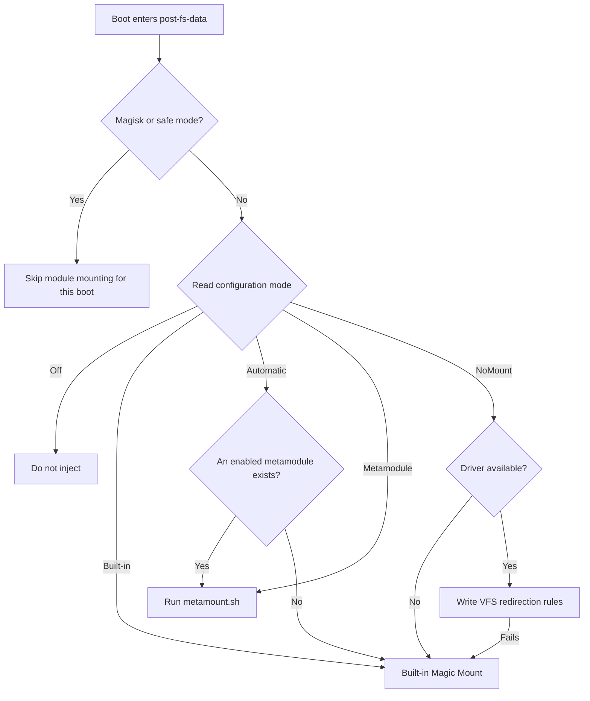

# Folk Mount

<Badge text="Module Injection" type="info" /> <Badge text="Mode Changes Apply Next Boot" type="warning" />

==Folk Mount decides who publishes module files to system paths at boot==. It can merge module directories directly through the built-in Magic Mount, or hand the mount stage to a metamodule or the NoMount VFS backend. It does not install modules; modules are still unpacked to `/data/adb/modules/` by the module manager.

::: tip One Line First

Regular users should keep **Automatic**. Only pin a provider manually when you specifically need a metamodule or NoMount.

:::

## Current Mode and This Boot

The feature page shows two values that are easy to confuse:

- **Configuration mode**: the persistent choice saved to `mount_mode`, which decides the next boot.
- **This boot**: the provider actually executed during the current boot, and how many targets it published.

Changing the mode only writes the configuration and does not re-mount immediately. Only after a reboot should the two match; if they do not match, a fallback, takeover or boot protection usually occurred.

::: table Five Modes

| Configuration Mode | Who Executes on the Next Boot | When to Use | Key Boundary |
| --- | --- | --- | --- |
| **Automatic** | Handed to an enabled metamodule if present, otherwise the built-in Magic Mount | Most users | Returns to the built-in engine when the Metamodule is missing or disabled |
| **Built-in (Magic Mount)** | Always uses the built-in merger | When you require stable use of the mount shipped with FinaSU | Does not hand the mount stage to a metamodule |
| **Metamodule** | Handed only to the currently active metamodule | When you already depend on a specific Metamodule's mount mechanism | A no-op when the script is missing, and it will not silently switch back to built-in |
| **Built-in (VFS)** | Uses NoMount path redirection | When you need to avoid traditional mount records | Falls back to the built-in engine when the driver is unavailable or injection fails |
| **Mounting Off** | Performs no module injection | To temporarily troubleshoot boot problems caused by modules | Modules stay installed, they just do not appear in this boot |

:::

::: warning Mounting Off Does Not Disable All Modules

"Mounting off" does not delete modules and does not run the modules' own uninstall logic. It only means that this boot has no provider publishing module files. To permanently remove a module, follow the module management flow.

:::

## How the Provider Is Chosen at Boot



The boot path also checks the UAPI, the run lock and whether the same boot cycle has already been executed. When Magisk or safe mode is detected, a skip state is recorded instead of continuing to stack module mounts.

::: important Why NoMount Falls Back but Metamodule Does Not

NoMount is an injection backend that FinaSU can replace. When driver preparation or rule publishing fails, it falls back to the built-in Magic Mount and records a warning, so that modules do not become entirely invisible.

Metamodule is an independent executor that may also provide its own `metainstall.sh`, `metauninstall.sh` and `metamount.sh`. Its mount script is a black box; FinaSU will not take it upon itself to run another mount logic just because the script is missing or failed.

:::

## What the Built-in Magic Mount Does

The built-in executor scans modules under `/data/adb/modules/` that can take part in mounting, and merges their `system/` trees into a single boot injection.

### Module Participation Conditions

A module enters the merge only if it meets all of the following conditions:

- It is not a symlink and is an actual directory.
- It has no `disable`, `remove` or `skip_mount` marker.
- It is not the current metamodule itself.
- It contains a `system/` directory, and that directory is not a symlink.

Module directories are sorted in a stable byte order, so files with the same name follow ==first one wins==. Do not rely on the order the filesystem returns, and do not treat several modules modifying the same path as a predictable overwrite game.

### Merging and Publishing

:::: field-group

::: field Opaque
@type `Directory semantics`
When a module directory carries `trusted.overlay.opaque`, it means replacing the existing contents of that directory with the module directory instead of continuing to merge.
:::

::: field Whiteout
@type `Deletion semantics`
A special character device entry can act as a whiteout, making the target path appear not to exist in the merge result.
:::

::: field Tmpfs
@type `Type conflict handling`
When a module node conflicts in type with a real filesystem node, or when a replacement directory must be constructed, the executor prepares a temporary filesystem and then binds/moves it to the target location.
:::

::: field Metadata
@type `Publishing details`
Publishing copies the necessary owner, permissions, timestamps and SELinux context. It is not simply copying files into `/system`.
:::

::: field Transaction
@type `Failure handling`
Newly published mounts are registered; on a mid-way failure they are rolled back in reverse order. Targets that cannot be reverted are reported as leftovers rather than pretending full success.
:::

::::

The executor uses `/data/adb/ksu/workdir/` as its working directory and switches into the mount namespace of PID 1 during boot. It also prevents repeated execution within the same boot cycle, avoiding a second stacked mount.

## Metamodule

A Metamodule is a special module carrying the `metamodule=1` marker. At most one active metamodule exists on the system.

In **Automatic** mode, an available active metamodule takes over module mounting first. A metamodule that is disabled, has the marker removed, or has no active link will not keep being selected by automatic mode.

When **Metamodule** is selected manually, the result for this boot is `noop` even without `metamount.sh`, and it will not quietly switch back to the built-in engine. This keeps users from believing the Metamodule is working when another executor actually published the files.

::: tip Metamodules Suit People Who Know Exactly What They Want

Regular module users usually do not need to install a metamodule. A Metamodule's capabilities and compatibility are up to the Metamodule itself; FinaSU can only handle invocation and state recording.

:::

## NoMount Backend

After selecting **Built-in (VFS)**, Folk Mount prepares the NoMount driver first, then lets NoMount generate path redirection rules.

The following cases make this boot switch to the built-in Magic Mount:

- The current build has no NoMount driver matching the KMI, and the kernel has no built-in support either.
- Driver loading fails, or the API still does not respond after loading.
- The previous NoMount injection stage was abnormally interrupted, so the same path is conservatively not repeated.
- Rule publishing fails.

When NoMount has already taken over injection in another module, the built-in backend stands down and will not compete with another program writing rules.

::: warning The Visibility Model Changes

The built-in Magic Mount and NoMount differ in their default logic for "which apps see module files". Before switching, read [NoMount exception apps](/en/builtin/nomount/#visibility-model), and do not treat the two as differing only in implementation.

:::

## State and Logs

::: table This Boot Result

| Result | Meaning | Next Step |
| --- | --- | --- |
| `mounting` | The provider is executing | Wait for boot to finish, do not trigger it again |
| `mounted` | At least one target has been published | Check the target modules and scope |
| `noop` | The provider finished but had no targets or scripts | Check module markers, `system/` and metamodule scripts |
| `partial` | Some targets were published, but a later step failed or rollback was incomplete | Look at errors and leftover paths first, then reboot to verify |
| `failed` | The provider failed | Check the error text and the corresponding backend state |
| `disabled` | Configured as mounting off | This is the expected state |
| `skipped` | Skipped because of Magisk, safe mode or a UAPI check | Do not disable modules to guess at the fault |

:::

The page also shows:

- **Provider for this boot**: `builtin`, `metamodule`, `nomount` or `none`.
- **Target count**: built-in and NoMount can count published targets; when a metamodule is a black box, no count is fabricated.
- **warning**: for example the built-in engine was used to complete mounting after NoMount failed.
- **error**: the reason a configuration file, module traversal or provider execution failed.

:::: collapse accordion

### `mounted` but the module has no effect

First confirm the module is not marked with `disable`, `remove` or `skip_mount`, then check whether the module really contains `system/`. Then confirm whether module files are hidden from the app by an App Profile or a NoMount exception policy. Finally check whether the path was overridden by a later-loaded module under first-wins rules.

### Why automatic mode chose the built-in engine

Automatic mode hands over to a metamodule only when an **enabled active metamodule** exists. Check whether `/data/adb/metamodule` exists, whether the target module carries `metamodule=1`, and whether the module directory has `disable` or `remove`.

### After switching to NoMount, apps see more module files

NoMount by default lets apps see injected files and only excludes explicitly selected UIDs; the built-in Magic Mount and App Profile have different default visibility. Configure the NoMount exception apps before switching, then verify after a reboot.

### Can I change the mount provider without rebooting

No. The mode is only saved for the next boot. Individual NoMount module rules can be hot-injected or withdrawn within the current boot, but that will not immediately switch Folk Mount's overall provider from Magic Mount to VFS.

::::

## Configuration and Diagnostics Locations

```file-tree title="Folk Mount locations"
/data/adb/ksu
├── mount_mode                  # persistent mode
├── mount_runtime               # provider, result and warnings for this boot
├── mount_log                   # recent mount log
└── workdir/                    # built-in executor working directory
```

The Manager is the entry point for daily operations. When you need scripted diagnostics, you can read the state read-only:

::: code-tabs

@tab Manager

```text
Settings → Features → Folk Mount
Check the configuration mode, this boot, target count and warnings
```

@tab Command Line

```sh
/data/adb/ksud mount status --json
```

:::

The Manager is the entry point for daily operations. The command line is only for collecting state; do not replace the boot flow with hand-assembled mount commands.

## Recommended Strategy

1. **Keep automatic for daily use.** Without a concrete requirement, do not pin a metamodule or NoMount manually.
2. **Change one backend at a time.** After changing the mode, reboot and verify before continuing to change app visibility or modules.
3. **Record before rolling back.** When a module misbehaves, keep the warning and the module list, then switch back to automatic or mounting off.
4. **Do not treat mounting off as uninstalling.** Turning it off only affects injection for this boot and does not change module installation state.

::: danger Do Not Stack Choices After a Boot Failure

If this boot was interrupted at some provider stage, the next boot should prefer a conservative combination and check the logs. Repeatedly switching between the metamodule, NoMount and the built-in engine makes the problem harder to locate and may prolong the faulty boot time.

:::
