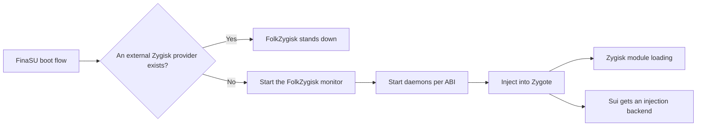

# FolkZygisk

<Badge text="Zygisk Provider" type="info" /> <Badge text="Chosen on the Next Boot" type="warning" /> <Badge text="Supports 32/64-bit" type="tip" />

==FolkZygisk is the Zygisk provider built into FinaSU==. During boot it injects the Zygisk runtime components into Zygote, so that Zygisk modules installed in the module directory can enter app processes. It is itself one of the backends Sui can use, but Sui is not its only user.

::: important The Switch Does Not Mean Currently Injected

The switch on the feature page means **whether to attempt FolkZygisk on the next boot**. Whether the current boot succeeded depends on the actual state, such as Injected, Partially Injected, Starting, Injection Failed and Unverified.

:::

## What It Is Responsible For



Zygisk modules and Zygisk providers are two different things:

- A **provider** is responsible for injecting the runtime components into Zygote, for example FolkZygisk or an external compatible implementation.
- A **module** works by using the Zygisk environment that already exists, for example a particular framework or feature module.

Whether a module needs Zygisk, which Android versions it supports, and whether it needs another reboot should follow the module's own documentation. FolkZygisk will not repair incompatible APIs or broken scripts for a module.

## Enabling and Rebooting

:::: steps

1. **Confirm the engine is available**

   Open **Settings → Features → FolkZygisk**. If it shows a missing engine or boot protection, handle the corresponding prompt first instead of toggling it repeatedly.

2. **Check for an external provider**

   If an external provider appears in the list, the external implementation will take over on the next boot. FinaSU will not modify, uninstall or rewrite that module.

3. **Turn on the switch**

   The switch only saves the choice for the next boot. A successful enable usually prompts that a reboot is needed.

4. **Reboot the device**

   Zygisk injection happens during boot and cannot be completed by reopening the Manager.

5. **Check the injection state**

   Only when the current boot shows **Injected** can you confirm that all supported ABIs passed the daemon and Zygote process checks.

::::

::: tip Note for Sui Users

A working FinaSU driver and an enabled FolkZygisk switch do not automatically equal a working Sui. Also confirm that a Zygisk provider really works in this boot, then check Sui's own service state.

:::

## External Zygisk Providers

FolkZygisk scans the module installation directory and the pending update directory at boot. When it finds an active external module recognized as a provider, ==the built-in engine actively stands down==, so that two implementations do not inject into Zygote at the same time. Only ordinary modules that use the Zygisk API will not be mistaken for a provider.

This stand-down does not modify the external module and does not consume the built-in engine's failure count. After the external provider is removed or disabled, the next boot can restore the built-in engine.

::: table Real Impact of an External Provider

| Aspect | Behavior |
| --- | --- |
| Current boot | The external provider has priority at boot; the built-in FolkZygisk does not start injection |
| Sui | An external compatible provider can serve as the Sui backend, and Sui can run |
| Injection verification | FinaSU cannot verify the external provider's full injection result |
| Module management | FolkZygisk will not update, disable or repair the external provider for you |
| Restoring the built-in engine | After the external provider is removed or disabled, the next boot chooses again |

:::

::: warning External Provider Enabled Is Not a Fault

When the page shows an external provider takeover, first confirm its working state at the external module's own management entry. Do not keep two Zygisk providers at the same time just to eliminate the prompt.

:::

## Five Current Injection States

FolkZygisk does not treat "the process exists" as successful injection. It checks whether the runtime state, the ABIs, the daemons and the corresponding Zygote processes still belong to the current boot.

:::: field-group

::: field Injected
@type `Success`
All supported ABIs in the current boot passed the injection check.
:::

::: field Partial
@type `Partial success`
At least one supported ABI is injected, but not all of them. Modules that depend on an ABI may only work in some apps.
:::

::: field Starting
@type `In progress`
A runtime record exists, but not all supported ABIs have finished injecting. It is normal to see this briefly right after boot.
:::

::: field Failed
@type `Failure`
The monitor is not ready, the tracing state is abnormal, or the daemon for a supported ABI is not running.
:::

::: field Unverified
@type `No trustworthy receipt`
There is no valid runtime record for the current boot, or the record has expired. It cannot prove that injection succeeded, and it cannot prove injection failure on its own.
:::

::::

The status line also shows:

- **Enabled / Disabled for the next boot**
- **Detected external provider**
- **Reboot required**
- **Boot protection paused**
- **Most recent failure code and details**

## Boot Protection

FolkZygisk writes a protection record for every boot attempt. After three consecutive failures, boot protection latches and later boots no longer attempt automatically, so the device does not repeatedly enter the same failing path.

::: timeline How Boot Protection Triggers

1. **The first boot failure**

   This attempt is recorded and the failure count increases by one. It can be tried again after a reboot.

2. **The second consecutive failure**

   The failure count keeps increasing. If the Manager shows a specific failure code, troubleshoot by that code first.

3. **The third consecutive failure**

   Boot protection latches. Later boots skip the built-in injection and wait for the user to handle it.

4. **Tap restore**

   The Manager keeps the protection for the current boot, installs missing engine assets if any, and prepares the next boot for another attempt.

5. **Reboot again**

   Only after a new boot completes can you confirm whether the protection is lifted and injection succeeded.

:::

::: warning Restore Is Not Immediate Re-injection

"Restore" does not bring the monitor back up during the current boot. It keeps the current boot protected and schedules an automatic attempt on the next boot.

:::

## Safe Mode and Magisk

When safe mode or Magisk is detected, the boot stage skips the built-in Zygisk injection. This avoids stacking the boot flow of another Root environment on top of FinaSU.

If Magisk and FinaSU both exist, do not treat the FolkZygisk state as the only entry point for Root or module diagnostics. Handle the coexistence of the two Root environments first.

## Modules and Compatibility

Zygisk modules still belong to the ordinary module system. Module files live in `/data/adb/modules/`, and whether a module has a Zygisk entry point is up to the module itself.

- Installing a module does not by itself repair a missing Zygisk provider.
- When an external provider has priority, the FolkZygisk injection state does not represent the state of the external implementation.
- Some modules support only a single ABI, a specific Android version or a specific Zygisk API.
- Frameworks such as LSPosed usually depend on a working Zygisk provider, but they are not the provider themselves.

## Troubleshooting Order

:::: steps

1. **Check whether "next boot" and "this boot" agree**

   A mismatch right after changing the switch is normal. Checking "Injected" without rebooting is meaningless.

2. **Check the external provider**

   With an external provider present, the built-in engine stands down by design. Move the troubleshooting to that module.

3. **Check boot protection**

   After repeated failures the page may show a pause reason and a restore entry. Record the failure code first, then restore.

4. **Check the engine files**

   A missing engine usually means an incomplete installation or manual deletion. Use the Manager to restore it or reinstall the full release package; do not assemble placeholder files.

5. **Check the ABI results**

   When injection is partial, confirm whether the target app and the module depend on the 32-bit or 64-bit ABI that was not injected.

6. **Finally, look at the kernel log and module logs**

   Keep the time points and failure details. Simply rebooting over and over overwrites more valuable context.

::::

:::: collapse accordion

### It shows "enabled" but the state is still Unverified

Common reasons are that no reboot has happened yet, the current boot has no valid runtime record, or the record belongs to the previous boot. Reboot first and wait for the system to settle, then check the state.

### It shows an external provider takeover. Can Sui still be used?

Yes, Sui can run when the external provider is compatible. However, FinaSU cannot verify the external provider's injection result, so you need to verify it in practice in Sui and in compatible apps.

### How do I try again after three failures

Use the restore action on the page. It only prepares the conditions for the next boot; it does not hot-start injection in the current boot.

### When does the built-in FolkZygisk come back after uninstalling the external provider

On the next boot. Provider selection happens during boot, and the currently running Zygote is not hot-switched.

::::

## Configuration and Diagnostics Locations

```file-tree title="FolkZygisk locations"
/data/adb/ksu
├── zygisk.json                 # next-boot switch
├── zygisk-boot.json            # boot protection, failure count and latest problem
├── .zygisk/
│   └── state.json              # monitor, ABI and injection state for this boot
└── bin/
    └── folkzygisk/             # built-in engine files
```

`state.json` is only treated as a valid runtime record when the boot ID, monitor PID and process start time all match the current system. Copying an old file will not manufacture a successful injection.

::: code-tabs

@tab Manager

```text
Settings → Features → FolkZygisk
Check the status summary, external provider, boot protection and failure details
```

@tab Command Line

```sh
/data/adb/ksud zygisk status --json
```

:::

The Manager is the main entry point for lifecycle operations. The command line suits collecting state while avoiding a mismatch with the in-app state.

## Best Practices

- Keep only one active Zygisk provider.
- Reboot fully once after changing a provider or modules.
- On repeated failures, read the failure code first instead of relying on a fourth or fifth reboot to get lucky.
- Do not treat "Sui can start" as proof that FolkZygisk injection is definitely healthy.
- The external provider's logs and compatibility are the external implementation's responsibility; FinaSU can only report the facts it detects.
