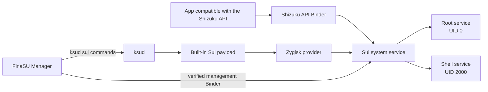

# Sui Service

<Badge text="Major Feature" type="danger" /> <Badge text="Requires Zygisk" type="warning" />

==Sui== is the Shizuku API backend built into FinaSU. It lets apps that already support the Shizuku API obtain a managed **root** or **shell** execution identity, so users no longer need to install the Shizuku manager separately.

::: tip No Need to Install Shizuku Itself

FinaSU already packages the Sui server, daemons and permission management entry into the current release flow. Compatible apps connect to Sui and do not need the official Shizuku app running at the same time.

:::

::: warning Sui Is Not Another Kind of Unconditional Root

Sui only provides an interface to apps that explicitly request Shizuku permission. An app does not automatically gain Root because FinaSU is installed on the device; every access is still constrained by the app UID, permission mode, default policy and hiding rules.

:::

## Scope

Sui targets apps that follow the Shizuku API, rather than automatically elevating any app. An app must first discover and connect to Sui's Binder service, then request permission.

::: table Sui Capability Boundaries

| Scenario | What Sui Provides | What It Does Not Include |
| --- | --- | --- |
| Apps compatible with the Shizuku API | Managed system API calls executed through Sui | Does not automatically modify app logic |
| Root mode | Runs as the root identity recognized by the kernel after the request is approved | Not the same as permanently writing the app into the Root allowlist |
| Shell mode | Runs as the Android shell identity, with lower privilege than root | Cannot access data that only root can reach |
| Permission management | Allow, deny, hide or ask per app | Cannot replace FinaSU Superuser authorization |
| Zygisk integration | Injects the Sui service through a Zygisk provider | Does not coexist with a second Sui instance |

:::

## Runtime Requirements

Sui depends on the FinaSU driver, a Zygisk provider, the built-in payload and the management channel at the same time. Missing any one of them may show only "disabled", "unavailable" or "state abnormal".

:::: field-group

::: field FinaSU Driver
@type `required`
@default `LKM or Built-In`
The device must already have a working FinaSU Root, and `ksud` must be able to run Sui lifecycle commands.
:::

::: field Zygisk
@type `required`
@default `Built-in or external provider`
Sui needs a working Zygisk backend. You can use the built-in [YukiZygisk](/en/builtin/yukizygisk/) or another compatible Zygisk provider, but only one active implementation may remain. With an external provider Sui runs normally; FinaSU simply cannot verify its injection result.
:::

::: field Architecture
@type `required`
Official releases must ship the Sui payload for the corresponding ABI inside `ksud`. The current flow does not provide a riscv64 Sui payload.
:::

::: field Manager Identity
@type `required`
@default `Automatic registration`
Only a trusted FinaSU Manager can read and modify Sui permissions. The Manager registers the package name, UID and signature information after the service starts.
:::

::: field Notification Permission
@type `optional`
Sui uses notifications to announce authorization requests while the app is in the background. Denying notification permission on Android 13 and above does not stop Sui from working, but background request reminders may be invisible.
:::

::::

## Quick Enable

::: steps

1. **Confirm the Zygisk backend**

   Check the Zygisk provider in use, and confirm that the engine is enabled and not blocked by boot protection. The built-in **YukiZygisk** and other compatible providers can both serve as the Sui backend, but only one active implementation may remain.

2. **Enable Sui**

   Go to **Settings → Features → Sui**, check the Zygisk and payload information shown in the status card, then turn on the switch and confirm enabling.

3. **Reboot the device**

   The Manager installs the Sui payload, but Zygisk can only inject into Zygote during boot. After the first enable, a payload update or a change of Zygisk provider, a reboot is usually needed to reach the "running" state.

4. **Confirm the service state**

   Return to the Sui page after the reboot. Only when it shows **Running** have the Zygisk injection, root service, shell service and management channel all passed the current checks.

5. **Configure app permissions**

   Tap **Manage Sui permissions**. You can also handle the first request directly in the Manager's authorization dialog.

:::

::: important Check the State Before the App

When an app shows "Shizuku unavailable", first check whether Sui itself is **Running**. Reinstalling the compatible app will not solve the problem while Sui is not running.

:::

## Boot Lifecycle

Sui does not run persistently inside the Manager UI. It goes through payload publishing, system boot, Zygisk injection, daemon startup and Manager registration.

::: timeline Sui from Enabled to Available

- Publish the payload
  time=Step 1 type=info

  `ksud sui enable` verifies the hash of the built-in payload files, publishes the contents to the `finasu-sui` module directory, and records that "Sui should be enabled on the next boot".

- Zygisk injection
  time=Step 2 type=tip

  On the next boot, the Zygisk provider injects the Sui code into system processes. With the built-in YukiZygisk, FinaSU can verify the injection state.

- Start the daemons
  time=Step 3 type=success

  Sui needs two services at the same time: the root service and the shell service. Only when both are running and the current boot marker matches does the state become "running".

- Register the Manager
  time=Step 4 type=info

  The root service reads the UID and certificate of the FinaSU Manager and establishes a verified management channel. The permission list and global settings are read and written through that channel.

- Accept app requests
  time=Step 5 type=tip

  Compatible apps connect to the Shizuku API and request permission. The Manager shows authorization options, or already configured default rules handle the request directly.

:::

### Data Flow



The two service paths in the diagram are not two separate products. They both serve the same Sui and only decide whether to execute as root or as shell according to app permissions.

## Status Meanings

The Manager's switch means "whether the user wants Sui enabled", while the runtime state is the result of FinaSU checking the payload, Zygisk, daemons and boot marker. When the two disagree, the runtime state wins.

::: table Sui Status Meanings

| UI State | Meaning | Suggested Action |
| --- | --- | --- |
| **Disabled** | Sui is currently not requested to start, or the payload is not installed yet | Turn on the switch and confirm |
| **Enabled, waiting for reboot to take effect** | The payload is installed, but the current session has not finished injection or boot registration | Reboot the device and check again |
| **Running** | Using the built-in YukiZygisk, and both injection and the two daemons are confirmed | App permissions can be managed |
| **Third-party injection, cannot verify** | An external Zygisk provider is working; the Sui service process exists, but FinaSU cannot verify the injection chain | Test the connection in a compatible app; check the external provider's boot log on failure |
| **Unavailable** | Zygisk is not enabled, the engine is missing, or boot protection or the injection check failed | Check the dependencies and injection reason in the status card |
| **State abnormal** | A conflicting Sui exists, the payload is damaged, the module is disabled or externally modified | Expand the diagnostics; repair the payload if necessary |

:::

::: collapse accordion

- **Zygisk is not enabled**

  Open the YukiZygisk page, enable the engine and reboot. Sui will not force injection while Zygisk is off.

- **Zygisk engine unavailable**

  Check the specific reason shown in parentheses. Repair the YukiZygisk payload or engine first, then enable Sui.

- **Zygisk boot protection is locked**

  This means boot protection blocked Zygisk injection for this session. Handle the YukiZygisk boot protection state first, then reboot and check again.

- **Zygisk injection failed**

  Check the Android version, the Zygisk provider and the latest boot diagnostics. Do not toggle Sui repeatedly instead of rebooting.

- **Another Sui detected**

  A conflicting directory `/data/adb/modules/zygisk-sui` or its update directory exists on the system. Remove the old Sui, keep only FinaSU's `finasu-sui`, then reboot.

- **Payload missing or too old**

  Use **Repair payload**. The Manager republishes the built-in files from the current `ksud` and verifies the hashes in the payload manifest.

:::

## Permission Model

Sui permissions are stored per app UID. The Manager only lists ordinary apps that have a launcher entry and a UID of at least `10000`, so root, shell and system UIDs never appear in the app permission list.

### App Permissions

::: table Sui App Permission Modes

| Mode | Behavior | When to Use |
| --- | --- | --- |
| **Default** | No separate rule; inherits "default permission" | When you want the global policy to decide |
| **Allow root** | The app executes as root through Sui | Only for apps you fully trust and that explicitly need root |
| **Allow shell** | The app executes as shell through Sui | When system APIs are needed but full root is not |
| **Deny** | Explicitly denies this app | Stops asking; suits apps that definitely do not need Sui |
| **Hide Sui** | Hides the Sui service from this app | When you do not want the app to discover or use Sui |

:::

### Default Permission

"Default permission" only applies to apps without a separate rule. You can choose:

- **Ask**: show an authorization dialog on the first request.
- **Allow root**: unconfigured apps execute directly as root.
- **Allow shell**: unconfigured apps execute directly as shell.
- **Deny**: unconfigured apps do not get the service.
- **Hide Sui**: unconfigured apps cannot see Sui.

::: danger Set the Global Default Root Carefully

Setting the default to **Allow root** gives every qualifying app without a separate rule direct root execution capability. Unless you know the origin and behavior of every compatible app on the device, keep **Ask** or use **Deny**.

:::

### Authorization Prompt

When an app requests permission, the Manager offers four choices:

| Choice | Grants Permission | Execution Identity | Remembered |
| --- | --- | --- | --- |
| **Allow as root** | Yes | root | Yes |
| **Allow as shell** | Yes | shell | Yes |
| **Allow once** | Yes | root | No |
| **Deny** | No | — | Yes |

Closing the authorization window directly only abandons the current request; it does not automatically write a "deny" rule. The next request may still ask again.

If the app makes the request in the background, Android may prevent the Manager from showing the UI directly. After notification permission is granted, FinaSU sends a request notification; without it, the request may still wait inside the Manager, but without a background reminder.

## Permission Management Page

After tapping **Manage Sui permissions** you can use:

- **Search**: filter by app name or package name.
- **Show Shizuku apps only**: keep only apps that declare the Shizuku permission in their manifest, or that already have explicit root/shell configuration.
- **Default permission**: change how apps without a separate rule are handled.
- **Apps hidden from Sui**: show how many apps are currently hidden.
- **App permission list**: tap an app to set default, root, shell, deny or hide individually.

::: warning Hide Sui Is Not General Anti-Detection

Hiding only changes Sui's visibility and service behavior for that app. It does not automatically hide FinaSU Root, modules, mounts or other kernel traces, and it cannot replace a dedicated hiding configuration.

:::

## Advanced Options

The menu at the top right of the permission management page also contains Sui's own compatibility and debugging options.

::: table Sui Advanced Options

| Option | Effect | When It Takes Effect | Advice |
| --- | --- | --- | --- |
| **Legacy Shizuku compatibility** | Responds to Binder requests that old clients send through `rikka.shizuku.intent.action.REQUEST_BINDER`, and only intervenes when the official Shizuku app is not installed or not enabled for that UID | After saving | Enable only when an old app cannot connect |
| **Block Shell escalation (KSU)** | Prevents Sui's shell-side processes from escalating to root again through KernelSU | After a reboot | Enable when shell mode must be strictly limited; falls back to off automatically when the kernel does not support it |
| **ADB Root** | Configures Sui's ADB Root support: off, once on the next boot, always on | Next boot | Only for debugging scenarios that explicitly need it |

:::

### Risks of ADB Root

ADB Root changes how the debugging daemon runs. Once enabled, anyone with local ADB access may gain capabilities beyond an ordinary shell. Do not leave it enabled on public computers, with untrusted USB connections, or when debugging is not needed.

::: danger

"Always on" keeps changing the ADB debugging behavior. Switch back to **Off** and reboot after debugging; do not treat it as an ordinary Root permission switch.

:::

## Enable, Disable and Repair

::: code-tabs

@tab:active Status

```sh
/data/adb/ksud sui status --json
```

@tab Enable

```sh
/data/adb/ksud sui enable
```

@tab Disable

```sh
/data/adb/ksud sui disable
```

@tab Repair

```sh
/data/adb/ksud sui repair
```

:::

Regular users should prefer the Manager. These commands serve to understand Manager behavior or to read state while troubleshooting.

- **Enable**: verifies and publishes the built-in payload, records the enabled state, applies SELinux rules and tries to start the watchdog process. A reboot is usually required to complete Zygisk injection.
- **Disable**: stops the Sui daemons and writes a disable marker into the module directory. Code already injected into the current Zygote does not disappear immediately from disabling alone; it is fully cleared only after a reboot.
- **Repair**: republishes the payload from the current `ksud` and verifies the file manifest and hashes. Repairing the payload does not automatically fix an incompatible Zygisk provider.

### Payload Reported as Too Old After an Upgrade

A FinaSU update may carry a new Sui version. When the status card reports "incomplete or too old":

::: steps

1. Confirm the FinaSU update is fully installed.
2. Tap **Repair payload** in the Sui diagnostics area.
3. Wait for the repair to finish and reboot the device.
4. Return to the Sui page and confirm the payload version and runtime state.

:::

## Storage Layout

Sui's module payload, runtime state, logs and Manager identity are stored separately. Do not edit state files manually to force a permission change.

::: file-tree title="Main Sui directories"

- /data/adb/modules/finasu-sui
  - module.prop  # built-in module information
  - sui.dex
  - sui.apk
  - bin/sui  # Sui native entry point
  - zygisk  # Zygisk libraries provided per ABI
  - sepolicy.rule  # resolves device SELinux contexts during installation
  - disable  # blocks the next boot while present
- /data/adb/ksu/sui
  - state.json  # enable intent, payload version and hashes
  - manager.json  # UID and certificate information of trusted managers
  - boot  # current boot marker
  - daemon.log  # Sui daemon log
  - watchdog.lock  # prevents duplicate watchdog processes
- /data/adb/sui
  - permission database
  - shell configuration
  - compatibility and debugging markers

:::

::: info Why Not Edit `state.json` Directly

`state.json`, `manager.json` and the boot marker are FinaSU internal control data. Manual changes can become inconsistent with the module disable marker, the Sui permission database or the current boot state; use the Manager or the `ksud sui` commands.

:::

## Compatible Apps and Developers

Apps that support the Shizuku API do not need to recognize FinaSU. An app only needs to:

1. Connect to an available Shizuku API Binder.
2. Check whether its own permission has been granted.
3. Send a request when not granted, and handle the user's choice.
4. Call system APIs or remote services while the Binder is alive.

Sui provides a root or shell identity to approved apps. Apps should still follow the principle of least privilege: anything that can be done with shell should not unconditionally request root.

::: important Multi-process Apps

Every process that needs to access the Shizuku API must complete Sui initialization and establish a Binder. Initializing only in the main process does not automatically give other isolated processes access to the service.

:::

Developer documentation:

- [Shizuku API usage guide](https://github.com/RikkaApps/Shizuku-API)
- [FinaSU built-in capabilities overview](/en/builtin/)
- [FinaSU logs and feedback](/en/troubleshoot/logs/)

## FAQ

::: chat title="Sui Usage Q&A"
{User}
Do I still need to install Shizuku?

{.}
No. FinaSU already includes the Sui server. As long as Sui shows "Running", apps that support the Shizuku API can request permission.

{User}
Why can't I use it right after turning on the switch?

{.}
The first enable adds the payload to Zygisk's boot flow. Zygisk can only inject into Zygote when the device boots, so a reboot is usually required. Do not toggle the switch repeatedly while the state shows "enabled, waiting for reboot".

{User}
Why does an installed app not appear in the permission list?

{.}
The list only shows ordinary apps with a launcher entry and a UID of at least 10000. The app must also actually request Shizuku permission or already have a Sui rule; system apps and the root and shell UIDs never appear as permission targets.

{User}
What is the difference between Root mode and Shell mode?

{.}
Root mode executes as the root identity recognized by the kernel, which offers more capability and more risk. Shell mode executes as the Android shell identity, limited by Android permissions and SELinux, and suits apps that do not need full root.

{User}
Why can apps still connect after Sui is disabled?

{.}
Disabling stops the daemons immediately, but code already injected into the current Zygote only disappears completely after a reboot. To disable it thoroughly, disable Sui and then reboot the device.

{User}
What should I do when "cannot verify" is shown under a third-party Zygisk provider?

{.}
It means Sui can see the service process, but FinaSU cannot check the external provider's injection chain. Verify in practice in a compatible app first; if it cannot connect, check the injection and boot logs according to the current Zygisk provider's documentation.
:::

## Troubleshooting Order

Check in the following order when a problem occurs, instead of modifying system files directly:

1. Confirm the FinaSU driver shows `LKM` or `Built-In`.
2. Confirm there is only one Zygisk provider, and that the current backend is not blocked by boot protection.
3. Check whether the Sui status and diagnostics area reports a missing payload, a conflict or a failed injection.
4. Repair the payload and reboot.
5. Confirm Sui shows "Running", then test app permissions.
6. Check the authorization mode, default permission, hiding rules and notification permission.
7. If it still fails, collect logs and refer to [Driver Runtime Errors](/en/troubleshoot/runtime/) and [Logs & Feedback](/en/troubleshoot/logs/).

::: danger Do Not Install Two Sui at the Same Time

Do not keep both `finasu-sui` and `/data/adb/modules/zygisk-sui`. Duplicate Sui services compete for Binder and permission state, and FinaSU blocks enabling and reports the conflict.

:::

*[Shizuku API]: A managed system API interface framework for Android apps
*[Zygisk]: A mechanism that injects modules during the Android Zygote boot stage
*[Binder]: The Android inter-process communication interface
*[UID]: An Android/Linux user identifier
*[SELinux]: The mandatory access control mechanism on Android
*[ADB]: Android Debug Bridge
