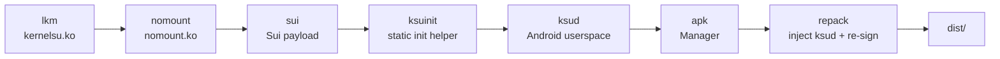

# Build FinaSU

<Badge text="Use build.sh" type="tip" /> <Badge text="One KMI locally" type="warning" /> <Badge text="Signature must match" type="danger" />

`build.sh` is the entry point to the local release flow, and its stage order matches GitHub Actions. It builds the driver across KMIs, builds and embeds the built-in engines, cross-compiles `ksud`, produces the Manager APK, and finally injects `ksud` again and signs the result.

::: danger Do Not Hand-Assemble a Release APK

Copying any `libksud.so` into the APK directory is only good for temporary debugging. A release package must have `repack` inject the `ksud` from the current build and must be signed with a key that matches the kernel trust slot.

:::

## Build Stages



:::: table What Each Step Does

| Step | Main Input | Output & Destination | Dependencies |
| --- | --- | --- | --- |
| `lkm` | `kernel/`, DDK image, Manager second certificate | `<kmi>_kernelsu.ko`, embedded into `userspace/ksud/bin/aarch64/` | Docker |
| `nomount` | `userspace/nomount/`, the same KMI matrix | `<kmi>_nomount.ko`, embedded into `ksud` | Docker |
| `sui` | `userspace/sui/` | Sui payload for each supported ABI, embedded into `ksud` | JDK, Gradle/NDK |
| `ksuinit` | `userspace/ksuinit/` | static `ksuinit`, embedded into `ksud` | Rust, NDK r29 |
| `ksud` | `userspace/ksud/` | executable `ksud` for each ABI | Rust, NDK, prepared engine assets |
| `apk` | `manager/` and the existing `jniLibs` | Gradle release APK | JDK, Android SDK |
| `repack` | the built `ksud`, the APK, the keystore | final APK in `dist/` | Python, signing tools |

::::

## Prepare the Environment

### Base Tools

- A Linux x86_64 build environment; the repository's local scripts and Docker paths are Linux-first.
- Docker, able to run privileged containers, for the DDK KMI builds.
- Rust and the matching Android target.
- Android SDK, Build-Tools and **NDK `29.0.14206865`**.
- JDK 21, for Sui and the Manager.
- Python 3, for payload packaging and the final APK repack.

::: warning Do Not Bump the NDK Version Casually

`ksuinit` requires static linking. The repository is currently pinned to NDK r29; updating the NDK may introduce duplicate symbols or change static link behavior, causing build failures or boot problems.

:::

### Signing Configuration

```sh
cp manager/sign.example.properties manager/keystore.properties
```

Fill in:

- `KEYSTORE_FILE`
- `KEYSTORE_PASSWORD`
- `KEY_ALIAS`
- `KEY_PASSWORD`

`build.sh lkm` computes the DER size and SHA-256 of the second trust slot from that certificate and compiles the result into `kernelsu.ko`. The Manager APK and the kernel must use the same certificate relationship.

::: important A Keystore Is Not an Ordinary Config File

Do not commit `keystore.properties`, JKS files, passwords or signing private keys. CI uses secrets; local release builds should also keep them in a controlled environment only.

:::

## Full Build

```sh
./build.sh all
```

This is equivalent to:

```sh
./build.sh lkm nomount sui ksuinit ksud apk repack
```

Check `dist/` when it finishes. The final APK should contain the `ksud` from this build and be signed again with the key named by `KEYSTORE_PROPS`.

:::: steps

1. **Confirm the workspace state**

   Do not release on top of uncommitted changes you do not understand. Confirm `git status`, the version number and where the signature comes from first.

2. **Build the payloads first**

   `lkm`, `nomount`, `sui` and `ksuinit` prepare the assets that `ksud` embeds. If any required asset is missing, the matching step should fail.

3. **Cross-compile `ksud`**

   `ksud` compiles the kernel module, NoMount, Sui, FolkZygisk and `ksuinit` assets for the current ABI into itself.

4. **Build and re-sign the APK**

   `apk` first has Gradle produce the APK; `repack` then injects the current `ksud` and signs it again. Do not distribute the raw Gradle output.

5. **Verify on a device**

   At minimum verify boot, Manager identity, root requests, ordinary modules, Zygisk and the target ABI. Before a full-matrix release, also verify every declared KMI.

::::

## Step-by-Step Builds

### Kernel Module

```sh
KMIS="android14-6.1 android15-6.6" ./build.sh lkm nomount
```

This step builds and stages `kernelsu.ko` and `nomount.ko` for the given KMIs. The DDK image name comes from:

```text
ghcr.io/ylarod/ddk-min:<kmi>-<DDK_RELEASE>
```

### Sui Payload

```sh
SUI_BUILD_TYPE=release ./build.sh sui
```

`sui` runs `zipRelease` of the vendored Sui project, then maps the payload into the `ksud` asset directory of each target ABI. The build does not flash an extra module, and it does not run Sui's own install script.

### `ksuinit`

```sh
./build.sh ksuinit
```

`ksuinit` must run during the ramdisk `init` stage, so static linking is required. The build script checks whether the artifact really is a static ELF.

### `ksud`

```sh
ABIS="arm64-v8a" KSUD_BUILD_TYPE=release ./build.sh ksud
```

Output lands in `target/<target-triple>/release/ksud`. The step depends on the embed assets prepared earlier.

### Manager and repack

```sh
APP_BUILD_TYPE=release ./build.sh apk repack
```

Gradle requires `manager/app/src/main/jniLibs/<abi>/libksud.so` to exist. For temporary debugging you can use an already built `ksud`:

```sh
mkdir -p manager/app/src/main/jniLibs/arm64-v8a
cp userspace/ksud/target/aarch64-linux-android/release/ksud \
  manager/app/src/main/jniLibs/arm64-v8a/libksud.so
```

But only `repack` writes the current release `ksud` into the official artifact. Do not leave a temporarily copied native library in a commit.

## Environment Variables

:::: table Common Overrides

| Variable | Default | Purpose |
| --- | --- | --- |
| `KMIS` | `android15-6.6` | space-separated KMI list |
| `ABIS` | `arm64-v8a` | target ABIs for `ksud` and the APK |
| `DDK_RELEASE` | `20260828` | DDK image tag |
| `ANDROID_API_LEVEL` | `26` | Rust Android API level |
| `KSUD_BUILD_TYPE` | `release` | Cargo profile for `ksud` |
| `APP_BUILD_TYPE` | `release` | Gradle APK type |
| `SUI_BUILD_TYPE` | `release` | Sui ZIP type |
| `OUT_DIR` | `dist` | `repack` output directory |
| `KEYSTORE_PROPS` | `manager/keystore.properties` | signing config path |

::::

::: danger A Local Build Is Not All-KMI by Default

`KMIS` defaults to `android15-6.6` only. A single ordinary local build does not automatically produce drivers for every device. A full release should use the CI KMI matrix, or pass the full `KMIS` explicitly.

:::

## Target Matrix

CI currently builds the following KMIs:

```text
android12-5.10
android13-5.10
android13-5.15
android14-5.15
android14-6.1
android15-6.6
android16-6.12
android17-6.18
```

Current CI Manager targets include `ksud` builds for `arm64-v8a`, `x86_64` and `riscv64`. Sui and FolkZygisk have no `riscv64` payload; the current KernelSU/NoMount module release matrix targets aarch64 and x86_64.

## Local vs CI Differences

::::: field-group

:::: field Local Build
@type `Single-machine verification`
Flexible and fast, but by default it only covers the KMIs you name, may not include every engine payload, and does not perform a real device boot matrix.
::::

:::: field CI Release
@type `Full matrix`
Uses a pinned toolchain and the KMI matrix to produce multi-ABI, multi-KMI packages suitable for release, and runs Manager unit tests and lint.
::::

:::: field Device Verification
@type `Irreplaceable`
Even a passing compile, signature and unit test suite does not prove that a particular vendor kernel, partition layout and module combination can boot.
::::

:::::

## Common Failures

:::: collapse accordion

### Missing `manager/keystore.properties`

Copy `sign.example.properties` and fill in the real keystore path and password. Do not replace the release certificate with an arbitrary one.

### `ksuinit` is not statically linked

Confirm you are using NDK r29, the correct Android target and the static RUSTFLAGS from the build script. Do not substitute a normal PIE artifact.

### `asset not found: ksuinit`

This means the current `ksud` build did not embed `ksuinit`. Run `./build.sh ksuinit` first, then rebuild `ksud` and the APK.

### The installed APK is not recognized as the Manager

Check the APK certificate against the trust slot of the current kernel. A custom signature requires rebuilding the kernel or authorizing it through the dynamic manager.

### Only one KMI is available

Check `KMIS`. The local default builds only `android15-6.6`; that is by design, not an automatic probe of every device.

### The Manager build is missing `libksud.so`

Build `ksud` first and copy it to the matching `jniLibs/<abi>/libksud.so` for Gradle; the release package still gets the final payload injected by `repack`.

::::

## Pre-Release Checklist

:::: steps

1. Confirm `git status`, the version number, the signature source and the KMI matrix.
2. Run the compile, lint and tests that match the changed component.
3. Build with `./build.sh all` or the full CI release flow.
4. Verify the signature of the final APK and its second trust slot.
5. Verify boot and Manager identity on at least one target device.
6. Verify root, standard modules, Zygisk, Sui and the target ABI.
7. Keep the build logs, artifact hashes and known limitations.

::::

## Related Pages

- [Development overview](/en/developer/): choose an extension type.
- [Built-In kernel integration](/en/developer/builtin-integration/): modify the kernel instead of building standalone payloads.
- [Lua plugin package & lifecycle](/en/developer/lua-plugin/): plugin assets and the runtime.
- [Standard module development](/en/developer/module-development/): module ZIPs and scripts.
- [Troubleshoot a device that will not boot](/en/troubleshoot/bootloop/): recovery order when the build does not boot.
