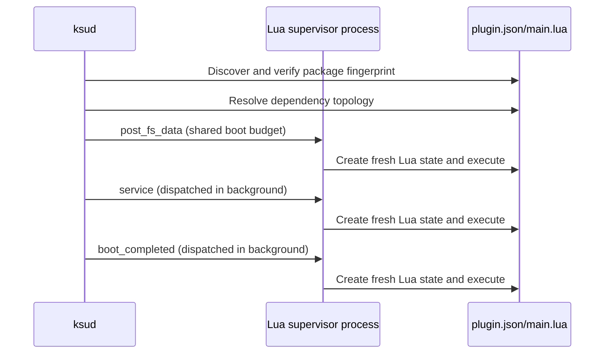

# Lua Plugin Package & Lifecycle

<Badge text="plugin.json" type="tip" /> <Badge text="Transactional install" type="warning" /> <Badge text="Root automation" type="danger" />

`ksud` embeds a Lua 5.5 runtime. A plugin describes its package with one `plugin.json` and returns a callback table from one Lua file; it suits property, file, command, configuration and scheduled automation, and it does not handle `system/` file mounting.

::: important A plugin is not a standard module

A standard module takes `module.prop` as its entry point and is handed to the mount backend and the module script system; a Lua plugin takes `plugin.json` as its entry point and runs in a separate supervised process. The two can cooperate, but their directory, install format and lifecycle differ.

:::

## Minimal Plugin

```file-tree title="hello-plugin.zip"
hello-plugin.zip
├── plugin.json
├── main.lua
└── lib/
    └── helper.lua
```

`plugin.json`:

```json
{
  "id": "hello_plugin",
  "name": "Hello Plugin",
  "author": "Example",
  "version": "1.0.0",
  "description": "Writes a greeting after the service stage.",
  "license": "MIT",
  "entry": "main.lua",
  "callbacks": ["service", "action"],
  "quick_action": {
    "function": "action",
    "label": "Write greeting"
  }
}
```

`main.lua`:

```lua
local function greeting()
  local name = get_config("name")
  if name == "" then
    name = "FinaSU"
  end
  return "Hello, " .. name .. "!\n"
end

return {
  service = function()
    assert(write_file(PLUGIN_DIR .. "/data/greeting.txt", greeting()))
    info("greeting updated")
  end,

  action = function()
    assert(write_file(PLUGIN_DIR .. "/data/greeting.txt", greeting()))
  end,
}
```

The entry script must return a table, and every callback value in that table must be a function. ==The entry is reloaded on every callback==, so it cannot rely on Lua globals from the previous round.

::: tip A callback does only what this round needs

Write data that must survive across rounds into `config.json` or a file, and treat Lua globals as values of this round only. That way manual runs, stage dispatch and daemon rounds behave the same.

:::

## Package Root and Directories

The ZIP can be flat:

```text
plugin.json
main.lua
```

It can also be wrapped in one extra directory:

```text
hello-plugin/
├── plugin.json
└── main.lua
```

The installer looks for the shallowest `plugin.json` and uses that directory as the package root. Do not nest multiple components that each carry a `plugin.json`, and do not rely on ZIP file name order to decide what gets installed.

After installation the directory is fixed:

```text
/data/adb/plugins/<id>/
```

The host locks, staging and allow records live in:

```text
/data/adb/ksu/plugin_locks/finasu/
/data/adb/ksu/plugin_stage/finasu/
/data/adb/ksu/plugin_state/finasu/
```

These paths are managed by the host; plugins must not read them, tamper with them or depend on their internal file names.

## `plugin.json` Fields

:::: table Manifest fields

| Field | Type | Required | Behavior |
| --- | --- | --- | --- |
| `id` | string | Yes | Unique plugin ID, also the install directory name |
| `name` | string | No | Name shown in the Manager |
| `author` | string | No | Author |
| `version` | string | No | User-facing version |
| `description` | string | No | Main description |
| `descriptions` | object | No | Descriptions per language code; the Manager currently keeps them but does not use them as the primary display source |
| `license` | string | No | License text |
| `min_version` | number | No | Minimum required FinaSU host versionCode |
| `depends` | string[] | No | Plugin IDs this plugin depends on |
| `entry` | string | No | Entry file name, defaults to `main.lua` |
| `config` | object[] | No | Configuration control declarations |
| `quick_action` | string / object | No | Manager quick action |
| `has_action` | boolean | No | Declares that an action exists; the quick button also depends on a callback |
| `callbacks` | string[] | No | Callback names that need automatic scheduling |

::::

### ID, Entry and Callback Names

::::: field-group

:::: field Plugin ID
@type `Rules`
At most 64 characters; the first character must be an ASCII letter or digit and the rest may only be ASCII letters, digits, `.`, `_`, `-`. It cannot be `.` or `..`.
::::

:::: field Entry file
@type `Rules`
At most 128 characters; it must be a plain file name under the package root, may only contain ASCII letters, digits, `.`, `_`, `-`, and cannot contain directory separators.
::::

:::: field Callback name
@type `Rules`
At most 64 characters; the first character must be an ASCII letter, digit or `_`, and the rest may only be ASCII letters, digits or `_`.
::::

:::::

The entry supports only package root files, not `sub/main.lua`. When code needs splitting, the entry can organize it through other package data or module loading conventions, but the entry name itself must still be a plain file name.

### `min_version`

`min_version` is compared with the running host `versionCode`. If the plugin requires a newer host than the current one, manifest parsing fails and the plugin cannot be enabled or run automatically.

### Dependencies

- Installation allows installing a plugin whose dependencies are not ready yet.
- Enabling requires every `depends` entry to be installed.
- Automatic stages run in dependency topological order.
- If a dependency is missing, disabled or has an invalid manifest, plugins that depend on it are skipped as well.
- No member of a dependency cycle runs.
- Disabling or uninstalling a plugin that is still depended on by another enabled plugin is rejected.

Plugin dependencies only express run order and the enable relationship; they never install, enable or update dependencies automatically.

## Configuration Controls

```json
{
  "config": [
    {
      "key": "mode",
      "label": "Mode",
      "type": "select",
      "default": "balanced",
      "options": ["fast", "balanced", "safe"]
    },
    {
      "key": "enabled",
      "label": "Enabled",
      "type": "bool",
      "default": true
    }
  ]
}
```

The only supported control types are:

:::: table `config[].type`

| Type | Extra requirement | Notes |
| --- | --- | --- |
| `text` | None | Text input |
| `number` | None | Numeric input, still stored as a string |
| `bool` | None | Boolean switch |
| `select` | `options` must be non-empty | Choose from fixed options |

::::

`key` is at most 64 bytes and cannot contain `/` or `\`. `label` is the primary display text, and `labels` can carry text organized by language code; the current Manager reads only `label` and does not yet use `labels` as the main localization source.

`config[].default` is only used for the initial display in the Manager and is never injected into Lua by the host. The plugin must fall back itself when reading:

```lua
local mode = get_config("mode")
if mode == "" then
  mode = "balanced"
end
```

## Quick Actions and `action`

The simplest form the current Manager recognizes is:

```json
{
  "callbacks": ["action"],
  "quick_action": {
    "function": "action",
    "label": "Run cleanup"
  }
}
```

`quick_action` can also be written directly as a string:

```json
{
  "quick_action": "clean_now"
}
```

In that case the Manager calls `quick_action.function` first; only without `quick_action` does it fall back to `action`. Writing only `"has_action": true` is enough to mark the manifest as having an action, but the current Manager will not invent an executable callback from it, so declare `quick_action` or `callbacks: ["action"]` as well.

`labels` can provide multilingual text for the quick action, but the current Manager still uses `label` as the primary one.

## Install and Update

Plugin installation is transactional:

1. Read and validate the manifest.
2. Check ZIP paths, duplicate entries, symlinks, device files, size and compression ratio.
3. Extract into a staging directory on the same filesystem as the plugin directory.
4. Carry over the existing `config.json`, `disable` and `last_output.log`.
5. Read the manifest again and confirm the entry file exists.
6. Switch to the new version with an atomic swap or rename.

A failure at any step keeps the old version. When a plugin has a daemon or supervised process running, update and uninstall are rejected.

:::: table Package limits

| Item | Limit |
| --- | --- |
| `plugin.json` | 1 MiB |
| Single extracted file | 16 MiB |
| Total extracted size | 64 MiB |
| ZIP member count | 2048 |
| Compression ratio per file | 200 |

::::

Paths must be relative and cannot contain absolute paths, empty segments, `.`, `..`, duplicate members or NUL. A package cannot carry `config.json`, `disable` or `last_output.log`; those are user state and are migrated from the existing installation on update.

After installation all package files are set to `0644`. Files that need execute permission should get it through `chmod` from Lua or by handing them to a system tool; do not expect the ZIP to preserve Unix modes.

## Enable and Allowlisting

When a plugin is installed or enabled, the host records the fingerprint of the current package contents. Automatic boot stages run only plugins whose fingerprint matches:

- A plugin that was never installed or enabled in FinaSU is not run automatically.
- If the plugin code files are modified externally, the fingerprint becomes invalid and automatic stages refuse to run it.
- Reinstalling or re-enabling registers the current package fingerprint.
- `config.json`, logs and `disable` are runtime state and do not take part in the fingerprint.

This prevents a package that "already exists but was never confirmed by the current Manager" in the shared `/data/adb/plugins/` from gaining execution at boot.

## Callbacks and Stages

The entry returns a table. Automatic stages recognize only three names:

:::: table Automatic stages

| Stage | Lua callback |
| --- | --- |
| `post-fs-data` | `post_fs_data` |
| `service` | `service` |
| `boot-completed` | `boot_completed` |

::::

Plugins have no `post-mount` automatic stage. A plugin that needs to work after module mounting should use a standard module's `post-mount.sh`, or explicitly accept running in the `service` stage.



### Execution Rules

- `post-fs-data` shares the roughly 35 second budget with standard module boot scripts; a single callback is capped at 120 seconds, but the effective timeout is the remaining budget.
- `service` and `boot-completed` are dispatched in the background and do not block boot.
- Each stage runs automatically at most once per boot.
- After declaring `action`, it can be invoked manually from the Manager or the CLI.
- Any valid callback name can be invoked with `ksud plugin run <id> <callback>`.
- A missing callback exits with code `2`; a failure or supervision termination exits with code `1`.
- A regular manual callback has a supervision cap of 300 seconds.

### Resident `main`

Only when `"main"` is declared in `callbacks` does the host start a resident loop after the `service` callback:

- The minimum interval is fixed at 1 second.
- Every round creates a brand new Lua state.
- Only one daemon per plugin per callback is allowed.
- It stops after the plugin is disabled or its directory disappears.
- A failed round is logged, and later rounds still reload the package.

There is no 120 second supervision timeout between rounds, so callbacks should return quickly on their own. For a resident background process, use `exec` to start and manage a separate program, or call `start_daemon` explicitly.

## Config, Logs and State

```file-tree title="Installed plugin"
/data/adb/plugins/hello_plugin/
├── plugin.json          # package manifest
├── main.lua             # entry
├── config.json          # user config, JSON string values
├── last_output.log      # callback log, at most 64 KiB
└── disable              # disables when present
```

The config file limit is 4 MiB. When the host reads older non-string scalars it converts them to text, but new writes always store JSON strings. A corrupted `config.json` is never overwritten automatically; reads and writes return an error.

The log collects `info`, `warn` and the callback process stdout/stderr. Opening a log that already exceeds 64 KiB truncates it first, so logs cannot serve as a long-term audit record.

## CLI

::::: code-tabs

@tab:active Install and status

```sh
ksud plugin install /data/local/tmp/hello-plugin.zip
ksud plugin list
ksud plugin enable hello_plugin
ksud plugin disable hello_plugin
ksud plugin uninstall hello_plugin
```

@tab Run and logs

```sh
ksud plugin run hello_plugin service
ksud plugin action hello_plugin
ksud plugin log hello_plugin
ksud plugin clear-log hello_plugin
```

@tab Config

```sh
ksud plugin config --id hello_plugin list
ksud plugin config --id hello_plugin get mode
ksud plugin config --id hello_plugin set mode fast
ksud plugin config --id hello_plugin delete mode
```

:::::

`ksud plugin list` outputs a JSON array containing `enabled`, `has_action`, `quick_action`, `config`, `depends`, `callbacks` and per-plugin reported errors. A corrupted manifest still lists the entry so you can locate it instead of it being skipped silently.

`ksud plugin daemon` and `ksud plugin stage` are internal commands used by the host to re-execute itself; they are not part of the stable public plugin interface.

## Compatibility Boundaries with FolkPatch

The plugin directory, `plugin.json`, the Lua callback table and part of the CLI shape are close to the FolkPatch ecosystem, so simple plugins usually migrate. But the FinaSU implementation is not a complete copy of the FolkPatch API:

:::: table Interfaces not to copy over

| Interface | FinaSU status |
| --- | --- |
| `save_text` / `read_text` | Not provided; use `write_file` / `read_file` |
| `getConfig` / `setConfig` | Not provided; use `get_config` / `set_config` |
| `install_module` | Not provided |
| `modules` global table | Not provided |
| Lua 5.4 specific behavior | Not guaranteed for compatibility; FinaSU uses Lua 5.5 |
| Native `io` / `os` | Not a stable contract; use the APIs in this page |

::::

When migrating, search for these interfaces first, then replace them one by one and retest. See the [Lua API Reference](/en/developer/lua-api/) for the complete function list and error behavior.

## Debugging Order

::::: steps

1. **Confirm the package is recognized**

   Run `ksud plugin list`. If `error` is non-empty, fix the manifest first; do not keep guessing at the callback logic.

2. **Confirm the plugin is enabled**

   Check `enabled` and the `disable` file. Automatic stages also require a registered package fingerprint; reinstall or enable once to confirm the current contents.

3. **Run the target callback manually**

   `ksud plugin run <id> <callback>` exposes syntax errors, missing callbacks and runtime exceptions directly. Make it succeed first, then reboot to verify the automatic stages.

4. **Read the log**

   Use `ksud plugin log <id>` to see Lua and child process output. Newlines are folded, but the last 64 KiB of content is kept.

5. **Check dependencies and stage budget**

   A missing dependency, a dependency cycle, an unregistered fingerprint or an exhausted boot budget all cause the plugin to be skipped in automatic stages. The log usually states the specific reason.

6. **Verify update and uninstall**

   If a daemon is running, stop the corresponding flow first. After an update, confirm `config.json` and the log were preserved; after uninstall, confirm the directory and the allow record are both gone.

:::::

:::: chat title="Lua plugin development Q&A"
{User}
Can I use a plugin as a standard module to mount files?

{.}
No. A plugin runs root-level Lua but does not take part in `system/` mounting. File injection belongs to standard modules and the current mount backend.

{User}
Why can the default value in `plugin.json` not be read in Lua?

{.}
`config[].default` is only for display in the Manager. `get_config` returns an empty string when nothing is stored, so the plugin must provide its own fallback.

{User}
Why is there no action button even though `has_action` is set?

{.}
The current Manager uses `quick_action.function` first and otherwise calls `action`. Declare `quick_action` or put `action` into `callbacks`.

{User}
Can a plugin freely choose between `io.open` and `write_file`?

{.}
Do not rely on native `io`. Use `write_file` / `read_file`; they have defined size and error semantics and are also the FinaSU compatibility interface.
::::

## Related Pages

- [Lua API Reference](/en/developer/lua-api/): signatures, return values and limits of the 18 functions.
- [Standard Module Development](/en/developer/module-development/): use it when you need file mounting or boot scripts.
- [Plugin Management](/en/manager/plugin/): install, log, configuration and run entries in the Manager.
