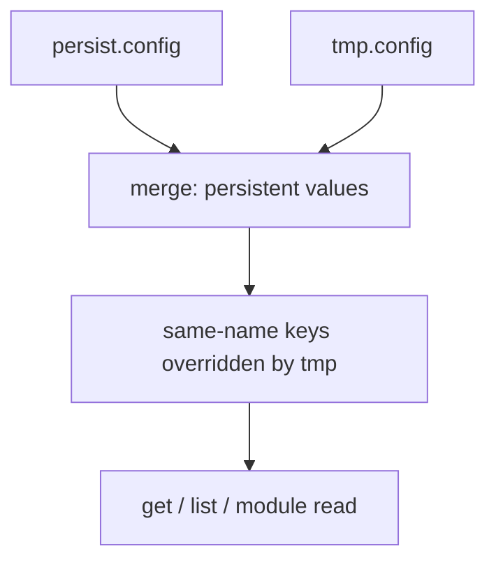

# Module Configuration

<Badge text="Persistent + temporary" type="tip" /> <Badge text="Binary file" type="warning" /> <Badge text="32 entries max" type="danger" />

Module configuration lets a standard module keep user choices outside the module directory. The configuration is not overwritten by the ZIP when the module updates, and it is cleaned up when the module is uninstalled. It serves `customize.sh`, boot scripts, the WebUI and the Manager; it is not the `config.json` of a Lua plugin.

```file-tree title="Configuration Locations"
/data/adb/ksu/
└── module_configs/
    └── example_module/
        ├── persist.config     # persistent configuration
        └── tmp.config         # temporary override, cleared early in boot
```

## Two Configuration Layers

:::: table Storage Layers

| File | CLI Flag | Lifecycle | Good For |
| --- | --- | --- | --- |
| `persist.config` | default | kept across reboots, cleaned up when the module is uninstalled | user settings, long-term modes |
| `tmp.config` | `--temp` / `-t` | cleared early on the next boot | one-off migrations, failure recovery, temporary overrides |

::::

On read, `persist.config` is loaded first and then overridden by keys of the same name from `tmp.config`. ==Delete and clear only affect the target layer== and never touch the other layer automatically.

## Calling from Module Scripts

While a module script runs, `ksud` sets `KSU_MODULE`. The script therefore does not need to pass the module ID again:

```sh
mode="$(ksud module config get mode 2>/dev/null || echo balanced)"

ksud module config set mode fast
ksud module config set migration_done true --temp
```

Outside a module script environment you can specify the internal name explicitly:

```sh
ksud module config --internal webui get mode
ksud module config --internal webui set mode fast
```

`--internal <name>` actually resolves to the module ID `internal.<name>`; it is not an alias for an arbitrary module ID. To operate on an ordinary module, enter that module's context through the `KSU_MODULE` environment.

## CLI

::::: code-tabs

@tab:active Read and write

```sh
ksud module config get mode
ksud module config set mode fast
ksud module config set mode balanced --temp
ksud module config delete mode
ksud module config clear
```

@tab Write from stdin

```sh
printf '%s' "$long_value" | ksud module config set description
printf '%s' "$long_value" | ksud module config set description --stdin
```

@tab View all

```sh
ksud module config list
```

:::::

- `set` with the value omitted, or with `--stdin` passed explicitly, reads from standard input until EOF.
- `get` returns an error when the key is missing instead of printing an empty string.
- `delete` returns an error when the key is missing.
- `clear` deletes the whole target configuration file; it still counts as success when the file does not exist.
- `list` prints the merged `key=value` pairs, with temporary values overriding persistent ones.

## File Format

Configuration files use a binary format maintained by FinaSU itself:

- The magic is `KSUM`, the little-endian value `0x4b53554d`.
- The current format version is `1`.
- The content is a count followed by length-prefixed keys and length-prefixed values, all interpreted as UTF-8.
- Writes use a temporary file, `sync_all` and an atomic rename.

::: danger Do Not Edit by Hand

Editing the binary file by hand can corrupt the magic, version, length fields or UTF-8. Once the file is damaged, module configuration reads fail; write the configuration again or delete the matching file.

:::

## Value Limits

:::: table Limits

| Item | Limit |
| --- | --- |
| Entries per configuration file | at most 32 |
| Key length | at most 256 bytes |
| Key format | `^[a-zA-Z][a-zA-Z0-9._-]+$` |
| Minimum key length | 2 characters |
| Value length | at most 1 MiB |
| Value encoding | any valid UTF-8 |

::::

Note that the key rule matches the module ID rule: the first character is an ASCII letter and at least one more letter, digit, `.`, `_` or `-` follows. So `a` is invalid while `a1` is valid.

::: warning Values Are Not Boolean

Configuration values are always strings. When reading a boolean, the installer-related convention treats only case-insensitive `true` and the exact `1` as true, and every other value as false. A module should define its own parsing rules explicitly and document them.

:::

## Precedence Example

```sh
ksud module config set mode balanced
ksud module config set mode fast --temp
ksud module config list
```

This boot reads:

```text
mode=fast
```

`tmp.config` is cleared early in boot. The next boot reads:

```text
mode=balanced
```



## Declaring Managed Features

A module can declare through persistent configuration that it manages a particular FinaSU feature:

```sh
ksud module config set manage.su_compat true
```

When the Manager lists modules, it collects every `manage.<feature>` whose value is true into the module's `managedFeatures`. After reading `managedFeatures` from `module.prop`, the installer checks whether the feature is supported by the kernel and whether another module already manages it.

This convention only expresses that a module declares it manages something; it does not disable or take over the feature automatically. The module must perform the actual work itself and guarantee recovery on uninstall.

```properties
id=example_module
managedFeatures=su_compat
```

::: warning Duplicate Management Is Not Resolved Automatically

When two modules manage the same feature at the same time, the installer can only warn. Module authors must still avoid the functional conflict; do not assume the last installed module wins reliably.

:::

## Module Description Override

`override.description` in the persistent configuration overrides the module description shown by the Manager:

```sh
ksud module config set override.description \
  "Current mode: fast (updated dynamically by module config)"
```

This suits showing the current mode or runtime state. Do not write long real-time logs into the description; the module list reads it frequently.

## Development Recommendations

::::: steps

1. **Define keys and defaults first**

   Record the type, allowed values, default and when a change takes effect for every key. Do not handle this implicitly only inside the reading script.

2. **Separate persistent from temporary**

   User choices go to the persistent layer; a migration or recovery within a single boot goes to the temporary layer. Do not let a temporary value be mistaken for a permanent setting.

3. **Handle missing keys**

   A failing `get` is normal. Scripts should prepare a default and write it explicitly to the persistent configuration when needed.

4. **Limit concurrent writes**

   When several WebUI requests or scripts update the configuration at the same time, the module must serialize them itself. A single CLI write is atomic; that does not make several read-modify-write cycles a transaction.

5. **Verify uninstall cleanup**

   After uninstalling, confirm that both the module directory and `/data/adb/ksu/module_configs/<id>/` are cleaned up and that no feature declarations are left behind.

:::::

::::: collapse accordion

:::: collapse Does configuration get lost when the module updates
No. The configuration lives in `/data/adb/ksu/module_configs/<id>/`, while the module ZIP only overwrites the module directory. As long as the module ID stays the same, the persistent configuration remains.
::::

:::: collapse Can I edit `persist.config` directly
Not recommended. The format contains magic, version, count and length fields; a bad write makes the whole file unreadable. Use `ksud module config`.
::::

:::: collapse Why do `--temp` values disappear after a reboot
That is by design. Early in `post-fs-data` every module's `tmp.config` is cleared, so one-off state cannot pollute the official configuration across boots.
::::

:::: collapse How should the WebUI call it
The WebUI can run `ksud module config ...`, but it must validate user input, avoid splicing unescaped content into a shell, and handle a non-zero exit code.
::::

:::::

## Related Pages

- [Standard module development](/en/developer/module-development/): module installation, script lifecycle and WebUI.
- [Lua API reference](/en/developer/lua-api/): the plugin `get_config` / `set_config`, which use a separate JSON store.
