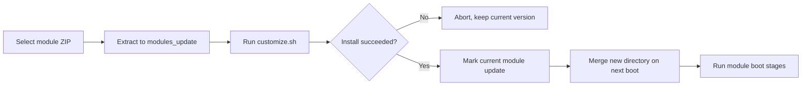

# Standard Module Development

<Badge text="module.prop" type="tip" /> <Badge text="ZIP root" type="warning" /> <Badge text="Boot stages" type="danger" />

A standard module is a ZIP with a `module.prop`, which FinaSU extracts into the module directory and then handles `system/` files, properties, SELinux rules and boot scripts according to module rules. ==Zygisk modules, WebUI modules and metamodules are also built on this module format==, but each of them has additional requirements.

::: important First decide what "module" means here

The modules in this page are Android systemless modules under `/data/adb/modules/`. For Linux `.ko` kernel modules see [Managed Kernel Modules](/en/manager/kernel-module/); to compile the root driver into the kernel see [Built-In Kernel Integration](/en/developer/builtin-integration/).

:::

::: tip Start with a single path override

If the goal is only to replace one system file, first finish the minimal `module.prop` plus `system/` directory, then verify mounting and the Profile. Do not add resident scripts, hot install or a metamodule from the beginning.

:::

## Minimal Installable Structure

The ZIP root must contain `module.prop` directly. Standard modules do not support wrapping everything in one extra directory.

```file-tree title="Minimal module"
example-module.zip
├── module.prop
├── customize.sh
├── post-fs-data.sh
├── service.sh
└── system/
    └── bin/
        └── example
```

An example `module.prop`:

```properties
id=example_module
name=Example Module
version=1.0.0
versionCode=1
author=Example Author
description=An example systemless module.
```

The install entry point strictly validates `id`:

- It must match `^[a-zA-Z][a-zA-Z0-9._-]+$`.
- The first character must be an ASCII letter.
- It must be at least 2 characters long and cannot contain spaces, slashes or non-ASCII characters.

Missing other fields usually does not block installation, but the Manager shows an empty name, version or description. A published module should fill in all of them.

:::: table Common `module.prop` fields

| Field | Purpose | Recommendation |
| --- | --- | --- |
| `id` | Unique module identifier, directory name and configuration namespace | Required, do not change it casually after release |
| `name` | Name shown in the Manager | Required |
| `version` | User-facing version string | Required |
| `versionCode` | Number used to compare versions | Required, increment on every release |
| `author` | Author | Required |
| `description` | Module description | Required, keep it short |
| `managedFeatures` | Comma-separated FinaSU features the module manages | Fill in only when the module really takes over a feature |

::::

::: warning The module ID is a persistent identifier

Configuration, pre-boot copies and uninstall cleanup are all tied to the module ID. Renaming makes existing configuration appear to "disappear"; if the old module is still present, you may also end up with two modules under different IDs.

:::

## What Happens During Installation

A standard module can only be installed from a booted Android environment. `ksud module install` first confirms `sys.boot_completed=1`, then extracts the ZIP into:

```text
/data/adb/modules_update/<id>/
```

The install script runs inside the staging directory. After a successful default installation, an `update` marker is written to the currently running module directory; on the next boot `ksud` merges the staging directory into `/data/adb/modules/<id>/`.



So "installation finished" does not mean the `system/` files already appear in the target process. Except for hot install, which is explicitly supported, a new version fully takes effect only after a reboot.

## Install Script

Modern modules use `customize.sh`. The old `install.sh` is still recognized by the compatibility path, but it uses a different install interface and new modules should no longer rely on it as the primary entry.

### Default Behavior

If `SKIPUNZIP=1` is not set, the following already happened before `customize.sh` is loaded:

1. ZIP contents were extracted to `$MODPATH`, excluding `META-INF/`.
2. Regular directories were set to `0755` and regular files to `0644`.
3. Files under `system/bin`, `system/xbin` and `system/system_ext/bin` were made executable.
4. `system/vendor` uses the vendor file context and executable permissions.
5. Only then is `customize.sh` sourced.

With `SKIPUNZIP=1` set, the default extraction and permission steps are skipped, and the author must place the needed files into `$MODPATH` themselves. Unless the module has to filter files per device model, adding this complexity is not recommended.

### Available Install Functions

:::: table Common install script functions

| Function | Purpose |
| --- | --- |
| `ui_print <text>` | Write a line to the Manager install output |
| `abort <text>` | Print an error, clean the staging directory and stop installation |
| `set_perm <path> <uid> <gid> <mode> [context]` | Set owner, permissions and SELinux context for a single path |
| `set_perm_recursive <path> <uid> <gid> <dir-mode> <file-mode> [context]` | Set permissions recursively |
| `mktouch <path> [content]` | Create a file, optionally write content, set mode `0644` |
| `mark_remove <path>` | Mark a target for deletion from the module view with a special node |

::::

A minimal `customize.sh`:

```sh
#!/system/bin/sh

ui_print "- Installing $(grep '^name=' "$MODPATH/module.prop" | cut -d= -f2-)"
set_perm "$MODPATH/system/bin/example" 0 2000 0755
```

### Install Environment

::::: field-group

:::: field `MODPATH`
@type `Path`
The staging module directory of this installation. Any script changes to module files should be based on this variable.
::::

:::: field `ZIPFILE`
@type `Path`
Absolute path of the original module ZIP.
::::

:::: field `TMPDIR`
@type `Path`
Install temporary directory, currently `/dev/tmp`. Do not rely on its contents persisting after the script exits.
::::

:::: field `ARCH` / `ABI` / `API`
@type `Device info`
The detected architecture, primary ABI and Android API level respectively.
::::

:::: field `BOOTMODE`
@type `Boolean`
FinaSU installs from a booted Android, so this value is true. Scripts should still avoid assuming a recovery environment.
::::

:::::

The installer also provides `KSU=true`, `KSU_VER`, `KSU_VER_CODE`, `KSU_UAPI_VER`, `KSU_RUNTIME_MODE` and `KSU_HAS_HOT_INSTALL`. Do not use these variables for unverified compatibility branches with older managers.

## Boot Scripts

Module scripts are executed by BusyBox `ash`. Every module script should first resolve its directory from its own path:

```sh
MODDIR=${0%/*}
```

Do not hardcode `/data/adb/modules/<current module>/` and then copy the script elsewhere; only `MODDIR` keeps the path consistent with the current install location.

:::: table Lifecycle

| Stage | File | Blocking | When to use |
| --- | --- | --- | --- |
| `post-fs-data` | `post-fs-data.sh` | Yes, with a timeout budget | Data preparation that must run as early as possible |
| `post-mount` | `post-mount.sh` | Shares the budget of the previous stage | Work that needs the module file view already in place |
| `service` | `service.sh` | No, dispatched in the background | Service startup, resident processes |
| `boot-completed` | `boot-completed.sh` | No, dispatched in the background | Tasks after the system is interactive |

::::

`post-fs-data` and `post-mount` share a boot budget of roughly 35 seconds. Scripts must not wait unbounded, probe in loops or start foreground processes that never exit; resident work belongs in `service.sh` with its own logging and stop conditions.

There is no stable global ordering guarantee between scripts of regular modules. Stage scripts of a Metamodule run before regular modules. When modules need to cooperate, use explicit marker files, timeouts and idempotent logic, and do not rely on directory traversal order.

In safe mode, `ksud` skips common/module boot scripts and disables modules. Treating "not executed in safe mode" as a broken script leads to wrong conclusions.

## Other Entries in the Module Directory

:::: table Files and directories

| Path | Purpose |
| --- | --- |
| `system/` | Published to the matching system paths through the mount backend |
| `system.prop` | Set properties early during boot |
| `sepolicy.rule` | Append SELinux rules to the current policy |
| `action.sh` | Manual execution entry point in the Manager |
| `webroot/` | Static assets for the module WebUI |
| `uninstall.sh` | Runs before the module is deleted on next boot |
| `initrc/*.rc` | Merged into the `modules.rc` generated by preinit |
| `preinit/` | Preinit assets that must run extremely early, must contain `preinit.conf` |
| `zygisk/<ABI>.so` | Zygisk module native library |
| `skip_mount` | Keep script execution but skip `system/` file injection |
| `disable` | Disable the module |
| `remove` | Delete the module on next boot |

::::

### Zygisk Entry

Zygisk native libraries are placed per device ABI:

```text
zygisk/arm64-v8a.so
zygisk/armeabi-v7a.so
zygisk/x86_64.so
zygisk/x86.so
```

The standard module format only places files in the module directory; the actual injection is done by the currently available Zygisk provider. Do not assume injection succeeds just because the module contains `zygisk/`, and do not assume inside module scripts that the built-in FolkZygisk is the current provider.

### WebUI and Manual Actions

- `webroot/index.html` is the WebUI entry point. The WebUI presents module content with root capabilities, so treat its input as untrusted.
- `action.sh` is executed by the module action button in the Manager and suits short tasks; for long-running work, move it to the background yourself and log it.
- Module configuration can be exposed to scripts and the WebUI through [Module Configuration](/en/developer/module-config/).

## Hot Install

Regular module updates fully take effect after a reboot. Advanced modules can explicitly request hot install in `customize.sh`:

```sh
MODULE_HOT_INSTALL_REQUEST=true
MODULE_HOT_RUN_SCRIPT=post-install.sh
```

Hot install tries to replace the live module directory immediately and runs the specified script inside the module. It only handles "the directory was switched" and "the specified script ran":

- `system/` files are still mounted on next boot.
- `system.prop` is still loaded on next boot.
- `post-fs-data.sh` and `post-mount.sh` are not re-run.
- Preinit actions start from the next boot.
- Metamodules do not support hot install.
- In safe mode it falls back to the regular reboot path.

::: danger Do not make hot install the default

Hot install suits modules that have already verified their replacement protocol. Running processes may still hold old files, old mounts or old code; a wrong switch mixes "update succeeded" with "failure on next boot".

:::

## Metamodule Boundaries

A module that declares `metamodule=1` in `module.prop` takes over the module install or mount flow. FinaSU allows only one active Metamodule at a time, and its stage scripts run first.

Before developing a Metamodule, confirm:

- The custom installer follows the FinaSU script environment and exit codes.
- It does not take over the same paths at the same time as an active NoMount injection backend.
- There is a recovery path if uninstall or disable is interrupted halfway.
- An update does not lose user configuration, other modules or the current mount state.

Regular feature modules do not need to become a Metamodule. Use one only when you really need to replace the shared install/mount flow.

## Debugging and Verification

:::: code-tabs

@tab:active Install a module

```sh
adb push example-module.zip /data/local/tmp/
adb shell su -c 'ksud module install /data/local/tmp/example-module.zip'
```

@tab Inspect modules

```sh
adb shell su -c 'ksud module list'
adb shell su -c 'ksud module enable example_module'
adb shell su -c 'ksud module disable example_module'
```

@tab Manual actions

```sh
adb shell su -c 'ksud module action example_module'
adb shell su -c 'ksud module skip example_module'
adb shell su -c 'ksud module skip example_module --off'
```

::::

::::: steps

1. **Verify the installation in the staging directory**

   Check that `customize.sh` ended with a successful status and that `module.prop`, entry scripts and ABI files are all in the final module directory.

2. **Verify each stage after a reboot**

   Check the actual results of `post-fs-data`, `post-mount`, `service` and `boot-completed` separately. Do not infer that the whole lifecycle is fine from a single stage.

3. **Verify disable and uninstall**

   Walk through `disable`, `skip_mount`, `remove` and `uninstall.sh` for real. In particular, confirm that uninstall does not leave behind reverse proxies, processes, mounts or properties.

4. **Test on the target ABI and Android version**

   Working on `arm64-v8a` does not mean `x86_64`, a 32-bit ABI or another Android version works; both native libraries and system paths may differ.

5. **Preserve the failure scene**

   Record `module.prop`, install output, `ksud` logs, `logcat`, module script output and the directory state before and after the reboot. Recording only "the device does not boot" is not enough to locate the problem.

:::::

## Release Checklist

::::: collapse accordion

:::: collapse ID and version
Confirm the module ID contains no path characters, `versionCode` has been incremented, and `module.prop` exists directly in the ZIP root.
::::

:::: collapse Install and uninstall
Fresh install, upgrade install, disable, re-enable, uninstall and reboot after uninstall have all been verified; an upgrade install does not lose user configuration.
::::

:::: collapse Boot budget
`post-fs-data.sh` and `post-mount.sh` return quickly; resident tasks do not start in a blocking stage; every external command has a timeout or failure handling.
::::

:::: collapse Files and permissions
`system/` target paths, SELinux contexts, file modes and ABIs are all correct; no debug binaries or temporary certificates left over from testing.
::::

:::: collapse Security
Scripts accept no unvalidated network input, write no credentials to logs, execute no high-privilege files from predictable temporary paths, and do not enable dangerous features by default.
::::

:::::

:::: chat title="Standard module development Q&A"
{User}
I only want to replace one system file. Do I need a process supervision script?

{.}
No. Start with the minimal `module.prop` plus a `system/` path override; consider scripts only after confirming the mount mode and Profile behavior.

{User}
Why have the files not changed after installing the module?

{.}
A standard install usually goes into `/data/adb/modules_update/<id>/` first and is merged into mounting only after a reboot. Check the `update` marker on the module and the current mount mode.

{User}
Can I use `post-fs-data.sh` as a resident service entry point?

{.}
No. It belongs to a blocking stage with an overall budget. Resident work belongs in `service.sh` or an independent controlled process, and must handle stopping and repeated starts.
::::

## Related Pages

- [Module Configuration](/en/developer/module-config/): CLI and limits for persistent and temporary configuration.
- [Folk Mount](/en/builtin/folk-mount/): which mount backend publishes module files.
- [FolkZygisk](/en/builtin/folkzygisk/): the injection provider Zygisk modules depend on.
- [Managed Kernel Modules](/en/manager/kernel-module/): the `.ko` load path, which differs from standard modules.
