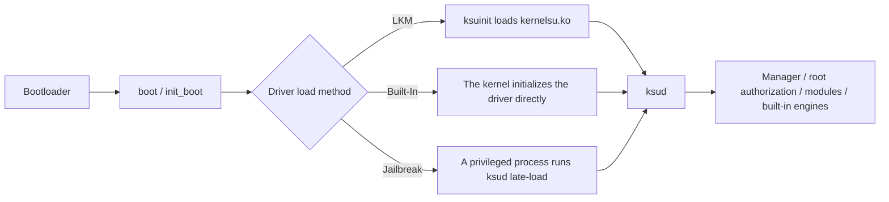

# Core Concepts

<Badge text="Read this first if you are new" type="warning" /> <Badge text="Concepts are not operations" type="tip" />

FinaSU involves the kernel, the boot image, root authorization and module injection. Many failures come from mixing up different layers: the APK is not the driver, LKM is not a regular module, and Built-In is not another kind of "mode switch". This page separates those concepts first, then points to the articles that cover the actual operations.

::: tip Already rooted?

If you already get root from Magisk, KernelSU or one of its forks, or APatch/KernelPatch, read the matching switching article first:

- [Switching from Magisk](/en/guide/switch/magisk/)
- [Switching from KernelSU](/en/guide/switch/kernelsu/)
- [Switching from APatch](/en/guide/switch/apatch/)

:::

## FinaSU at a Glance



Whichever method is used, the goal is the same: get the FinaSU driver inside the kernel working, after which `ksud` and the Manager provide authorization, module and engine management. What differs is where the driver comes from, when it is loaded, and whether it survives a reboot.

## Boot Chain

When Android boots, the bootloader first verifies and loads the boot image, then starts the Linux kernel and the first userspace program `init`. A persistent FinaSU installation has to step in at this early stage, so it modifies one of the images in the boot chain.

::: table Boot partitions

| Partition | Main contents | Relation to FinaSU |
| --- | --- | --- |
| `boot` | The Linux kernel; on some devices also the generic ramdisk | Built-In replaces the kernel; LKM modifies the ramdisk when there is no `init_boot` |
| `init_boot` | A separate generic ramdisk on some newer devices | When present and the KMI is not `android12-*`, LKM usually modifies this one |
| `vendor_boot` | Vendor boot resources and ramdisk | Used by a few devices; choose it only when the Manager explicitly shows it |

:::

::: warning There is no Linux kernel in `init_boot`

`init_boot` is a ramdisk partition, not a kernel partition. Do not flash a complete kernel into it just because its name contains "boot", and do not swap `boot.img` and `init_boot.img`.

:::

### Bootloader and AVB

The bootloader is the earliest boot program on the device. Many devices only allow writing a custom boot image after unlocking. AVB (Android Verified Boot) verifies the boot chain; flashing on a locked bootloader can break verification and leave the device unable to boot.

Jailbreak mode does not modify the boot partition, so it may be usable on devices with a locked bootloader; LKM and Built-In require an unlocked device and the ability to restore the boot image.

### A/B Slots

A/B devices have two system slots, commonly with the suffixes `_a` and `_b`. An OTA usually writes to the inactive slot and the device switches on reboot. Confirm the current slot before flashing; do not write an `_a` image to `_b`, and do not handle both slots at once without confirming first.

## Driver and Userspace

:::: field-group

::: field `kernelsu.ko`
@type `LKM / Jailbreak`
@default `Kernel driver`
The root driver of FinaSU. LKM puts it into the ramdisk, jailbreak mode loads it after boot, and Built-In compiles it into the kernel so it no longer exists separately.
:::

::: field `ksuinit`
@type `LKM`
@default `Boot wrapper`
An early boot program installed in the ramdisk, responsible for loading `kernelsu.ko` during the `init` stage.
:::

::: field `ksud`
@type `Userspace`
@default `/data/adb/ksud`
A userspace command-line tool invoked by boot events or by the Manager with subcommands; it handles modules, authorization, built-in engines and boot scripts.
:::

::: field Manager APK
@type `Userspace`
@default `Official signature`
Provides the interface, authorization records, installation, updates and logs. Only a Manager trusted by the kernel can manage the driver; installing the APK alone does not grant root.
:::

::: field supercall
@type `Kernel interface`
@default `ioctl`
The management interface the kernel exposes to userspace; the Manager and `ksud` use it to read state, manage authorization and trigger features.
:::

::::

::: important LKM is not a regular module on the "Kernel Modules" page

LKM in these docs refers specifically to the FinaSU root driver `kernelsu.ko`. The entries on the Manager's "Modules" page are regular modules or managed kernel module items, which is not the same thing as "how root is obtained".
:::

::: info `sulogd` is the exception

`ksud` itself is a command-line tool that runs per subcommand; only the hidden `sulogd` subcommand stays resident as a daemon, used to read the SU log. Do not take the resident behavior of `sulogd` as how the whole `ksud` runs.
:::

## The Three Run Modes

::: table LKM, Built-In and Jailbreak

| Item | LKM | Built-In | Jailbreak mode |
| --- | --- | --- | --- |
| Driver location | ramdisk | kernel image | loaded after boot |
| Modifies the boot partition | Yes | Yes | No |
| Root survives a reboot | Yes | Yes | No |
| Partition usually modified | `init_boot` or `boot` | `boot` | none |
| Suitable for | Most users | Building your own kernel, source-integrated SUSFS | Devices that cannot or should not be flashed |

:::

For the detailed flow, see the category menu in [Installation Options](/en/guide/install/).

::: warning Built-In is not the same as GKI

Built-In describes "the driver is already compiled into the kernel", while GKI describes "the split between the generic kernel and vendor modules". They are different concepts, and a Built-In build can also run on a non-GKI kernel.

:::

## KMI, GKI, ABI and UAPI

::: table Four terms that are easy to confuse

| Term | Meaning | Practical impact |
| --- | --- | --- |
| **KMI** | Kernel Module Interface, the kernel module interface version, for example `android15-6.6` | LKM and NoMount must match the device KMI exactly |
| **GKI** | Generic Kernel Image, the split between the generic kernel and vendor modules | GKI devices load drivers through LKM more easily, but the KMI must still match |
| **ABI** | CPU architecture and calling convention, for example arm64, x86_64 | The driver and `ksud` must match the device architecture |
| **UAPI** | The stable interface version between the kernel and userspace | When the Manager and kernel UAPI differ, the Manager reports an update or an incompatibility |

:::

The official prebuilt LKM supports `arm64-v8a` and `x86_64`; riscv64 currently has no LKM driver asset, and Sui has no riscv64 payload either. For the full KMI list, see [Quick Start](/en/guide/get-started/).

## Root Authorization Model

FinaSU's root decision happens on the kernel side; the Manager only sends requests and displays results.

### Allowlist

The kernel maintains the list of UIDs allowed or denied root and persists it to `/data/adb/ksu/.allowlist`. An allowlist record does not mean every capability is permanently open to an app; the actual behavior is also affected by the App Profile.

### App Profile

App Profile is the policy for each app or UID, split into:

- **Root Profile**: the UID, GID, supplementary groups, capabilities, SELinux domain, namespace and `no_new_privs` settings used when root is allowed.
- **Non-root Profile**: the behavior when the app does not have root, for example whether modules are unmounted.

App Profile can use the default policy or a template, or be configured per app. Do not confuse it with "whether the app itself requests root".

### Manager Identity

By default the kernel only trusts the Manager signature written at build time. Debug builds, self-built builds or Managers signed with another key do not gain management permission automatically. If you need another signature you can use a [Dynamic Manager](/en/manager/dynamic-manager/), but that widens the kernel's trust scope.

::: danger Do not trust an arbitrary Manager

"Allow any app as a dynamic manager" is an experimental option. A trusted Manager has the ability to manage kernel root, so use it only with an APK you built and verified yourself.

:::

### su Compatibility

FinaSU keeps a `su` compatibility layer: when a qualifying app executes `/system/bin/su`, it is routed to the `ksud` authorization flow. This keeps older apps working, but it does not bypass the allowlist or the App Profile.

## Module System

A regular module is usually a ZIP with a `module.prop`. `ksud` unpacks it into `/data/adb/modules/<id>/` and runs the module scripts during boot.

```file-tree title="Modules and the FinaSU data directory"
/data/adb
├── ksud                      # userspace command-line tool (file)
├── ksu/
│   ├── .allowlist            # authorization state
│   ├── .dynamic_manager      # Manager registration
│   └── profile/              # App Profile
├── modules/
│   └── <module ID>/
│       ├── module.prop       # module metadata
│       ├── post-fs-data.sh
│       ├── post-mount.sh
│       ├── service.sh
│       ├── boot-completed.sh
│       ├── disable           # disable marker
│       ├── remove            # pending-removal marker
│       └── skip_mount        # skip-mount marker
├── modules_update/           # module updates waiting to be merged
└── metamodule -> /data/adb/modules/<module ID>
```

::: table Module markers

| Marker | Effect |
| --- | --- |
| `disable` | Disables the module but keeps its files |
| `remove` | Deletes the module on the next boot |
| `skip_mount` | Module scripts still run, but file mounting is skipped |

:::

### Metamodule

A Metamodule is a special module that declares `metamodule=1` in `module.prop`. It takes over the mount or installation hooks for regular modules, and only one Metamodule can be active at a time. FinaSU does not require a Metamodule by default.

## Mounting, Injection and Kernel Capabilities

::: table FinaSU module and injection components

| Component | Role | Dependency |
| --- | --- | --- |
| [Folk Mount](/en/builtin/folk-mount/) | Selects a mount provider and injects modules; can delegate to a Metamodule | FinaSU driver |
| [NoMount](/en/builtin/nomount/) | Injects files through kernel VFS path redirection without creating a traditional mount | A NoMount module matching the KMI |
| [YukiZygisk](/en/builtin/yukizygisk/) | Built-in Zygisk engine that injects during the Zygote startup stage | Enabled and rebooted |
| [Sui](/en/builtin/sui/) | Shizuku API backend | FinaSU driver and Zygisk |
| [SUSFS](/en/builtin/susfs/) | Interface for hiding and path spoofing capabilities | Source integration or an already loaded SUSFS-LKM |

:::

YukiZygisk steps aside when an external Zygisk provider is detected; features that depend on Zygisk, such as Sui and LSPosed, need at least one available provider. SUSFS is not a kernel implementation built into FinaSU; it needs a source-integrated build or an already loaded SUSFS-LKM.

## SELinux and Hiding

SELinux is Android's mandatory access control mechanism. Root does not mean SELinux is disabled; FinaSU sets up the matching domains and permissions for authorized processes.

::: warning Do not disable SELinux permanently

Switching the system to Permissive lowers overall security. Jailbreak mode may depend on a particular SELinux state, but that does not mean protection should be turned off permanently.

:::

Hiding root usually requires combining the App Profile module unmount policy, NoMount, SELinux hiding and AVC log handling per app. There is no single switch that works against every detection.

## Common Misconceptions

::: collapse accordion

- **Installing the Manager APK means root**

  No. The APK only provides the interface and management capabilities; when the driver is not loaded, the Manager cannot grant real root either.

- **LKM is a regular module in the Manager**

  No. LKM refers to the root driver `kernelsu.ko`; regular modules are a different module system.

- **Built-In means GKI mode**

  No. Built-In means the driver is compiled into the kernel; GKI is the layout of the kernel and vendor modules.

- **`init_boot` is a kernel partition**

  No. `init_boot` mainly holds the ramdisk; the Linux kernel is usually in `boot`.

- **Unlocking the bootloader makes everything safe**

  No. Unlocking only allows flashing; a wrong image, partition or KMI can still leave the device unable to boot.

- **Zygisk means root**

  No. Zygisk is an injection mechanism that needs working root or kernel capabilities; it does not provide root itself.

- **FinaSU ships SUSFS**

  No. SUSFS needs a source-integrated build or a separately loaded SUSFS-LKM; FinaSU only provides the configuration interface.

- **Magisk modules always work under FinaSU**

  Not necessarily. The module structure may be compatible, but scripts that depend on Magisk-specific interfaces or mount methods can fail.

:::

## Glossary

::: table Common terms

| Term | One-line explanation |
| --- | --- |
| Root | Executing system operations with the highest privileges; FinaSU decides this in the kernel |
| KernelSU family | A class of solutions where a kernel driver provides root and the Manager handles authorization |
| LKM | Loadable kernel module; in this article, specifically the FinaSU root driver |
| Built-In | The driver is compiled directly into the Linux kernel |
| Jailbreak / late load | Loading the driver temporarily after the system boots, gone after a reboot |
| ramdisk | The early userspace filesystem inside the boot image |
| KMI | Kernel module interface version |
| GKI | The Android generic kernel image and its split from vendor modules |
| UAPI | The interface version between the kernel and userspace |
| supercall | The management interface the kernel provides to the Manager/`ksud` |
| allowlist | The kernel-side root allowlist |
| App Profile | The root / non-root policy configured per app or UID |
| `ksud` | A userspace command-line tool that runs per subcommand |
| Metamodule | A special module that takes over module mount or installation hooks |
| SELinux | Android mandatory access control |
| AVB | Android Verified Boot |

:::

## Quick Q&A

::: chat title="Core concepts Q&A"
{User}
Do I need to understand these concepts before installing?

{.}
At minimum you should know the three run modes and the difference between partitions. For the actual installation, just follow the matching article; you do not need to read the kernel source first.

{User}
LKM or Built-In, which is safer?

{.}
It is not simply a security question. LKM is easier to install and to recover from; Built-In requires building the kernel yourself and suits users who definitely need a built-in driver.

{User}
Are KMI and the Android version the same thing?

{.}
No. KMI describes the kernel module interface and must match exactly; the Android version is only a reference.

{User}
Why does one app have root and another one does not?

{.}
Root is managed per UID and App Profile. Check the allowlist, the default policy, the Root Profile and that app's authorization record.

{User}
Are jailbreak and LKM two different drivers?

{.}
No. They can load the same `kernelsu.ko`; the difference is the load timing and whether the boot partition is modified.
:::

## Related Pages

- [Installation Options](/en/guide/install/)
- [LKM Installation](/en/guide/install/lkm/)
- [Built-In Installation](/en/guide/install/built-in/)
- [Jailbreak Mode Installation](/en/guide/install/jailbreak/)
- [Updating FinaSU](/en/guide/update/)
- [FAQ](/en/guide/faq/)
- [Dynamic Manager](/en/manager/dynamic-manager/)
- [Bootloop Rescue](/en/guide/rescue-bootloop/)

*[LKM]: Loadable Kernel Module, a kernel module that can be loaded at runtime
*[KMI]: Kernel Module Interface, the Android kernel module interface version
*[GKI]: Generic Kernel Image, the Android generic kernel image
*[UAPI]: the stable interface between the kernel and userspace
*[AVB]: Android Verified Boot
*[SELinux]: the mandatory access control mechanism of Android
*[OTA]: Over-The-Air, online system update
