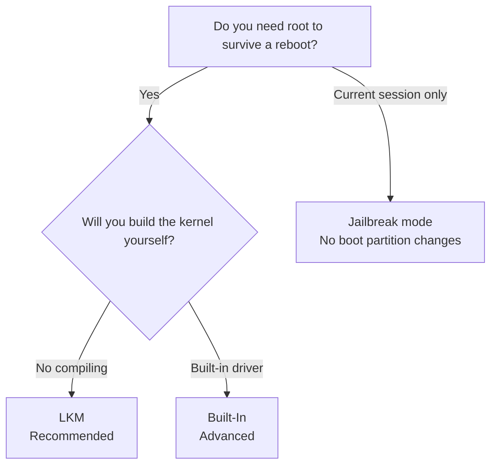

# Installation Options

<Badge text="Choose a method first" type="warning" /> <Badge text="Do not mix root solutions" type="danger" />

Installing the FinaSU Manager APK is not the same as installing the driver. Persistent root must be written into the boot chain: LKM modifies the ramdisk, Built-In modifies the kernel, and Jailbreak mode loads the driver after the system boots. Pick the right method first, then prepare images and flashing tools.

::: danger Prepare Bootloop Rescue Before You Start

Before you begin, read [Bootloop Rescue](/en/guide/rescue-bootloop/) in full. Keep at least the stock boot image that exactly matches the current device model, system version and slot, and confirm the computer can use `fastboot` or the matching official flashing tool. Do not wait until something breaks to look for the image.

:::

::: tip Already Rooted?

If the device is already rooted by Magisk, KernelSU or one of its forks, or by APatch/KernelPatch, do not stack FinaSU on top of the old boot image. Read the matching switching guide first:

- [Switching from Magisk](/en/guide/switch/magisk/)
- [Switching from KernelSU](/en/guide/switch/kernelsu/)
- [Switching from APatch](/en/guide/switch/apatch/)

:::

## Method Menu

::: table Choose Your Installation Method

| Category | What it solves | Modifies the boot partition | Who it suits |
| --- | --- | --- | --- |
| **Method overview** | Decide the partition, risk and installation route first | No | First-time install |
| [LKM](/en/guide/install/lkm/) | Puts `kernelsu.ko` into the ramdisk | Yes, usually `boot` or `init_boot` | Most users |
| [Built-In](/en/guide/install/built-in/) | Builds the driver directly into the Linux kernel | Yes, usually `boot` | Users who build their own kernel |
| [Jailbreak Mode](/en/guide/install/jailbreak/) | Loads the driver after boot without modifying the boot partition | No | Devices that cannot or should not modify the boot partition |

:::

::: warning Pick Exactly One Method

Do not keep LKM, a built-in driver and another root solution on the same system. Remove the old driver and boot chain modifications before switching methods.

:::

::: tip Terminology

This page uses "flash back" for restoring a **stock image** to a partition and "flash" for writing a **patched or newly built image** to a partition. "Flash back the stock boot" means recovery; "flash the patched image" means installation.

:::

## Know the Boot Partitions First

At boot, the bootloader loads the boot image first, then starts the Linux kernel and the first userspace program, `init`. FinaSU must step in at a very early stage, so a persistent install writes one image in the boot chain.

::: table Boot Partitions

| Partition | Main contents | Relation to FinaSU |
| --- | --- | --- |
| `boot` | Linux kernel; on some devices the generic ramdisk as well | Built-In modifies the kernel; without `init_boot`, LKM modifies the ramdisk here |
| `init_boot` | A separate generic ramdisk on some newer devices | When it exists and the KMI is not `android12-*`, LKM usually modifies it |
| `vendor_boot` | Vendor boot resources and ramdisk | Used on a few devices; follow what the Manager shows |

:::

One-line summary: ==Built-In replaces the kernel, LKM changes the ramdisk, and Jailbreak mode writes no boot partition==.

::: important Not Every Device Has `init_boot`

`init_boot` is common on some GKI devices that shipped with Android 13 or later. It is normal for a device not to have this partition; do not flash an `init_boot` out of nowhere to "complete the partitions". The partition the Manager identifies is authoritative.

:::

## How to Choose

- **Most users should choose LKM**: it does not replace the Linux kernel, so installation and recovery are more direct.
- **Choose Built-In when you need a built-in driver, full source-level SUSFS integration or your own kernel**: it requires rebuilding the complete kernel. If only SUSFS is missing, you can also consider the less capable SUSFS-LKM.
- **Choose Jailbreak mode when you cannot or do not want to modify the boot partition**: root is lost after a reboot, so it is not a persistent install.

## Before You Install

1. Confirm the device model, Android build, kernel version and KMI. A nearby system version does not replace a KMI match.
2. Prepare the complete OTA or factory firmware that exactly matches the current system, and locate its `boot`, `init_boot` or `vendor_boot` image in advance.
3. Unlock the bootloader, install a working Android USB driver, and confirm the computer can run `fastboot devices`.
4. Remove old root solutions such as Magisk, KernelSU or its forks, and APatch/KernelPatch first, so several solutions do not take over the boot chain at once.
5. Keep enough battery charge; do not cut power during installation and the first boot, and do not run a system OTA at the same time.
6. Read [Bootloop Rescue](/en/guide/rescue-bootloop/) again before you start, and make sure you know which partition and which slot you would need to restore.

## Next Steps

- [LKM installation](/en/guide/install/lkm/): selecting a file, downloading an image, direct install, the inactive slot, local LKM files and AnyKernel3.
- [Built-In installation](/en/guide/install/built-in/): cleaning up old integrations, compiling the kernel, flashing a complete kernel.
- [Jailbreak mode installation](/en/guide/install/jailbreak/): CVE privilege escalation, dynamic escalation tools and the limits of the home screen Jailbreak button.
- Switching from another solution: [Magisk](/en/guide/switch/magisk/), [KernelSU](/en/guide/switch/kernelsu/), [APatch](/en/guide/switch/apatch/).

*[LKM]: Loadable Kernel Module
*[KMI]: Kernel Module Interface, the Android kernel module interface version
*[GKI]: Generic Kernel Image
*[OTA]: Over-The-Air system update
*[AVB]: Android Verified Boot
