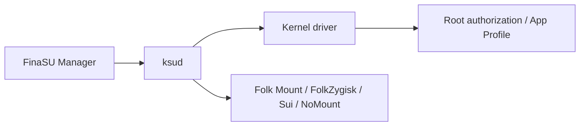

**Welcome to FinaSU!**

==FinaSU== is a kernel-level ROOT manager built on [KernelSU](https://github.com/tiann/KernelSU). It keeps kernel-side authorization, App Profile and the module system, and brings the common engines, themes and day-to-day management into one interface.

FinaSU does not require every user to accept the same interface. Whether you prefer a minimal layout or dynamic backgrounds, or need Zygisk, Sui, module mounting and system-level management, you can configure all of it in the same Manager.

## Runtime Structure

The Manager handles operation, `ksud` handles userspace execution, and the kernel driver makes the final authorization and policy decisions.

## Core Features

<CardGrid :cols="{ sm: 1, md: 2, lg: 2 }">
  <Card title="Kernel-level Root" icon="ri:shield-check-line">
    <ul>
      <li><strong>Root is decided by the kernel</strong>: <code>su</code>, the allowlist and App Profile do not rely on the Manager faking them.</li>
      <li><strong>Three installation methods</strong>: LKM is recommended, Built-In is advanced, and Jailbreak mode only lasts for the current boot session.</li>
    </ul>
  </Card>
  <Card title="Built-in Capabilities" icon="ri:apps-2-line">
    <ul>
      <li>Folk Mount, FolkZygisk, Sui and NoMount ship with FinaSU and are managed by <code>ksud</code>.</li>
      <li>Sui depends on Zygisk; compatible external providers also work, but FinaSU cannot verify their injection result.</li>
    </ul>
  </Card>
  <Card title="Highly Customizable" icon="ri:palette-line">
    <ul>
      <li>5 home layouts, 15 theme color sets, plus images, video, fonts, icons, music, sound effects and vibration.</li>
      <li>Supports <code>.fpt</code> theme import and export, and an online theme store.</li>
    </ul>
  </Card>
  <Card title="Modules and Maintenance" icon="ri:tools-line">
    <ul>
      <li>Supports systemless modules, WebUI, Metamodule and Lua plugins, and can fetch from multiple module sources.</li>
      <li>Can back up authorization, modules and the boot partition; SUSFS requires external kernel integration or a matching SUSFS-LKM.</li>
    </ul>
  </Card>
</CardGrid>

If you could give the project a star, that would be a great encouragement.

<RepoCard repo="LyraVoid/FinaSU" />

::: tip
If you want to talk about FinaSU, join:

- Telegram: [FinaSU](https://t.me/FinaSU)

:::
