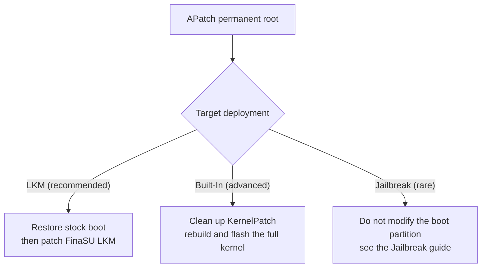

# APatch

<Badge text="Kernel patch" type="danger" /> <Badge text="Restore boot first" type="warning" />

::: important First tell the three KernelPatch Managers apart

There are currently three common KernelPatch Managers: **APatch**, **FolkPatch** and **Aster**. All three use KernelPatch as the kernel foundation; they differ mainly in the Manager interface, the module ecosystem and additional features. The word "APatch" in this article refers to all three; if you use FolkPatch or Aster, the kernel cleanup and switching approach is the same, but the entry names in the interface may differ.

**FolkPatch is not FinaSU**. FolkPatch is a KernelPatch Manager, while FinaSU is a KernelSU-family solution; the names are similar, but the kernel foundation, Manager trust and switching process are all different.

:::

All three Managers provide root by modifying the Linux kernel image through KernelPatch, and FinaSU cannot take over a running KernelPatch kernel. Users of these Managers usually already have permanent root, so switching to **FinaSU LKM** is recommended; choose **FinaSU Built-In** when a built-in driver is needed; consider Jailbreak only when the boot partition cannot or should not be modified permanently.

::: danger APatch modifies the kernel, not just the ramdisk

APatch's KernelPatch is usually written into the kernel image of `boot`. Restoring only `init_boot` does not remove it; conversely, restoring only the APatch boot image does not turn the device into FinaSU automatically. When switching, you must first return to a kernel state that does not contain APatch.

:::

::: tip Shortest route

Back up → restore the stock `boot` → reboot and confirm there is no root → install FinaSU → patch with the stock `init_boot` (when present) or `boot` → flash the same partition → reboot and verify **LKM**.

:::

## First confirm the boot partition

APatch can basically only patch the kernel image of `boot`. Even when the device has a separate `init_boot`, the APatch patch is usually not there; when switching, restore at least the stock `boot`. If `init_boot` was also patched by another root solution, restore it as well.

::: table Where APatch makes changes and what to restore

| Current situation | Where APatch made changes | Flash back when restoring |
| --- | --- | --- |
| Standard APatch installation | kernel of `boot` | stock `boot` |
| `init_boot` was also patched by another solution | ramdisk of `init_boot` | stock `init_boot` |
| Unsure | possibly several boot partitions | stock `boot` and `init_boot` (when present) |
| A/B device | current slot | the matching partition of the current slot |

:::

::: warning Do not restore only init_boot

APatch's core modification is inside the Linux kernel. Flashing only `init_boot` keeps the APatch kernel patch, so the device may still have root or keep conflicting with FinaSU. A standard APatch switch requires restoring at least the stock `boot`.

:::

### Restore the stock partition

Prefer the APatch restore stock image / remove kernel patch function, and keep the APatch app until FinaSU verification is complete. If no stock image restore capability is available, flash back manually with a stock image that exactly matches the current system version, kernel version and slot. On A/B devices, handle only the current slot and keep the other bootable slot intact.

::: code-tabs

@tab Non-A/B device

```sh
# kernel patches for APatch usually live here
fastboot flash boot boot.img

# init_boot was modified as well
fastboot flash init_boot init_boot.img
```

@tab A/B device

```sh
fastboot getvar current-slot

# current slot is a; if it is b, replace _a with _b
fastboot flash boot_a boot.img
fastboot flash init_boot_a init_boot.img
```

:::

::: collapse Unsure which partition APatch modified

1. Open the uninstall/restore page in APatch and check which image it is about to restore.
2. Run `adb shell getprop ro.boot.slot_suffix` to confirm the current slot; an empty output means the device is not an A/B device.
3. If you are still unsure, flash back the stock `boot` matching the current system; if the device has `init_boot`, flash the stock `init_boot` as well.
4. After rebooting, confirm APatch no longer provides root, then continue installing FinaSU.

:::

## Switching paths



## Path one: APatch to FinaSU LKM (recommended)

LKM puts FinaSU's `kernelsu.ko` into the ramdisk of the boot image and does not replace the Linux kernel. Because the APatch patch is in the kernel itself, the stock `boot` must be restored first; otherwise APatch and FinaSU exist at the same time.

::: steps

1. **Back up**

   Back up `boot`, `init_boot` (when present) for the current slot, the configuration in `/data/adb/ap` that you still need, and the modules to migrate. Record the system version, KMI and slot.

2. **Remove the APatch kernel patch**

   Use the APatch restore stock image / remove kernel patch function, or flash the stock `boot` matching the current system back to the current slot. Uninstalling only the APatch app does not remove the kernel patch; keep the app until FinaSU verification is complete.

3. **Reboot and confirm root is removed**

   After rebooting, confirm APatch can no longer grant. If root still exists, the `boot` was not really restored, or the device has another root solution.

4. **Install the FinaSU Manager**

   Install the official FinaSU APK. The device has no root at this point, which is a normal intermediate state.

5. **Patch the stock boot image**

   In FinaSU, choose **Install & Flash → Select a file and patch** and use the stock `boot` or `init_boot`. The Manager selects the LKM target partition based on the device:

   - Has `init_boot` and the KMI is not `android12-*`: usually patch `init_boot`.
   - No `init_boot`, or the KMI is `android12-*`: patch `boot`.
   - Use the partition shown on the install page.

6. **Flash the matching partition**

   Flash the patched image into the same partition and reboot. Do not cross-flash `boot` and `init_boot`.

7. **Verify and clean up**

   The home screen should show **LKM**, with root and modules working. Once confirmed, uninstall APatch and clean up `/data/adb/ap` when it is no longer needed; do not delete the whole `/data/adb`.

:::

::: timeline APatch to FinaSU LKM

- Back up boot/init_boot, APatch configuration and modules
  time=Prepare type=tip

- Restore the stock boot and remove KernelPatch
  time=Restore

- Install FinaSU and patch the stock image
  time=Replace

- Flash the matching partition and reboot
  time=Take effect

- Verify LKM, root and modules
  time=Wrap up type=success

:::

::: warning Do not keep the APatch kernel patch

FinaSU LKM only changes the ramdisk and cannot overwrite the APatch patch inside the `boot` kernel. Installing FinaSU directly while still using the APatch kernel only gives you two root solutions.

:::

## Path two: APatch to FinaSU Built-In (advanced)

A FinaSU Built-In build also requires kernel modification, but it cannot be stacked on a kernel that APatch has already patched. The correct approach is to rebuild from clean kernel sources.

::: steps

1. **Return to a clean kernel**

   Flash back the stock `boot`, or start from the original kernel sources matching the device system. Confirm that APatch's KernelPatch, hooks and init entry points have all been removed.

2. **Integrate FinaSU**

   Follow [Kernel Integration](/en/developer/builtin-integration/) to run `kernel/setup.sh`, enable `CONFIG_KSU=y`, and compile in the certificate matching the target Manager.

3. **Build and check**

   Build with the matching compiler and configuration, passing `KSU_REQUIRE_PREINIT=1` explicitly. Check the version, KMI and certificate information in the log.

4. **Flash the full kernel**

   Flash the full kernel image into `boot`, rather than putting the LKM into the ramdisk. `init_boot` is not the target of a built-in driver; only touch it when the kernel package explicitly requires it.

5. **Verify Built-In**

   After rebooting, the home screen should show **Built-In**, with the Manager identity, root and modules working.

:::

::: danger Do not stack FinaSU on an APatch kernel

APatch's KernelPatch and the FinaSU built-in driver both take over the kernel entry points. When both patches exist, conflicts are harder to diagnose than with LKM and may prevent the device from booting at all.

:::

## Path three: APatch to Jailbreak (brief)

APatch users usually already have permanent root and do not need Jailbreak. Consider Jailbreak mode only when the boot partition cannot or should not be modified, and the device already has a ready privilege escalation entry point.

Jailbreak is only valid for the current boot session; root is lost after a normal reboot. For CVE escalation, dynamic escalation tools and how to replace `ksud` for fixed tools, see path four in [Switching from KernelSU](/en/guide/switch/kernelsu/).

## Data and modules

```file-tree title="APatch data locations"
/data/adb
├── ap/                       # APatch config, binaries and state
├── modules/                  # installed modules
├── ksud                      # FinaSU user-space command-line tool (file)
└── ksu/                      # FinaSU state directory
```

::: table How FinaSU handles APatch content

| Content | Kept | Recommendation |
| --- | --- | --- |
| APatch grants (legacy superkey / new signature authentication) | not migrated | grant again in FinaSU |
| `/data/adb/ap` | no longer needed | clean it up after FinaSU is confirmed working |
| Module files | possibly kept | disable first, then verify compatibility one by one |
| APatch-specific module interfaces | compatibility not guaranteed | modules that depend on APatch/KernelPatch interfaces must be replaced |
| KernelPatch kernel patch | must be removed | restore the stock kernel first |

:::

::: info Legacy and new versions authenticate differently

Older APatch versions use a superkey for authorization; newer versions use signature authentication similar to FinaSU. FolkPatch and Aster also keep their own authorization records. Signature authentication only means the Manager must be trusted by the kernel; it does not mean those authorization records can be migrated directly. Apps must still be granted again in FinaSU after switching.

:::

::: warning Do not delete the whole `/data/adb`

This directory also holds modules, grants and FinaSU state. When switching, clean only the directories or files that are explicitly APatch-specific; do not use "clear data" as a substitute for uninstalling.

:::

## Post-switch checks

::: steps

1. **Confirm the run mode**

   The home screen should show **LKM** or **Built-In**, consistent with the path you chose.

2. **Confirm the Manager identity**

   FinaSU should be able to read the version, granted apps and managed modules. If it shows not installed or cannot grant, check whether the signature and UAPI match.

3. **Test root**

   Request root from a test app and confirm the grant dialog and `su` work.

4. **Enable modules one by one**

   Enable one module first and reboot to confirm mounting and scripts work. Do not restore all APatch modules at once.

5. **Verify the kernel state**

   A Built-In build should show **Built-In**; LKM should show **LKM**. Neither should still show APatch's authorization interface.

:::

## Troubleshooting

::: collapse accordion

- **Root still exists after flashing boot back**

  Check whether the wrong slot or partition was flashed, or whether the device still has another root solution. APatch's kernel patch disappears only after `boot` is really replaced.

- **Flashing only init_boot has no effect**

  APatch's core patch is usually in the kernel `boot`. Restoring only `init_boot` does not remove KernelPatch.

- **The device does not boot after an update**

  Stop rebooting repeatedly and restore the stock boot image as described in [Bootloop Rescue](/en/guide/rescue-bootloop/). Common causes are a kernel version, partition or slot mismatch.

- **FinaSU shows not installed**

  Check whether the boot image was flashed to the current slot, whether the KMI matches, and whether the Manager signature is trusted by the kernel.

- **Modules are not mounted**

  Confirm the module supports FinaSU's mount method; modules that depend on APatch/KernelPatch-specific interfaces may not work.

- **APatch authorization data is still visible**

  Older APatch versions use a superkey and newer versions use signature authentication similar to FinaSU; neither record is equivalent to FinaSU, so apps must still be granted again in FinaSU after switching.

:::

## FAQ

::: chat title="Switching from APatch Q&A"
{User}
Can APatch and FinaSU coexist?

{.}
No. Both take over kernel root, so the APatch kernel patch must be removed before installing FinaSU.

{User}
Is uninstalling the APatch app enough?

{.}
No. APatch's KernelPatch is inside the kernel image, and uninstalling the app does not remove it; you must restore the stock `boot` or flash a clean kernel again.

{User}
Can I keep the APatch kernel and install FinaSU LKM directly?

{.}
No. LKM only changes the ramdisk, the APatch patch is still in the kernel, and the two root solutions would conflict.

{User}
Do APatch modules still work?

{.}
The module files may still be there, but modules that depend on APatch/KernelPatch interfaces are not guaranteed to be compatible. Disable them first and verify one by one.

{User}
Do I need to wipe `/data/adb`?

{.}
No, and it is not recommended. Clean only the directories or files that are explicitly APatch-specific, and keep the modules and data FinaSU needs.

{User}
Do APatch users need Jailbreak?

{.}
Usually not. Consider Jailbreak only when the boot partition cannot or should not be modified permanently, and root is lost after a reboot.
:::

## Related pages

- [Install & Flash](/en/guide/install/)
- [Switching from KernelSU](/en/guide/switch/kernelsu/)
- [Switching from Magisk](/en/guide/switch/magisk/)
- [Kernel Integration](/en/developer/builtin-integration/)
- [Bootloop Rescue](/en/guide/rescue-bootloop/)

*[LKM]: Loadable Kernel Module, a loadable kernel module
*[KMI]: Kernel Module Interface, the Android kernel module interface version
*[UAPI]: The stable interface between the kernel and userspace
*[AVB]: Android Verified Boot, Android boot verification
*[GKI]: Generic Kernel Image, the Android generic kernel image
