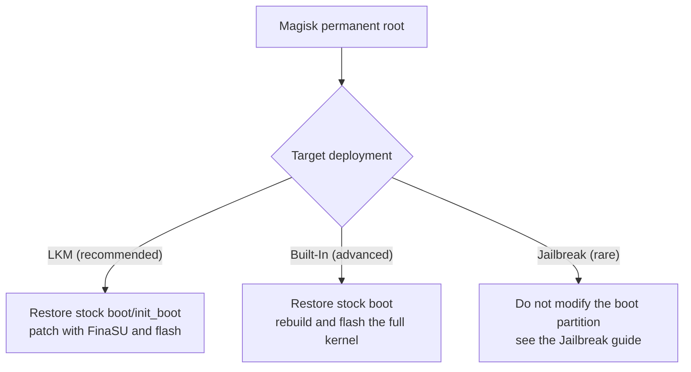

# Magisk

<Badge text="Permanent root" type="tip" /> <Badge text="Restore the stock image first" type="danger" />

Magisk and FinaSU both take over the boot chain and module injection, so they cannot coexist. Magisk users usually already have permanent root, so the most common route is switching to **FinaSU LKM**; the Built-In kernel suits users willing to compile their own kernel; consider Jailbreak only when the boot partition cannot or should not be modified permanently.

::: danger FinaSU does not take over a Magisk-patched image directly

FinaSU boot image patching rejects a ramdisk that Magisk has already patched and reports `Cannot work with Magisk patched image`. When switching, you must first restore the stock boot image that matches the current system; FinaSU cannot be stacked directly on top of the Magisk patch.

:::

::: tip Shortest route

Back up → restore the stock image in Magisk → reboot and confirm there is no root → install FinaSU → patch with the stock `boot` or `init_boot` → flash the same partition → reboot and verify **LKM**.

:::

## First confirm which partition Magisk modified

Magisk provides root by patching the ramdisk of the boot image. When the device has a separate `init_boot`, the patch usually lands in `init_boot`; without `init_boot`, or with an older layout, it lands in `boot`.

::: table Where Magisk makes changes and what to restore

| Current situation | Where Magisk made changes | Flash back when restoring |
| --- | --- | --- |
| Device has no `init_boot` | ramdisk of `boot` | stock `boot` |
| Device has `init_boot` and Magisk patched it | ramdisk of `init_boot` | stock `init_boot` |
| Unsure what Magisk changed | possibly both | stock `boot` and `init_boot` (when present) |
| A/B device | current slot | the matching partition of the current slot |
| Magisk patched `vendor_boot` (a few devices) | ramdisk of `vendor_boot` | stock `vendor_boot` |

:::

::: warning Do not flash the wrong partition

`boot.img` cannot be flashed into `init_boot`, and the reverse is also true. Flashing only the other partition does not remove Magisk changes and may leave the device unable to boot. Use the partition layout shown by Magisk or the FinaSU install page.

:::

### Restore the stock partition

Prefer the Magisk restore stock image action, and keep the Magisk app until FinaSU verification is complete. If restoring is no longer possible, flash back manually with a stock image that exactly matches the current system. On A/B devices, handle only the current slot and keep the other bootable slot intact.

::: code-tabs

@tab Non-A/B device

```sh
# devices without init_boot
fastboot flash boot boot.img

# has init_boot and Magisk patched it
fastboot flash init_boot init_boot.img
```

@tab A/B device

```sh
fastboot getvar current-slot

# current slot is a; if it is b, replace _a with _b
fastboot flash boot_a boot.img
fastboot flash init_boot_a init_boot.img
```

:::

::: collapse Unsure which partition to flash

1. Open the uninstall/restore page in Magisk and check which partition it is about to restore.
2. Run `adb shell getprop ro.boot.slot_suffix` to confirm the current slot; an empty output means the device is not an A/B device.
3. If you are still unsure, flash back the stock `boot` matching the current system; if the device has `init_boot`, flash the stock `init_boot` as well.
4. After flashing, reboot and confirm Magisk can no longer provide root before continuing with the FinaSU installation.

:::

## Switching paths



## Path one: Magisk to FinaSU LKM (recommended)

LKM does not replace the Linux kernel; it only puts FinaSU's `kernelsu.ko` into the ramdisk of the boot image. It suits the vast majority of Magisk users and is also the permanent root option with the lowest migration cost.

::: steps

1. **Back up**

   Back up `boot`, `init_boot` (when present), `/data/adb/modules` and the module configuration you want to keep for the current slot. Record the system version, KMI, slot and the partition Magisk actually modified.

2. **Restore the stock boot image**

   Run the Magisk restore stock image action, or flash back the stock `boot` or `init_boot` matching the current system with `fastboot`. Do not keep the Magisk-patched image; if a full uninstall is the only option, confirm first that the stock image has been backed up.

3. **Reboot and confirm root is removed**

   After rebooting, confirm Magisk can no longer grant root. If root still exists, the restored partition or slot is wrong; resolve that before continuing.

4. **Install the FinaSU Manager**

   Install the official FinaSU APK. The device has no root at this point, which is a normal intermediate state.

5. **Patch the stock image**

   In FinaSU, choose **Install & Flash → Select a file and patch** and use the stock `boot` or `init_boot`. The Manager selects the LKM target partition automatically based on the device:

   - Device has `init_boot` and the KMI is not `android12-*`: usually patch `init_boot`.
   - No `init_boot`, or the KMI is `android12-*`: patch `boot`.
   - Use the partition shown on the install page.

6. **Flash the matching partition**

   Flash the patched image into the same partition and reboot. A patched `init_boot` cannot be flashed into `boot`, and the reverse is also true.

7. **Verify and clean up**

   The home screen should show **LKM**, with root and modules working. Once confirmed, uninstall the Magisk app and clean up `/data/adb/magisk` as needed; do not delete the whole `/data/adb`.

:::

::: timeline Magisk to FinaSU LKM

- Back up boot/init_boot and modules
  time=Prepare type=tip

- Uninstall Magisk and flash back the stock image
  time=Restore

- Install FinaSU and patch the stock image
  time=Replace

- Flash the matching partition and reboot
  time=Take effect

- Verify LKM, root and modules
  time=Wrap up type=success

:::

::: tip Why you cannot flash FinaSU using Magisk root

FinaSU boot image patching checks whether the ramdisk has already been patched by Magisk and rejects it outright when detected. Even if Magisk can grant root, that check cannot be bypassed. A stock boot image is required.

:::

## Path two: Magisk to FinaSU Built-In (advanced)

A Built-In build compiles the driver into the Linux kernel and suits users who need a built-in driver or maintain the kernel themselves. It is not about putting the FinaSU module into Magisk's ramdisk.

::: steps

1. **Restore the stock boot**

   The Magisk ramdisk patch must be removed. Flash back the stock `boot` matching the current system and confirm that root is no longer provided by Magisk.

2. **Prepare the kernel sources**

   Use kernel sources matching the device system version, and first remove boot modifications made by Magisk or another root solution.

3. **Integrate FinaSU and build**

   Enable `CONFIG_KSU=y` as described in [Kernel Integration](/en/developer/builtin-integration/), and compile in the certificate matching the FinaSU Manager.

4. **Flash the full kernel**

   Flash the full kernel image into `boot`, rather than putting the LKM into the ramdisk. `init_boot` is not the target of a built-in driver; only touch it when the kernel package explicitly requires it.

5. **Verify Built-In**

   After rebooting, the home screen should show **Built-In**, with the Manager identity, root and modules working.

:::

::: danger Do not stack a Built-In kernel on top of Magisk

When Magisk ramdisk modifications, the FinaSU built-in driver and other root solutions exist at the same time, they compete for the boot flow. Restore the stock `boot` before flashing the FinaSU kernel.

:::

## Path three: Magisk to Jailbreak (brief)

Magisk users usually already have permanent root and do not need Jailbreak. Consider Jailbreak mode only when the boot partition cannot or should not be modified, and the device already has a ready privilege escalation entry point.

Jailbreak is only valid for the current boot session; root is lost after a normal reboot. For how to switch with a fixed-manager Jailbreak tool, see path four in [Switching from KernelSU](/en/guide/switch/kernelsu/); CVE escalation and manual `ksud` replacement are described there as well.

## Modules, Zygisk and data

::: table How FinaSU handles Magisk content

| Content | Kept | Recommendation |
| --- | --- | --- |
| `/data/adb/modules` | files are usually kept | disable first, then enable compatible modules one by one |
| Magisk module scripts | compatibility not guaranteed | scripts that depend on interfaces such as `magisk` and `magiskpolicy` may fail |
| Zygisk modules | a Zygisk provider is required | use the built-in [YukiZygisk](/en/builtin/yukizygisk/) or another compatible provider, and keep only one |
| Magisk DenyList / Shamiko | cannot be used the same way | switch to the FinaSU hiding and App Profile configuration |
| `/data/adb/magisk` | no longer needed | clean it up after FinaSU is confirmed working |
| Magisk root grants | not migrated | grant again in FinaSU |

:::

::: warning Do not copy Magisk state files directly

`magisk.db`, the DenyList configuration and Magisk's module database are not in FinaSU's format. Copying them does not restore root grants and may cause conflicts instead. Migrate module files only, and reconfigure them in the new Manager.

:::

## Post-switch checks

::: steps

1. **Confirm the run mode**

   The home screen should show **LKM** or **Built-In**, consistent with the path you chose.

2. **Confirm the Manager identity**

   FinaSU should be able to read the version, granted apps and managed modules. If it shows not installed or cannot grant, check whether the signature and UAPI match.

3. **Test root**

   Request root from a test app and confirm the grant dialog and `su` work.

4. **Enable modules one by one**

   Enable one module first and reboot to confirm mounting and scripts work. Do not restore all Magisk modules at once.

5. **Verify Zygisk**

   When using Zygisk modules, confirm there is only one Zygisk provider and check the status of YukiZygisk or the external provider.

:::

## Troubleshooting

::: collapse accordion

- **`Cannot work with Magisk patched image` is reported**

  This means the patch input is still a Magisk-patched image. Restore the stock image in Magisk first, or flash back the stock `boot` / `init_boot` matching the system version.

- **Root still exists after flashing back**

  Check whether the wrong partition or slot was flashed, or whether the device still has another root solution. Do not continue installing FinaSU while two root solutions coexist.

- **The device does not boot after an update**

  Stop rebooting repeatedly and restore the stock boot image as described in [Bootloop Rescue](/en/guide/rescue-bootloop/). Common causes are a partition, slot, KMI or kernel version mismatch.

- **Modules are not mounted**

  Confirm the module supports FinaSU's mount method and check the provider used by Folk Mount. Modules that depend on Magisk-specific interfaces may not work.

- **Zygisk modules do not work**

  Confirm YukiZygisk is enabled, or keep only one compatible external Zygisk provider; switching providers usually requires a reboot.

- **FinaSU shows not installed**

  Check whether the boot image was flashed to the current slot, whether the KMI matches, and whether the Manager signature is trusted by the kernel.

:::

## FAQ

::: chat title="Switching from Magisk Q&A"
{User}
Can I keep Magisk and then install FinaSU?

{.}
No. The two boot chain modifications and root management would conflict. Restore the Magisk-patched boot image before switching.

{User}
Can I grant FinaSU root from Magisk and then install directly?

{.}
FinaSU cannot patch an image that Magisk has already patched; the tool rejects it. Restore the stock `boot` or `init_boot` first, then patch with FinaSU.

{User}
Do Magisk modules still work?

{.}
The module files may still be there, but compatibility is not guaranteed. Modules that depend on Magisk-specific interfaces or the Zygisk implementation must be replaced or reconfigured.

{User}
What about Zygisk modules?

{.}
Use the YukiZygisk built into FinaSU, or one compatible external Zygisk provider; only one active implementation may exist.

{User}
Should I uninstall the Magisk app first?

{.}
Restore the stock boot image first and confirm root is removed. After FinaSU verifies normally, uninstall the Magisk app and clean up `/data/adb/magisk`.

{User}
Do Magisk users need Jailbreak?

{.}
Usually not. Consider Jailbreak only when the boot partition cannot or should not be modified permanently, and root is lost after a reboot.
:::

## Related pages

- [Install & Flash](/en/guide/install/)
- [Switching from KernelSU](/en/guide/switch/kernelsu/)
- [Kernel Integration](/en/developer/builtin-integration/)
- [Bootloop Rescue](/en/guide/rescue-bootloop/)
- [FAQ](/en/guide/faq/)

*[LKM]: Loadable Kernel Module, a loadable kernel module
*[KMI]: Kernel Module Interface, the Android kernel module interface version
*[UAPI]: The stable interface between the kernel and userspace
*[AVB]: Android Verified Boot, Android boot verification
*[GKI]: Generic Kernel Image, the Android generic kernel image
