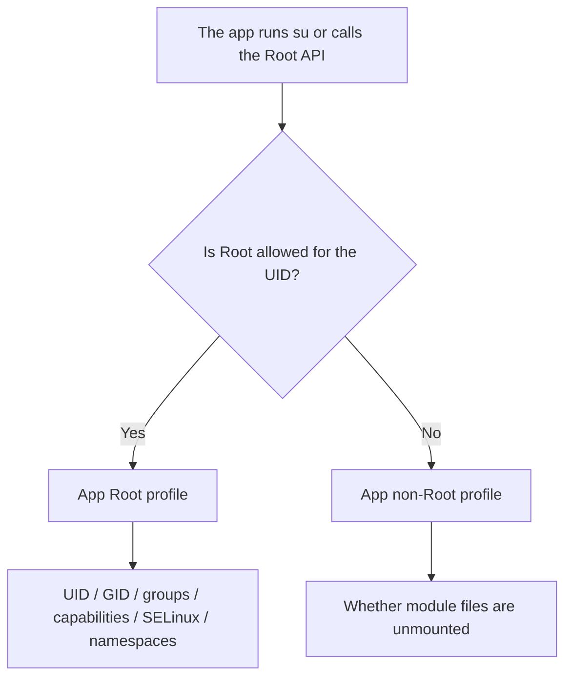

# App Profile

<Badge text="Applies per UID" type="tip" /> <Badge text="Permission boundary" type="warning" />

An App Profile is the complete app policy for one UID. It decides both the identity and permissions an app uses once it has Root, and whether the app sees files injected by modules while it does not have Root.

::: tip How to get there

Manager → **Superuser** → tap an app or UID group. Toggle Root authorization at the top of the detail page and select the profile mode below.

:::

## Page Layout

The app card at the top shows the app name, package name, version, UID, and any multi-user or shared UID marker. The menu at the top right also offers:

- **Launch**: open the target app;
- **Force stop**: end the target app process;
- **Restart**: stop and then start the target app.

These actions only make the app re-read its Root and file visibility state. They do not change authorization.

::: important The Root switch lives only here

The Superuser list is for finding apps and checking status. To actually change Root authorization, open the App Profile and toggle the "Superuser" switch. Turning authorization off does not delete app data.

:::

## Two Profiles

One app has two sets of policy, Root and non-Root. The Manager shows the matching configuration based on the Root switch.

### Root Profile Modes

:::: table Root profile

| Mode | Behavior | Who it suits |
| --- | --- | --- |
| **Default** | Uses the kernel default Root profile and stores no app-level custom parameters. | Ordinary users and most apps that need ordinary Root. |
| **Template** | Copies the Root profile fields as they are at that moment and records the template ID. Later changes to the template do not rewrite the saved app policy. | When you need to reuse one fixed set of permission settings. |
| **Custom** | Stores one set of parameters for this UID only. | People who fully understand UID, GID, capabilities, SELinux, and mount namespaces. |

::::

::: tip Start with Default or a preset template

When you do not know the fields, ==keep Default or choose a preset template that fits the use case==. There is no need to change UID, SELinux, or capabilities just to give an app Root.

:::

### Non-Root Profile Modes

The non-Root profile has only two modes, Default and Custom:

- **Default**: follows the default non-Root policy of the current kernel;
- **Custom**: decides separately whether files injected by modules are unmounted for this UID.

With "Unmount modules" on, the app sees the system files as they were before modules injected anything. With it off, the app can see module files. Templates describe only the Root profile and do not control the non-Root "Unmount modules" option.

## Custom Root Profile Fields

:::: field-group

::: field UID
@type `Integer`
The user ID the Root process uses. The default is `0`, which means root. Do not change it unless you specifically need to imitate another identity.
:::

::: field GID
@type `Integer`
The primary group ID the Root process uses. The default is `0`. A wrong GID can make file access and process group behavior differ from what you expect.
:::

::: field Groups
@type `Up to 32 entries`
Supplementary groups. Selecting `root`, `system`, `shell`, or a specific group adds the Root process to that group. More groups do not mean better compatibility. Choose according to what the app actually needs.
:::

::: field Capabilities
@type `Capability set`
The capability set passed to the Root process. Removing capabilities such as `SYS_ADMIN`, `DAC_OVERRIDE`, or `NET_ADMIN` can break Root-dependent features outright.
:::

::: field Mount namespace
@type `Inherit / Global / Isolated`
`Inherit` keeps the namespace of the process that started the request. `Global` switches to the global mount view. `Isolated` creates a private mount namespace. Unless module visibility needs something special, use Inherit.
:::

::: field Flags
@type `NO_NEW_PRIVS`
Prevents this Root context from gaining further privileges through KernelSU. Ordinary apps usually do not need it. Use it only when debugging a restricted Root environment.
:::

::: field SELinux
@type `Context and rules`
Sets the SELinux domain and extra rules for the Root process. The fields validate their format. A wrong domain or rule can make the app be denied access, or can widen its permissions. Do not replace the default values casually.
:::

::::

::: danger Custom does not mean more is better

A custom profile changes real kernel credentials. A wrong combination can give an app more capability than you intended, or can make Root features such as file managers, terminals, and backup stop working entirely. Verify with a test app that does not matter before you save.

:::

## Templates

The template entry point is **Settings → General → App Profile Templates**, not the word "Template" inside the app detail page.

A template usually contains an ID, a name, a description, and a set of Root profile parameters. When you select Template mode, the Manager copies the template fields as they are at that moment to the UID and records the template ID:

- templates are not inherited live; editing a template does not automatically update policy already saved for a UID;
- to make an app use new template values, select and apply the template again;
- deleting a template does not clear the fields already copied to the kernel for an app, but it removes the source used for later reapplication;
- the Manager does not list every app using the template ID in the template editor, so record the scope yourself before editing;
- importing a template means accepting every UID, group, capability, and SELinux setting inside it;
- ordinary users should use the presets already loaded on the page rather than creating their own.

See [App Profile Templates](/en/setting/profile-template/) for the full field reference.

## Dynamic Manager

The Dynamic Manager switch appears only when all of the following are true:

- the current kernel supports Dynamic Manager;
- the current entry is not a special UID;
- the app is a preset manager, is already authorized, or the experimental "Allow any app to become a Dynamic Manager" option is enabled in Settings.

When you turn the switch on, the Manager extracts the signing certificate size and SHA-256 of the target APK, registers the signature with the kernel, and authorizes this UID. When you turn it off:

- new kernels that support an app ID authorization table revoke only that UID's management permission and keep the registered signature;
- older kernels without separate revocation delete the whole signature registration.

::: danger Dynamic Manager is highly privileged

A Dynamic Manager can manage kernel Root. Do not authorize it just because the package name looks the same. After an upgrade, a re-sign, or a switch to a different build, verify it again. See [Dynamic Manager](/en/manager/dynamic-manager/).

:::

## Shared UID

Several packages can share one UID. The detail page shows "Affected apps" and lists every affected entry.

- Root state is stored per UID;
- the non-Root "Unmount modules" option also applies per UID;
- custom identity, capabilities, and SELinux in the Root profile are shared by the whole UID as well;
- authorizing any one of the packages also gives the other packages with the same UID the same Root eligibility.

## Verify After Changes

:::: steps

1. Save the profile and confirm the page shows no error.
2. Force stop or restart the target app from the menu at the top right.
3. Have the app run a Root-requiring operation again.
4. Check [SU Logs](/en/manager/su-log/) for the requesting UID and the result.
5. If it still fails, set the profile back to Default to verify, then restore your custom settings one at a time.

::::

## FAQ

:::: collapse accordion

- **The app is authorized, so why does it still say there is no Root?**

  Check the custom UID, GID, capabilities, SELinux domain, and namespace first. For troubleshooting, temporarily switch back to the default Root profile. Also check whether the app cached a failure from an earlier attempt.

- **Why is there no separate "denied" marker in the list?**

  The Superuser page shows the apps that can currently be enumerated and their profile state. An ordinary app that was denied can still appear in the list, just without the `ROOT` badge. The Manager does not keep a permanent "denied" badge. For actual request history, read the SU Logs.

- **Does turning off "Unmount modules" give the app Root?**

  No. It only changes file visibility in the non-Root state. Root authorization is decided separately by the "Superuser" switch at the top.

- **Can Template and Custom be used at the same time?**

  No. A Root profile is always in exactly one of three modes: Default, Template, or Custom.

- **Will every app that uses a template change automatically after I edit it?**

  No. Selecting a template already copied its fields to the UID. After editing a template, return to each App Profile that needs the update, select and apply the template again, then restart the app to verify.

::::

## Related Pages

- [Superuser](/en/manager/superuser/): find apps, UID groups, and authorization state.
- [App Profile Templates](/en/setting/profile-template/): presets, custom templates, and import/export.
- [Dynamic Manager](/en/manager/dynamic-manager/): manager trust and the difference in revocation.
- [SU Logs](/en/manager/su-log/): confirm actual requests and results.
