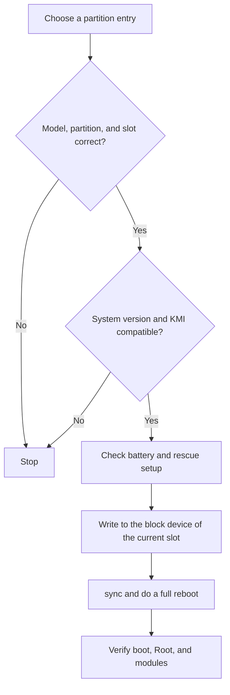

# Backup & WebDAV

<Badge text="More than authorization" type="tip" /> <Badge text="Partition restore is high risk" type="danger" />

The Manager can save the superuser list, boot partitions, and pre-flash module snapshots locally or to WebDAV. Backup configuration lives in **Settings → Backup**. This page focuses on the restore list, what a restore actually does, and the parts that are easy to misread.

::: tip How to get there

Manager → Settings → Backup. Once configured, use "Manage backups" to see local and WebDAV entries.

:::

::: important Read the authoritative instructions first

The full steps for the target switches, backup content, WebDAV fields, and "Back up now" are in [Settings → Backup](/en/setting/backup/). This page only adds the restore boundaries that matter in the Manager section.

:::

## Where Backups Are Written

### Local

Local backups are saved through the public Android Download directory:

```file-tree title="Local backup layout"
Download/
└── FinaSU/
    ├── modules/
    │   └── <module-id>/
    │       ├── <module>-installer-...zip
    │       ├── <module>-snapshot-...zip
    │       └── *.meta.json
    ├── allowlist/
    │   └── allowlist-<timestamp>.json
    └── boot/
        ├── boot-stock-<sha1>.img
        ├── init_boot-current-<sha1>.img
        └── *.meta.json
```

The `installer`, `snapshot`, `stock`, `patched`, or `current` part of a file name is an origin marker. It does not mean the content is compatible with the current device. Check the entry origin and metadata before restoring.

### WebDAV

WebDAV uses the same `modules/`, `allowlist/`, and `boot/` relative directories. When the remote path is left empty, files are written directly to the root directory given by the server address.

"Test connection" checks the current address, authentication, and basic access. It cannot guarantee that space will still be available later, that the network will not drop, or that remote files have not been changed by another client.

## How the Password Field Actually Behaves

The WebDAV password is stored encrypted in the secret store of the Manager, but the input box itself never echoes the password.

- **Leaving the password box untouched**: the saved password is kept;
- **Typing a new password**: the saved password is replaced immediately;
- **Clearing the box**: the saved password is deleted, and later connections carry no password;
- **Seeing "saved (leave empty to keep)"**: that describes the unedited state and does not mean a password you cleared on purpose is still kept.

::: warning Do not treat clearing as leaving it alone

When you want to keep the password, do not select it and delete it. Clear the box only when you really want to remove the credentials. If the server uses an app-specific password or token, update the value in the Manager as well after changing it.

:::

## Three Kinds of Backup Content

:::: table Backup content

| Content | When it is created | What a restore does |
| --- | --- | --- |
| **Modules** | Mostly after "pre-flash backup" is enabled; it archives the installer of this install or update and takes a snapshot of the installed module being replaced. | Hands the backup ZIP back to `ksud module install`; this usually takes effect after a reboot. |
| **Superuser list** | Created when "Back up now" or pre-flash backup includes this content. | Calls the kernel settings interface entry by entry to restore Root and profile data. |
| **Partitions** | Created when "Back up now" or pre-flash backup includes the matching partition. | Writes directly back to the block device of the current slot through the Root Shell. |

::::

::: important Back up now does not package every installed module

Back up now mainly saves the enabled superuser list and the selected partitions. Regular module installer archiving happens mainly in pre-flash backup, so turning on the "Modules" switch without going through a flash flow will not produce a complete module package right away.

:::

## Pre-flash Backup

With pre-flash backup enabled, installing or updating a module first tries to save according to the targets and content you enabled:

- the module ZIP about to be installed;
- a snapshot of the installed module this install replaces;
- the superuser list, if selected;
- the boot partitions, if selected.

The point of a snapshot is to leave rollback material before an overwrite, not to guarantee that everything saves successfully. Any failed target should be treated as a risk: you can continue flashing, but do not claim you have a complete rollback point.

::: tip Rehearse manually first

After configuring WebDAV for the first time, changing the remote path, or switching storage space, run "Back up now" once and confirm the entry is visible in "Manage backups". Do not discover a broken backup only when a flash fails.

:::

## Boot Partition Backup

The page lists only the partitions the Manager actually detects:

| Partition | What it usually contains | What you cannot infer from it |
| --- | --- | --- |
| `boot` | The Linux kernel; on some devices before Android 13, also the generic ramdisk. | It does not mean every device needs only `boot`. |
| `init_boot` | The generic ramdisk of some GKI devices from Android 13 onward. | There is usually no Linux kernel here. |
| `vendor_boot` | Vendor kernel modules, device tree, and vendor ramdisk. | It does not mean every vendor or device has this partition. |

On A/B devices, a restore resolves the block device of the currently active slot first. The device model, fingerprint, and file name in a backup only help identify it; they do not replace checking the slot and system version yourself.

::: danger Partition restore overwrites the block device directly

Confirm the backup comes from the same device, matches the right partition and slot, and that the system and KMI have not changed across a generation. Before restoring, ready a working computer or a Recovery rescue path; a wrong image can make the device unbootable outright.

:::

## Restore List

"Manage backups" shows local and WebDAV entries together, grouped into modules, superuser list, and partitions. Each row shows the source and the target size:

```text
Local · 128.4 MiB
WebDAV · 4.2 MiB
```

::: danger Tapping an entry performs the restore

The restore list has no extra preview step. Tapping an entry starts the restore itself; deletion asks for confirmation, but restore has no equally visible confirmation page. Read the group, source, name, and size carefully before acting.

:::

### Restoring Modules

A module entry is reinstalled into `/data/adb/modules/<id>`:

- both snapshots and original installers go through the module install flow;
- a module with the same name may be overwritten;
- scripts and file injection usually take full effect only after a reboot;
- content already loaded into the kernel or memory is not replaced automatically.

### Restoring the Superuser List

A restore applies the UIDs and profiles in the backup one by one:

- existing authorizations that are not in the backup are not removed automatically;
- after a change of UID, package name, or Android user space, old entries may no longer match the original app;
- after restoring, check Root, non-Root, template references, and SELinux configuration entry by entry;
- the operation may apply only some entries; when a failure message appears, do not assume everything succeeded.

### Restoring Partitions

The Manager first fetches the remote or local image into a temporary file, then writes it to the partition and syncs. After the restore completes, do a full reboot to verify, not just a soft reboot.



## Deleting Backups

Deleting removes the selected backup files and their metadata sidecars:

- local files are deleted from `Download/FinaSU/`;
- WebDAV files are deleted from the remote directory;
- deletion usually cannot be undone;
- do not delete remote files you do not recognize, especially in a shared directory.

## FAQ

:::: collapse accordion

- **Why can I not back up now after selecting only "Modules"?**

  Back up now requires at least the superuser list or one partition to be selected. Module archiving is mainly triggered by pre-flash backup.

- **The WebDAV test passed, so why does the backup still fail?**

  The test only verifies the current connection. Insufficient space, permission limits, a server that does not support a required method, a network drop, or a path conflict can all make the write fail.

- **Why does the app still have no Root after restoring authorizations?**

  Check whether the UID changed, whether the Root profile is enabled, whether the template still exists, and any SELinux, capability, or namespace limits.

- **The restore reported success, so why did nothing change?**

  What was restored is the module on disk, so a reboot is needed. The loader and the mount provider must also work properly.

- **Can I soft reboot after restoring a partition?**

  Not recommended. A partition-level change needs the full boot flow to read the image again.

::::

## Related Pages

- [Settings → Backup](/en/setting/backup/): full configuration, back up now, and WebDAV operations.
- [Module Management](/en/manager/module/): installing, enabling, and uninstalling modules.
- [Superuser](/en/manager/superuser/): check authorizations after a restore.
- [App Profile](/en/manager/app-profile/): profiles and template policy.
- [`/data/adb` Storage Layout](/en/manager/storage/): internal device state directories.
