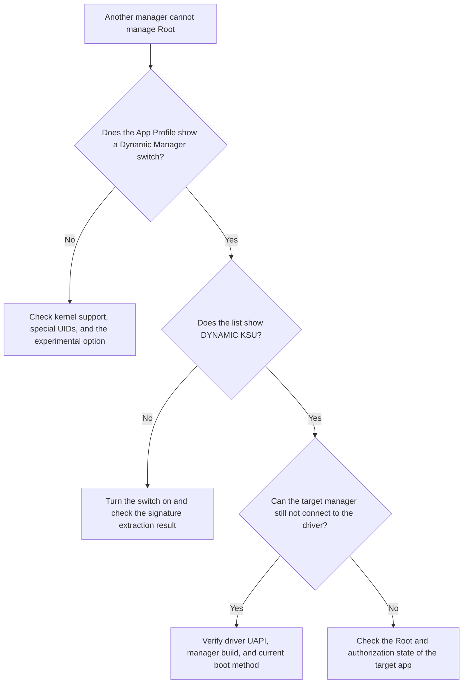

# Dynamic Manager

<Badge text="Manager identity" type="warning" /> <Badge text="High privilege" type="danger" />

By default the kernel trusts only the FinaSU manager signature specified at build time. Dynamic Manager lets another manager APK on the device register its own signature and, once its UID is authorized, manage the same Root driver.

::: tip Where the entry point is

Open **Superuser → app → App Profile** first. Only apps that meet the conditions show the "Set as Dynamic Manager" switch. The experimental "Allow any app to become a Dynamic Manager" option lives in **Settings → Features**.

:::

## Three Identity Levels

:::: table Manager states

| State | Meaning | Can manage the driver |
| --- | --- | --- |
| Default FinaSU signature | The manager identity trusted at build time. | Yes |
| Preset manager candidate | The kernel recognizes the signature but does not authorize it automatically. The Superuser list shows `KSU`. | Not until it is switched |
| Dynamic Manager granted | The signature is registered and the current UID is in the authorization table. The list shows `DYNAMIC KSU`. | Yes |

::::

Recognition and authorization are separate matters. The kernel recognizing a signature only means it matches the preset candidate rules. It does not mean any app using that signature can manage Root directly.

## When the App Profile Switch Appears

Set as Dynamic Manager is not a universal switch that every app can see. All of the following must be true:

- the current kernel supports Dynamic Manager;
- the current entry is not a special UID such as WebView Zygote;
- the app is a preset manager candidate, has already been granted Dynamic Manager, or "Allow any app to become a Dynamic Manager" is enabled in Settings.

::: warning Allow any app only shows the switch

Enabling the experimental option only makes the Dynamic Manager switch appear for any app in its App Profile. It does not authorize any app automatically. You still have to open a specific app and turn the switch on yourself.

:::

## Granting Dynamic Manager

:::: steps

1. **Verify the APK**

   Confirm the package name, where the signature comes from, the version, and where it was installed from. The same package name does not mean the APK matches an official build.

2. **Open the App Profile**

   Find the target app in the Superuser list. If there is no switch, check kernel support and the experimental option first.

3. **Turn on "Set as Dynamic Manager"**

   The Manager extracts the v2 signing certificate size and SHA-256 of the target APK, registers that identity with the kernel, and authorizes the matching app UID.

4. **Probe Root again**

   The Root Shell may be briefly affected during the switch. The Manager probes the identity again automatically. If the interface does not recover, open the home screen to trigger a refresh, or restart the Manager.

5. **Verify the takeover**

   The target manager should read the same driver version, authorization list, and module state. If the two do not match, stop changing authorization.

::::

Granting does not require a full reboot. The registration table persists and is applied again on later boots.

## Revoking Dynamic Manager

What revocation does depends on the kernel:

### New Kernels with an App ID Authorization Table

- only the management permission of the target UID is revoked;
- the certificate stays registered, so the app can still be recognized;
- turning the switch on again re-authorizes the same UID.

### Older Kernels Without Separate Revocation

- as long as the certificate is registered, apps using it may be treated as managers;
- so turning the switch off deletes the whole signature registration;
- other packages sharing the same signature lose Dynamic Manager identity as well.

::: danger One signature can cover several packages

Dynamic Manager trusts the signing certificate first, and newer kernels add UID authorization on top. Before turning the switch off on an older kernel, confirm that no other manager you want to keep uses the same signature.

:::

## Persistence and Upgrades

Dynamic Manager configuration is written to `/data/adb/ksu/.dynamic_manager` and pushed to the kernel again by `ksud` at boot. The kernel also keeps its own persistent snapshot, so authorization state is not lost when the userspace `ksud` is replaced by another manager.

- do not hand-edit these two files;
- if the signing key does not change during an APK upgrade, the certificate identity usually does not change either;
- re-signing produces a different certificate, and the old entry does not represent the new build;
- the same package name or a higher version number does not replace checking the signature.

## Inconsistent State

Common problems:

- **The switch appears but turning it on fails**: usually there is no working Root management channel, signature extraction failed, or the kernel refused the registration;
- **It still shows `KSU` after turning it off**: that is the preset candidate badge and does not mean management authorization is still granted;
- **It stopped working after an APK update**: re-signing changed the certificate, so it has to be registered again;
- **The two managers show different states**: confirm they connect to the same driver and that no old manager has overwritten `/data/adb/ksud`.

## Security Boundary

A Dynamic Manager can:

- read and change Root authorization;
- manage modules and built-in engines;
- perform device maintenance operations;
- affect the kernel security boundary.

It cannot gain trust just by looking like the same app. Use this feature only with APKs you built, signed, and verified the hash of yourself.

::: danger Do not open this up to any app just to silence an error

If the target APK cannot prove its identity, the right move is to fix its source or build it with the correct signing key, not to enable "allow any app" and authorize blindly.

:::

## Related Pages

- [App Profile](/en/manager/app-profile/): Root, non-Root, and the Dynamic Manager switch.
- [Settings → Features](/en/setting/function/): the experimental Dynamic Manager option.
- [Switching to FinaSU](/en/guide/switch/kernelsu/): migrating between manager setups.
- [`/data/adb` Storage Layout](/en/manager/storage/): where the Dynamic Manager files live.
