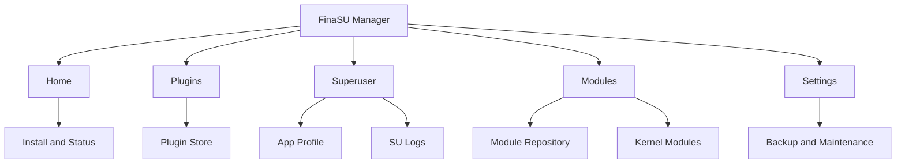
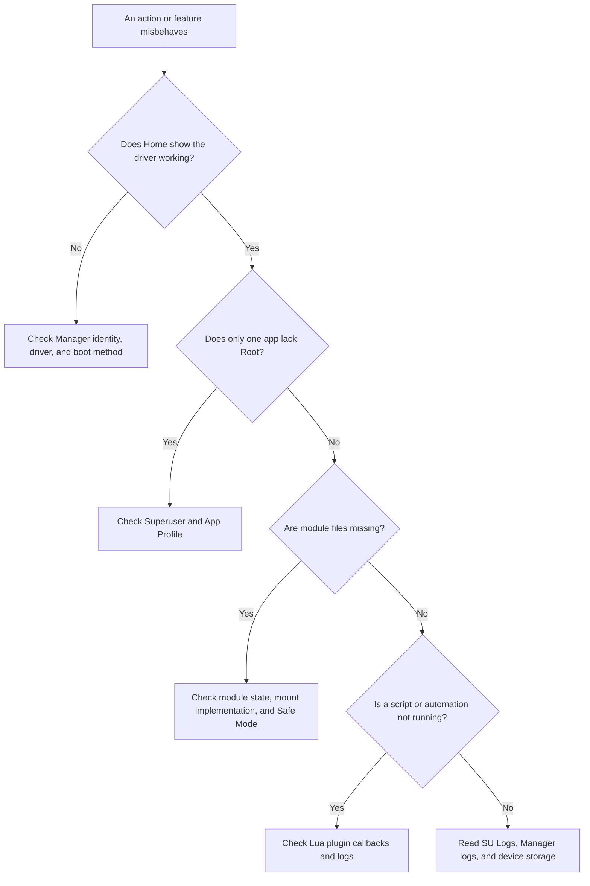

# Manager Overview

<Badge text="Start with the goal" type="tip" /> <Badge text="The Manager is not the driver" type="warning" />

The FinaSU Manager displays status, handles authorization, installs modules and plugins, and performs maintenance operations. Root itself comes from the kernel driver loaded by the current boot method. The APK alone does not grant Root just because it is installed.

::: tip Fastest way to find something

Start with the table below. The Manager does not squeeze every feature into the Settings page. Regular modules live under **Modules** at the bottom, Lua plugins under **Plugins**, and app authorization under **Superuser**.

:::

## Common Tasks

:::: table Go by goal

| I want to | Where to go | Notes |
| --- | --- | --- |
| Allow, deny, or change Root for an app | [Superuser](/en/manager/superuser/) | Find the app and open its App Profile. The Root switch is there. |
| Limit the module files, UID, capabilities, or SELinux domain an app can see | [App Profile](/en/manager/app-profile/) | Manages app policy in both Root and non-Root states. |
| Install, enable, disable, update, or uninstall regular modules | [Module Management](/en/manager/module/) | Manages ZIP modules in `/data/adb/modules`. |
| Browse community modules and download them | [Module Repository](/en/manager/module-store/) | Reached from the cloud icon at the top of the **Modules** tab. |
| Import or manage `.ko` files | [Kernel Modules](/en/manager/kernel-module/) | Reached from the memory chip icon at the top of the **Modules** tab. |
| Write boot scripts or action handlers in Lua | [Lua Plugins](/en/manager/plugin/) | Plugins are a separate tab at the bottom, not regular modules. |
| See who ran Root commands | [SU Logs](/en/manager/su-log/) | Reached from the document icon at the top left of **Superuser**. |
| Save authorizations, module installers, or boot partitions | [Backup & WebDAV](/en/manager/backup/) | Backup in Settings holds the actual configuration and actions. |
| Let another manager take over the driver | [Dynamic Manager](/en/manager/dynamic-manager/) | The target app must expose the Dynamic Manager switch first. |
| Look up directories under `/data/adb` | [`/data/adb` Storage Layout](/en/manager/storage/) | For diagnostics. Editing these files directly is not recommended. |
| Change theme, language, security, or built-in capabilities | [Settings Overview](/en/setting/overview/) | These options are not part of the Manager section. |

::::

## Interface Sections

The bottom navigation has five entries. Their order depends on the current navigation settings, but their purpose does not change.

:::: table Main navigation

| Entry | Main content | Common destinations |
| --- | --- | --- |
| **Home** | Root status, run mode, device info, warnings, authorization count, enabled module count, and quick actions. | Install/update, reboot, SUSFS management |
| **Plugins** | Installed Lua plugins, configuration, actions, logs, and the plugin store. | The cloud icon at the top opens the plugin store |
| **Superuser** | Installed apps grouped by UID, Root status, and policy. | The top left opens SU Logs |
| **Modules** | Regular modules, updates, WebUI, action scripts. | The top cloud icon opens the module repository; the memory chip icon opens kernel modules |
| **Settings** | Eight setting categories, backup, diagnostics, and maintenance. | See [Settings Overview](/en/setting/overview/) |

::::

Frequent paths can be remembered by goal:

::: code-tabs

@tab Regular modules

```text
Manager → Modules → Install at the bottom right
```

@tab Kernel modules

```text
Manager → Modules → Memory icon at the top right → Import .ko
```

@tab Lua plugins

```text
Manager → Plugins → Install at the bottom right
```

:::



## What to Check First on the Home Screen

The home layout can be switched in [Appearance → Home & Layout](/en/setting/home/). The information below does not always appear at the same time, but it always comes from the same sources.

### Status Card

The status card answers one question first: is the driver loaded?

- **Working**: the Manager is connected to the kernel interface and shows the driver version.
- **Not installed**: an installable environment was detected. Tap the status card or the install button to start installation.
- **Not supported**: the current kernel does not meet the conditions of that install path. Do not read "not supported" as "this device can never install".

After a successful connection, the status card can also show:

:::: field-group

::: field `LKM`
@type `Run mode`
The driver runs as a loadable kernel module. Updating and uninstalling usually involve the boot partition.
:::

::: field `Built-In`
@type `Run mode`
The driver is compiled into the kernel. Updating the Manager APK does not replace the driver inside the kernel.
:::

::: field `Safe Mode`
@type `Boot state`
Modules and some features are skipped or disabled, so the device can recover from boot problems caused by modules.
:::

::: field `Jailbreak mode`
@type `Boot state`
The driver loads late in the current system session. After a normal reboot the privilege escalation flow may need to run again. The Manager does not offer partition-flash updates here.
:::

::: field `Custom`
@type `LKM source`
The current LKM does not carry the marker for being bundled and loaded by a matching manager. It may come from a self-built image or another boot tool. Do not treat "custom" as malicious, but confirm the image source before upgrading.
:::

::::

### Warnings and Versions

Home screen warnings may report:

- version requirements for the Manager or the kernel;
- that the current build is a PR or debug build;
- that the Root Shell is recovering or unavailable;
- that a newer embedded LKM is available.

::: important Fix the driver connection first

If you cannot even reach the "Working" state, do not go on to install modules, change built-in engines, or restore partitions. First confirm that the Manager signature matches the current driver, then investigate the boot method.

:::

### Device Facts and Support Card

The info card usually shows the Manager version, kernel version, device model, SELinux, Seccomp, and the Zygisk and module mount implementation that were actually detected. SUSFS appears only when it is detected. Some rows can be hidden in [Home Info Settings](/en/setting/home/).

The card at the bottom of the home screen switches between "Learn about FinaSU", "Traditional support content", "Hidden", and "Custom". It only affects presentation and outbound links, not Root or module behavior.

## What Each Action Changes

:::: table Action boundaries

| Action | Immediate effect | Reboot required |
| --- | --- | --- |
| Change Root authorization or an App Profile | Authorization and policy data in the kernel | Usually not; the target app may need a restart |
| Enable or disable a regular module | Module flags and the next boot plan | Usually yes; the Manager will prompt |
| Install or update a module | Module directory and pending state | Usually yes |
| Import a `.ko` | Saves the file and configuration only | Does not load it automatically |
| Enable or disable a plugin | Whether automatic callbacks may run later | No |
| Restore a boot partition | Writes directly to that partition | Requires a full reboot |
| Switch the Dynamic Manager | Kernel trust and authorization tables | No, but identity and Root may be probed again |

::::

::: danger Do not confuse "saved" with "in effect"

Module mounts, kernel features, Zygisk, and some plugin callbacks run only at specific boot stages. A page showing that a setting is saved means the configuration was written successfully. Actions that need a reboot must be verified after that reboot completes.

:::

## Which Layer Owns the Problem



## Permissions and Security

The Manager calls `ksud` through the JNI kernel interface and a controlled Root Shell. Because of that:

- do not grant Dynamic Manager identity to an APK of unknown origin;
- do not install modules or plugins that run as Root from untrusted repositories;
- do not hand-edit authorization, Dynamic Manager, or mount state files;
- before restoring partitions, uninstalling permanently, or flashing, prepare a rescue image that matches the device.

## Continue Reading

- [Superuser](/en/manager/superuser/): app authorization and UID groups.
- [App Profile](/en/manager/app-profile/): fine-grained policy for each app.
- [Module Management](/en/manager/module/): the full set of ZIP module operations.
- [Module Repository](/en/manager/module-store/): sources, downloads, and integrity.
- [Lua Plugins](/en/manager/plugin/): lifecycle, configuration, and security boundaries.
- [Kernel Modules](/en/manager/kernel-module/): `.ko` import, loading, and Safe Mode.
- [SU Logs](/en/manager/su-log/): Root events and diagnostics.
- [Backup & WebDAV](/en/manager/backup/): saving and restoring.
- [Dynamic Manager](/en/manager/dynamic-manager/): switching manager identity.
- [`/data/adb` Storage Layout](/en/manager/storage/): what each directory and file does.
