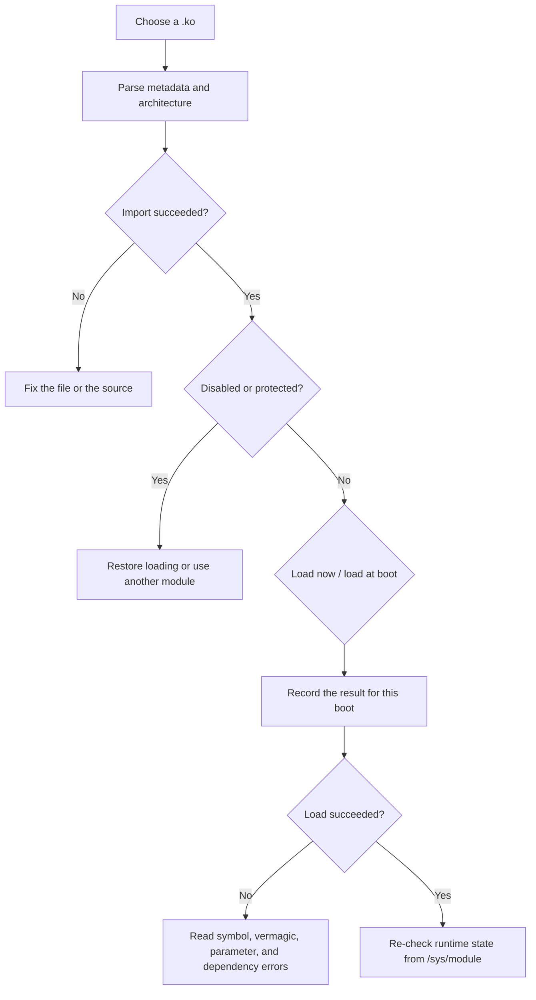

# Kernel Modules

<Badge text="Linux .ko" type="danger" /> <Badge text="Goes straight into the kernel" type="warning" />

The Kernel Modules page manages Linux `.ko` files that the user imports explicitly. It is entirely separate from the Android ZIP modules in Module Management. `.ko` code executes in kernel mode, so a wrong or incompatible module can cause a freeze, a reboot, or data corruption.

::: tip How to get there

Manager → **Modules** at the bottom → the memory chip icon at the top right. Long-pressing that icon shows the kernel module risk warning.

:::

::: danger Load only modules you trust that match the device

Do not load a `.ko` of unknown origin, and do not treat files from another device, another kernel version, or another KMI as universal modules. A failed load can crash the kernel, and Safe Mode cannot guarantee recovery from code that has already entered the kernel.

:::

## What Is Checked on Import

Tap "Import .ko" at the bottom right and select a local file. The Manager reads ELF and `modinfo` metadata and checks at least:

- the file is a valid kernel module ELF;
- the file size does not exceed the management limit;
- the device architecture matches the module architecture;
- a trustworthy internal module name can be obtained;
- the internal name is not the protected `kernelsu` or `nomount`;
- no existing entry is taken by another module.

When the internal module name cannot be parsed reliably, the file may still be saved for inspection, but "Load now" and "Load at boot" are unavailable.

::: important Architecture, vermagic, and symbols

An explicit architecture mismatch is rejected on import. When vermagic does not match, the loader tries to rewrite it based on kernel logs and retries; unresolved symbols are looked up through the kernel interface or `/proc/kallsyms`. Even when those steps succeed, the ABI, struct layout, or kernel configuration may still be incompatible.

:::

## Entry States

A kernel module has at least three independent states:

:::: field-group

::: field Load at boot
@type `Preference`
Decides whether a load is attempted on the next boot. Turning it on does not load the current instance immediately.
:::

::: field Disabled
@type `Persistent block`
While a `disable` flag exists, both manual and automatic loading are refused. Restoring loading only clears this flag.
:::

::: field Currently loaded
@type `Runtime fact`
Read from `/sys/module/<name>`, not inferred from whether the last command succeeded. The state can be loaded, not loaded, or unknown.
:::

::::

A card may also show "Protected". `kernelsu` and `nomount` are reserved internal names and cannot be loaded or set to load at boot from this page.

## Four Easily Confused Actions

:::: table Action semantics

| Action | What it does | What it does not do |
| --- | --- | --- |
| **Load now** | Calls the kernel loader with the current parameters. | Does not change whether it loads on the next boot. |
| **Load at boot** | Saves the load preference for the next boot. | Does not load the module now. |
| **Block future loading** | Writes the persistent disable flag. | Does not unload a module that is already running. |
| **Restore loading** | Clears the persistent disable flag. | Does not load now and does not turn on "Load at boot". |
| **Remove** | Deletes the `.ko` and configuration saved by the Manager. | Does not unload an instance that already entered the kernel. |

::::

So after "removed" or "disabled", the current kernel may still hold the module until a reboot or an explicit unload. The Manager does not pretend that a still-running module has disappeared.

::: danger Remove is not unload

This page has no general "safely unload any kernel module" action. A kernel module may be in use by the system or by other modules, and forcing an unload can crash the device. To stop using one, block future loading first and then do a full reboot.

:::

## Load Parameters

Parameters are passed to the kernel only the next time the module is loaded or loaded at boot. The usual form is space-separated `name=value`:

```text
mode=1 debug=0
```

The Manager does not hand this text to a Shell for evaluation; it passes it to the load interface as a module parameter string. A NUL byte or an over-length value is rejected.

::: tip Read the module documentation first

Parameter names and values are defined by the `.ko` author. A mistake is not the same as "ignore": the kernel may refuse to load, or the module may enter a state its author did not expect.

:::

## Metadata and Details

The Details page may show:

| Field | Purpose |
| --- | --- |
| Management ID | The stable identifier the Manager stores for the entry |
| Kernel module name | The name that appears under `/sys/module` after loading |
| Version, author, license | Verify the file origin and licensing |
| Architecture | Must match the device |
| Vermagic | Shows the module build environment; the loader may rewrite it to match the kernel |
| Dependencies | Module names that must be satisfied before automatic loading |
| Parameter list | Parameters the module declares it accepts |
| File size and SHA-256 | Verify the currently saved file |
| Metadata notes | Anything in the ELF or `modinfo` that could not be explained |

Updating a module keeps the old load-at-boot preference and parameters while re-checking the file. Updating a module that is already loaded does not replace the old instance in memory.

## Last Result

Every manual or automatic load records:

- the operation type;
- success, failure, already loaded, or incomplete;
- the kernel boot ID;
- a length-limited error message.



If the last record says "in progress", the Manager blocks another load of the same module so unknown states do not stack. Do a full reboot before deciding whether to continue.

## Dependencies and Automatic Loading

Automatic loading orders modules by the dependencies they declare:

- a dependency may already be provided by the kernel or another loader; if the Manager tracks it, it must be enabled and eligible for automatic loading;
- a dependency cycle is not loaded blindly;
- modules already attempted during this boot are not retried indefinitely;
- if the last load did not complete, later automatic loads are blocked conservatively.

Automatic loading runs on a worker thread. The Manager waits only for a limited time during startup; after a timeout it can still display state, but "the page is open" should not be mistaken for every module having loaded.

## Safe Mode

When the device enters Safe Mode, the boot flow writes a disable flag for every managed kernel module:

- import and remove may still be available;
- restoring loading, enabling automatic loading, and loading now are refused;
- this is not a safe unload; instances already loaded are still there;
- after leaving Safe Mode, decide one by one which modules to re-enable.

::: warning Safe Mode is not crash insurance

If a `.ko` has already made the kernel unstable during the current boot, Safe Mode can only affect the policy for the next boot. It cannot undo code that has already run.

:::

## Common Failures

:::: collapse accordion

- **Import reports an architecture mismatch**

  The file was not compiled for this device. Do not try to work around it by renaming files; use a build that matches the device architecture and kernel environment.

- **The load-at-boot switch is unavailable**

  Usually there is no trustworthy internal name, the module is disabled, or the internal name is protected. Read the metadata notes on the details page first.

- **Loading fails with a missing symbol**

  A kernel symbol the module depends on does not exist in the current kernel, is hidden, or has a different ABI. The kernel upgrade and that module must be handled together.

- **I just updated the module but the state still shows loaded**

  An update only replaces the on-disk file. The old instance stays until a reboot or the next explicit load.

- **Why is it still there after I disabled it**

  Disabling only blocks future loads. The current kernel does not unload a module just because a file flag changed.

- **Why is the list entry gone after removal but the function still works**

  The code has already loaded into the kernel. The Manager deleted the saved file and configuration, not the instance in memory.

::::

## Related Pages

- [Module Management](/en/manager/module/): Android ZIP modules.
- [SU Logs](/en/manager/su-log/): Root execution and authorization events.
- [`/data/adb` Storage Layout](/en/manager/storage/): the contents of `/data/adb/ksu/lkm/`.
- [Settings → Features](/en/setting/function/): NoMount and the mount engine, not arbitrary `.ko` files on this page.
