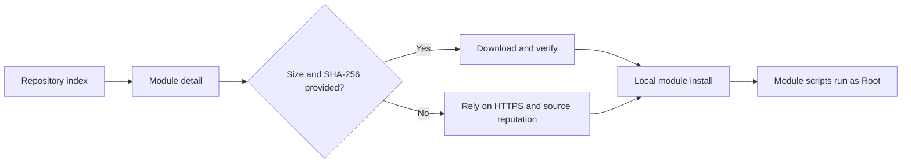

# Module Repository

<Badge text="Download entry" type="tip" /> <Badge text="A listing is not a review" type="danger" />

The module repository presents module catalogs from different sources in one place, with name, version, author, description, and downloadable releases. The repository only lists and downloads modules; installation is still done by the local module flash flow.

::: tip How to get there

Manager → **Modules** at the bottom → the cloud icon at the top left.

:::

## Repository Sources

The "Repository source" menu at the top offers four kinds of entry:

:::: table Sources

| Source | Purpose | How to select |
| --- | --- | --- |
| **Built-in index** | The built-in module index provided by the project. | Select it directly; no address needed. |
| **Community repositories** | Reads the repository cluster list, then you pick one community repository. | The list shows the repository name, description, and module count. |
| **KernelSU repository** | Reads the KernelSU module registry. | Releases load only when you open a module detail. |
| **Custom repository** | Uses a compatible repository root address or JSON index. | Enter an `http://` or `https://` address. |

::::

::: important Community repositories are not one fixed site

Community repositories opens a repository picker. The top of the list usually includes the default GMR repository, and the cluster index provides the others. You can also choose "Enter address manually".

:::

### Custom Repository Addresses

A custom source accepts two forms:

- ending in `.json`: the address is used directly as a module list document;
- any other directory address: the Manager looks for `json/modules.json` following the compatible repository rules.

The address must be an absolute HTTP(S) URL. An invalid address in the input box is not saved and does not trigger a refresh.

## Browsing and Search

The repository list supports:

- pull to refresh;
- searching module names and descriptions;
- opening module details;
- viewing releases, changelogs, license, homepage, source, and support links in the detail page.

Search does not match the author field. If an author name is visible but searching for it returns nothing, search by module name, description, or module ID instead.

::: tip Network state

When you are offline or the repository server is unreachable, the Manager keeps the list it already loaded and shows an error. Do not mistake an empty list for "every module was deleted". Pull to refresh once the network is back.

:::

## Details and Releases

A module detail page may contain:

| Field | Always present | Purpose |
| --- | --- | --- |
| Name, version, author, description | Depends on the source | Identify the module and what it does |
| Releases and update time | Depends on the source | Choose the version to download |
| Changelog | No | Judge compatibility and behavior changes |
| License, homepage, source, support | No | Verify the origin and feedback channels |
| Download button | A downloadable release must exist | Enters the local module install flow |

Some sources provide only the latest version, while others list several releases. The list document of the KernelSU repository contains directory information only; versions and download addresses are read when you open the detail page.

## Installation Flow

:::: steps

1. **Choose a module**

   Read the name, author, description, and changelog first. A similar name does not mean the same author.

2. **Start the download**

   Tap install or download. On Android 13 and later the Manager may request notification permission to show progress for long downloads.

3. **Verify the download**

   When the entry carries a usable size and SHA-256, the Manager verifies while downloading. A size or hash mismatch aborts the installation.

4. **Enter the module flash flow**

   When the download finishes you reach the local module install confirmation. If install verification or pre-flash backup is enabled, you may be asked to authenticate or a snapshot may be created first.

5. **Reboot and verify**

   File injection for regular modules usually takes full effect only on the next boot. Check the state following the steps in [Module Management](/en/manager/module/).

::::

::: warning No hash does not mean malicious

The integrity metadata provided by repositories varies. Without a size or SHA-256, the Manager may still download, but it can only rely on HTTPS, the repository itself, and your own judgment about the source. ==A module without verification data deserves less trust, not more==.

:::

## Integrity and Security Boundary

Keep in mind:

- being listed in a repository is not FinaSU review;
- download verification proves the file matches its metadata, not that the author is trustworthy;
- a module ZIP can run install scripts, boot scripts, and a WebUI;
- a newer version may change mount targets or script behavior, so do not judge by the version number alone;
- a same-named ZIP forwarded in a chat group should not override the repository source.

## Common Failures

:::: collapse accordion

- **The list keeps failing to load**

  Check the network, the repository address, and the TLS certificate. For a custom repository, confirm the address returns compatible JSON rather than the HTML of the repository landing page.

- **The community repository list is empty**

  The cluster index may be temporarily unavailable. Switch back to the built-in index or the KernelSU repository to check whether the Manager network works.

- **A detail page shows a module but no download button**

  The entry has no downloadable release, or the release lacks a valid download URL. Try another version or source.

- **The download finished but installation failed**

  A successful download only means the ZIP was obtained. Installation also checks the module package structure and local flash conditions. See [Module Management](/en/manager/module/) for the specific error.

- **Relative download addresses in a custom repository fail**

  Relative addresses resolve against the repository root. If the repository file and the ZIP are not in the same directory, the author should provide a correct relative path or an absolute HTTPS URL.

::::

## Related Pages

- [Module Management](/en/manager/module/): installation, enabling, WebUI, and updates.
- [Backup & WebDAV](/en/manager/backup/): save module installers before flashing.
- [Updating FinaSU](/en/guide/update/): update paths for the Manager and the driver.
- [Module Cards](/en/setting/module-cards/): display settings for the module list.
