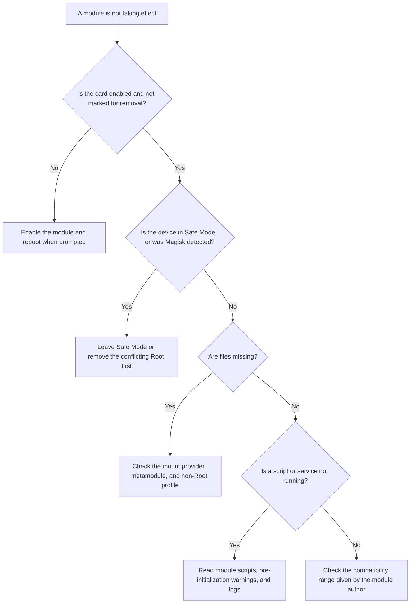

# Module Management

<Badge text="ZIP modules" type="tip" /> <Badge text="Takes effect after reboot" type="warning" />

The Modules page manages regular modules in `/data/adb/modules`. A module can inject files into system paths, run boot scripts, and provide a WebUI or action buttons. That content usually runs as Root, so do not install a module of unknown origin.

::: tip How to get there

Manager → **Modules** at the bottom. The cloud icon at the top opens the [Module Repository](/en/manager/module-store/) and the memory chip icon opens [Kernel Modules](/en/manager/kernel-module/). Long-pressing the memory chip icon shows the `.ko` risk warning.

:::

::: important Regular modules are not `.ko`

This page installs Android module ZIPs that contain `module.prop`. Linux kernel modules, that is `.ko` files, follow a separate management path; see [Kernel Modules](/en/manager/kernel-module/).

:::

## Page Overview

The install button at the bottom is used to choose one or more module ZIPs. The install button is hidden in these cases:

- the device is in Safe Mode;
- Magisk was detected taking over module mounting.

Search covers module ID, name, description, author, and pinyin. The list and the search box operate on the same module state.

## Installation

:::: steps

1. **Choose a ZIP**

   Tap the install button and choose one or more module packages. FinaSU, KernelSU, and common Magisk module formats are supported, but the module scripts themselves decide how far compatibility goes.

2. **Confirm the module information**

   The Manager reads the package and lists the modules it is about to install. A package can change system files, run scripts, or replace an existing module, so confirm its origin and device compatibility before continuing.

3. **Wait for the flash flow**

   Installation still goes through the local module flash flow. If module install verification or pre-flash backup is enabled, you may be asked to authenticate or a backup may be created first.

4. **Reboot when prompted**

   File mounts usually take full effect only on the next boot. When the page prompts for a reboot, you can restart now or handle it later.

::::

::: warning Download notifications on Android 13 and later

When downloading from the module repository, the Manager may request notification permission to show download progress. Denying notification permission does not grant Root; it only affects progress display.

:::

::: timeline One module install and activation

- The user picks a ZIP and moves to flash confirmation
  time=Install

- The install flow writes to the module directory or to a pending update
  time=Save

- The user reboots, and the boot flow reads the module flags
  time=Reboot

- `ksud` merges updates, runs boot scripts, and mounts files
  time=Take effect

- The Manager re-reads card state, and Zygisk modules start checking the provider
  time=Verify

:::

## Module Cards

A card can show the module name, version, author, description, and status badges:

:::: table Badges and buttons

| Element | Meaning |
| --- | --- |
| Enable switch | Decides whether the module takes part in later boots. When a reboot is needed, the Manager shows a prompt. |
| `META` | The module declares itself a metamodule. |
| `WebUI` | The module provides `webroot` and it can currently be opened. |
| `Action` | The module provides `action.sh` and one action can be run manually. |
| `Update` | The update information shipped with the module found a newer version. |
| Missing Zygisk warning | The module declares a Zygisk dependency, but no provider is available; the WebUI and action button may be unavailable as a result. |
| Delete/Undo | Shows "Uninstall" normally, and "Undo" once the module is marked for removal. |

::::

Module actions are affected by [Module Cards & Banners](/en/setting/module-cards/). Long-press a card to change the banner of the current module; if the card is collapsed, tap it first to expand the action buttons.

### WebUI and Action Scripts

- the WebUI opens only when the module is enabled, not marked for removal, and has no missing Zygisk dependency;
- the action button runs the module `action.sh`, and the module script decides the result;
- long-pressing the WebUI or the action button creates a home screen shortcut;
- finishing an action does not mean a module update is finished; a reboot may still be required.

::: danger WebUI and actions are not sandboxes

They belong to the module itself, can see the module directory, and run logic written by the author. Do not ignore where a module came from just because "it only opens a web page".

:::

## Enabling, Disabling, and Uninstalling

### Enable and Disable

The enable switch changes the persistent module flag:

- **Disable**: the module takes no part in scripts or file injection on the next boot;
- **Enable**: removes the disable flag so the module takes part in the next boot again;
- scripts or processes that are already running are not forcibly withdrawn by flipping the switch;
- the Manager prompts for a normal reboot or a soft reboot, depending on Settings.

### Uninstall and Undo

A normal uninstall writes a `remove` flag to the module first. Cleanup completes only after the device reboots, so:

- before the reboot you can tap "Undo" in the Manager to restore it;
- after the reboot the module directory is cleaned up and the undo entry should disappear;
- scripts, services, or kernel objects already loaded into memory are not guaranteed to disappear immediately;
- before uninstalling a metamodule, the Manager adds a warning about its mount or dependency impact.

:::: steps

1. Tap "Uninstall" on the module card.
2. Read the confirmation text; for a metamodule, confirm whether features that depend on it still need to stay.
3. Decide whether to reboot later or now.
4. After the reboot, confirm the card is gone, then check whether the related files and services are back to normal.

::::

## Updates

Whether the Manager can check for updates depends on [General Settings](/en/setting/general/) and the update metadata of the module itself:

- only enabled modules with complete metadata are likely to be included in the check;
- when an update is found, tapping "Update" downloads the matching ZIP and then enters the module flash flow;
- no update notice does not mean the module is up to date; the author may simply not provide parseable update information;
- read the release notes before updating and confirm the new version still supports your system and architecture.

::: tip Keep the old version when an update fails

A package is checked before it actually replaces anything. If the download or the pre-install check fails, do not treat a partial result as an update. It is still worth using [pre-flash backup](/en/manager/backup/) before upgrading important modules.

:::

## Sorting and Search

The sort panel at the top right controls:

- the priority order of metamodules, Zygisk modules, LSPosed modules, modules with a WebUI, and modules with actions;
- whether enabled modules come before disabled ones;
- a custom drag order;
- resetting the custom order.

A custom order suits setups with many frequently used modules where you do not want to search all the time. It only changes the display order in the Manager, not the execution priority of module boot scripts.

## Pre-initialization Warnings

When a pre-initialization warning appears on a module card, the problem is in configuration synchronization before later system stages:

| Message | Meaning | What to do |
| --- | --- | --- |
| Insufficient space | Not enough metadata space, configuration was not synced | Free metadata space, then reboot and verify |
| Sync failed | The previous configuration is kept for this boot | Read the logs and check the module directory and file system state |
| Repeated boots did not complete | Pre-initialization was suspended to avoid further boot problems | Enter Safe Mode or disable the suspect module first |
| Not supported | The current kernel or boot method has no pre-initialization capability | Do not keep rebooting and hoping |

## Safe Mode

Safe Mode is used to recover from boot problems caused by modules:

- boot scripts of regular modules are skipped, and the modules may be disabled in bulk;
- the install button is hidden so no more modules are added while recovering;
- after recovery, re-enable the modules you still need one by one;
- Safe Mode cannot fix kernel crashes, a wrong boot image, or other Root deployment problems.

## Metamodules

A metamodule can take over the module install or mount flow. A device can have only one active metamodule.

::: danger Uninstalling a metamodule affects every module

If the metamodule handles mounting, all regular module files may become invisible after it is removed. If it took over installation, later module installs may fail too. Confirm a replacement mount setup before uninstalling the metamodule.

:::

## Troubleshooting Order

Common readings:

- **The switch changed but behavior did not**: complete the reboot the Manager asked for;
- **Only one app cannot see module files**: check the "Unmount modules" option for that app;
- **No module files are visible at all**: check Folk Mount/NoMount state and the metamodule;
- **A module prevents booting**: use Safe Mode or the rescue flow, and do not stack more modules;
- **Zygisk modules are unavailable**: confirm that a Zygisk provider is actually running.

## Related Pages

- [Module Repository](/en/manager/module-store/): download modules from an index or a custom source.
- [Kernel Modules](/en/manager/kernel-module/): import and load `.ko` files.
- [App Profile](/en/manager/app-profile/): control whether a single app sees module files.
- [Backup & WebDAV](/en/manager/backup/): save installers and module state before flashing.
- [Module Cards & Banners](/en/setting/module-cards/): change how the module list is displayed.
