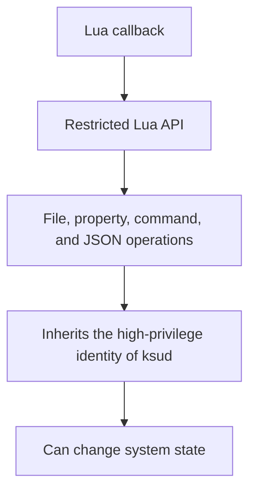

# Lua Plugins

<Badge text="Separate extension" type="tip" /> <Badge text="Inherits Root identity" type="danger" />

FinaSU Lua plugins run on a built-in Lua interpreter and live in `/data/adb/plugins/<id>/`. A plugin can react to boot stages, provide manual actions, declare configuration, or run repeatedly as a resident callback.

::: tip How to get there

Manager → **Plugins** at the bottom. The cloud icon at the top left opens the plugin store, and the install button at the bottom right selects a local plugin ZIP.

:::

::: important Plugins are not regular modules

Plugins do not work through module file mounting and do not need `module.prop`. A plugin declares its identity in `plugin.json` and is scheduled by `ksud`. Do not flash a plugin through Module Management.

:::

## Installing a Local Plugin

A plugin ZIP must contain `plugin.json` and the entry file it declares; the default entry is `main.lua`. The package can put the files at the ZIP root or wrap them all in a single directory.

:::: steps

1. **Choose a ZIP**

   Tap the install button at the bottom right of the Plugins page. The Manager copies the files to the app cache first, then hands them to `ksud` for checks.

2. **Check and stage**

   `ksud` checks the plugin ID, entry file name, dependencies, file count, per-file size, total size, compression ratio, and duplicate or unsafe paths.

3. **Publish transactionally**

   Only after the checks pass is the staging directory published to `/data/adb/plugins/<id>/`. Updates prepare a new directory first; a failure should not damage the installed version.

4. **Confirm run eligibility**

   Installing or re-enabling means you confirm that the current package content may enter automatic boot stages. If the package files are later replaced from outside, the plugin is refused automatic runs until it is confirmed again.

::::

::: warning Do not replace plugin files by hand

Editing or replacing a plugin package directly can change its fingerprint and stop automatic callbacks. Reinstall it through the Manager instead. When the underlying file system does not support atomic directory swap, an overwrite update fails explicitly and keeps the old version.

:::

## Plugin Directory

```file-tree title="An installed plugin"
/data/adb/plugins/
└── <plugin-id>/
    ├── plugin.json       # identity, entry, dependencies, config and callback declarations
    ├── main.lua          # default entry, renameable via plugin.json
    ├── config.json       # plugin config written by the Manager
    ├── last_output.log   # appended callback output
    └── disable           # disable marker
```

`/data/adb/ksu/plugin_locks/`, `plugin_stage/`, and `plugin_state/` are private runtime state of this Manager and should not be cleaned up by hand.

## Page and Plugin Cards

The installed page supports searching by plugin ID, name, and description. A card can show:

- the enable switch;
- version, author, description, and dependencies;
- read errors for the current package;
- the **Configure** button;
- the **Run** button;
- the **Output log** button;
- the **Uninstall** button.

Long-press a card to edit its banner. If the list uses collapsed mode, expand the card before using the action buttons.

::: important Disabling a plugin

Disabling creates a `disable` flag, stops the running processes and resident callbacks of that plugin, and keeps it out of later automatic stages. Re-enabling checks the package manifest and dependencies again.

:::

## Lifecycle

A plugin can declare callbacks in its manifest. The automatic stages are:

:::: table Automatic callbacks

| Stage | Lua callback | When |
| --- | --- | --- |
| `post-fs-data` | `post_fs_data` | Early boot, sharing the boot budget with module scripts |
| `service` | `service` | Android service stage, dispatched in the background |
| `boot-completed` | `boot_completed` | Boot completed stage, dispatched in the background |

::::

Each automatic callback runs for at most 120 seconds. `post-fs-data` also competes with scripts in the same boot budget; when the budget is exhausted, the remaining plugins are deferred to the next boot instead of blocking startup.

`main` is the resident callback. It repeats at a fixed interval after the service stage starts, and a new Lua interpreter is created each round, so it cannot rely on in-memory globals from the previous round. When the plugin disappears or is disabled, the resident instance stops.

## Actions, Configuration, and Logs

### Actions

Run calls the quick action declared in the manifest, and falls back to the `action` callback when none is declared. A manual callback runs for at most 300 seconds; past that limit the whole plugin process group is terminated.

A finished run only means the callback process exited. It does not mean the external programs it called achieved the intended result. The reason for a failure is usually written in the last line of the plugin log.

### Configuration

A plugin can declare configuration fields in `plugin.json`. The Manager supports controls for text, numbers, booleans, and preset options:

- saving writes `config.json` in the plugin directory;
- "Restore default" deletes a single saved value so the default inside the package applies again;
- configuration does not prove the script is safe; the plugin can still read other files in the directory;
- some plugins may read new configuration only on the next callback or the next boot.

### Output Log

The log comes from the Lua API `info` and `warn` calls, callback errors, and plugin process output. It is appended to `last_output.log` and is cleared from the beginning once the size limit is exceeded. It suits quick checks and does not replace SU Logs or module logs.

## Dependencies and Uninstalling

Plugins can declare dependencies. A dependency must already be installed before a plugin is enabled. When you disable or uninstall a plugin, the operation is refused if any enabled plugin still depends on it.

Uninstalling:

1. checks whether any enabled plugin depends on it;
2. stops the regular and resident processes of the plugin;
3. writes the disable flag and deletes the plugin directory;
4. syncs the plugin root directory.

::: warning Handle dependencies before uninstalling

Disable every dependent plugin first, then uninstall the one they depend on. Deleting a directory under `/data/adb/plugins` directly bypasses the checks and the process shutdown.

:::

## Plugin Store

The plugin store reads installable entries from the official plugin index:

- search by name and description;
- shows name, version, and description;
- downloads go through the same install flow as a local ZIP;
- the store entry name is only an index label; the real plugin ID comes from `plugin.json` inside the package.

A failed store download does not mean the plugin is installed. It appears in the installed list only after the install flow completes successfully.

## Security Boundary



The plugin API sets limits on a single read, write, command output, directory entries, JSON size, and Lua memory, but **these limits are not a permission sandbox**:

- a plugin can run system programs;
- a plugin can read and write paths its identity allows;
- a plugin can change system properties and file permissions;
- plugin code shares the high-privilege boundary of `ksud`.

Install only plugins whose origin, content, and update path you can verify. See [Lua Plugin Interface](/en/developer/lua-plugin/) for the full development interface.

## FAQ

:::: collapse accordion

- **The plugin is installed but does not run at boot**

  Check the enable switch, whether dependencies are satisfied, whether the card shows a manifest error, and whether the automatic stage budget ran out.

- **A manual run says there is no callback**

  The manifest declares no quick action and the entry script has no `action` function. Check the callback names the plugin author documents.

- **Nothing changed after editing the configuration file**

  The plugin may read configuration only on the next callback, the next boot, or a reload. Trigger a callback first, and reboot if needed.

- **Why can the plugin not be disabled or uninstalled**

  Another enabled plugin may depend on it. Handle the dependents first.

- **Why does it stop running automatically after I replaced files**

  Automatic running relies on the package fingerprint confirmed at install time. Once files change from outside, the confirmation is invalid and the plugin must be reinstalled or re-enabled.

::::

## Related Pages

- [Lua Plugin Interface](/en/developer/lua-plugin/): manifest, callbacks, and the Lua API.
- [`/data/adb` Storage Layout](/en/manager/storage/): plugin directories and private state.
- [Module Management](/en/manager/module/): regular system modules.
- [SU Logs](/en/manager/su-log/): Root calls and authorization events.
