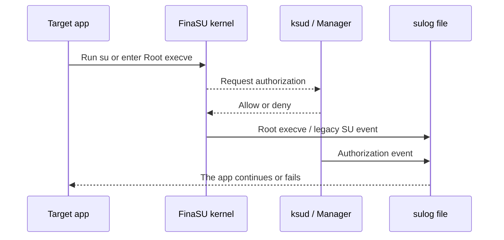

# SU Logs

<Badge text="Root events" type="tip" /> <Badge text="May contain sensitive data" type="warning" />

The SU Logs record Root-related events. They help confirm whether an app made a request, which UID it came from, and whether `ksud` executed normally or was restarted.

::: tip How to get there

Manager → **Superuser** → the document icon at the top left.

:::

## What the Log Records

:::: table Event types

| Type | What is recorded | Common use |
| --- | --- | --- |
| **Root execve** | The process, PID, UID, command line, and return value executed in a Root context. | Confirm what command an app actually ran. |
| **Legacy SU** | Requests that escalate through the `/system/bin/su` compatibility entry. | Troubleshoot older apps that only support classic `su`. |
| **Root granted** | Events where the management channel issued a Root authorization. | Tell an app request apart from a Manager grant. |
| **Daemon restart** | A `sulogd` session starting, re-executing, or recovering. | Judge whether a gap in the log came from a daemon restart. |

::::

The log may also contain `Dropped` entries or unknown types. `Dropped` means the kernel event queue could not keep up with writing and some events were lost. Such records are always shown so an incomplete log is easier to notice.

## How a Root Request Appears in the Log



The exact order of events depends on the request path. Do not judge from the last entry alone when troubleshooting; read the app, UID, PID, command, and return value together.

## Page States

The page can show four capability states:

:::: field-group

::: field `supported`
@type `Available`
The kernel supports SU logging. If logging is off, the page shows an enable button.
:::

::: field `forced`
@type `Forced on`
The boot configuration keeps logging on, and the Manager cannot turn it off here.
:::

::: field `managed`
@type `Managed by a module`
An external module controls the logging capability, and this page should not fight the module over the switch.
:::

::: field `unsupported`
@type `Not supported`
The current kernel has no SU logging capability. Upgrading the Manager APK does not add a kernel feature.
:::

::::

::: tip Nothing shows up the first time

Confirm that logging is on, then trigger an actual Root request. Events from before logging was enabled are not backfilled.

:::

## Browsing and Filtering

The page supports pull to refresh and filtering by type:

- search matches raw event fields, times, and values;
- tapping an entry opens details with the full key-value pairs;
- `Success` or `Exit <code>` shows the execution result;
- events are listed newest first.

For each log file it reads, the interface keeps at most the last 1000 lines so a huge log does not slow the Manager. Earlier content may still be in the file and must be exported from the device for analysis.

## Log Files

Logs live in `/data/adb/ksu/log/` and are named by date:

```file-tree title="SU log files"
/data/adb/ksu/log/
├── sulog-2026-10-25.log
├── sulog-2026-10-25-1.log
└── sulog-2026-10-24.log
```

By default logs are cleaned up daily and kept for 3 days. When a single file reaches 10 MiB, a numbered file for the same day is created. The exact thresholds are persistent `sulogd` configuration, and the background daemon performs the cleanup.

## Clearing the Log

The clear button at the top acts on the current selection:

- with the newest log file selected, the file content is cleared but the file stays for the rest of the day;
- with an older log file selected, the file is deleted.

::: danger Clearing cannot be undone

Deleted logs cannot be recovered from the Manager. Before reporting a problem or investigating an incident, export or copy the files you need to a computer, then clear the records on the device.

:::

## Privacy

The log may contain:

- app package names and UIDs;
- command paths and arguments;
- process names, PIDs, and parent processes;
- file paths and execution results.

::: warning Check before sharing

Before publishing a log, remove personal directories, tokens, accounts, internal network addresses, and private script arguments. If needed, extract only the relevant time range and events instead of sending all of `/data/adb` or a full log archive.

:::

## Using Logs to Locate a Problem

:::: steps

1. **Confirm logging is on**

   If the page says logging is off, enable it first and then reproduce the problem.

2. **Locate by time**

   Note roughly when the problem happened and pick the file for that date. If the newest file has no matching entry, check older files.

3. **Filter by event type**

   When an app calls `su`, look at legacy SU first; for Root command execution, look at Root execve; for authorization problems, look at Root granted.

4. **Verify identity**

   Compare the UID in the log with the app UID on the Superuser page. Multi-user setups, app clones, and reinstalls can all change a UID.

5. **Check the result**

   A non-zero exit code can come from a denied authorization, a failing command, or a permission policy limit. A failure does not mean the logging system is broken.

::::

::: chat title="SU log Q&A"
{User}
My app does not appear in the log. Is Root broken?

{.}
Not necessarily. The app may not have made a Root request, the request may have happened before logging was enabled, or the log daemon may have just restarted. Trigger it again, then check the app UID and the logging switch.

{User}
Why does the command still fail when authorization is allowed?

{.}
Allowing Root only means the UID may enter a Root context. The UID, GID, capabilities, SELinux domain, and namespace in the App Profile, or an error in the command itself, can all cause a later failure.

{User}
What should I do when the log shows Dropped?

{.}
It means events were discarded before they were written out. Reduce log noise, clear old files, or check storage space first, then reproduce the problem. A missing interval does not mean no request happened.
:::

## Related Pages

- [Superuser](/en/manager/superuser/): check the target app and UID.
- [App Profile](/en/manager/app-profile/): Root and non-Root permission policy.
- [`/data/adb` Storage Layout](/en/manager/storage/): log and runtime state directories.
- [Diagnostics & Feedback](/en/setting/diagnostics/): export Manager logs and diagnostic information.
