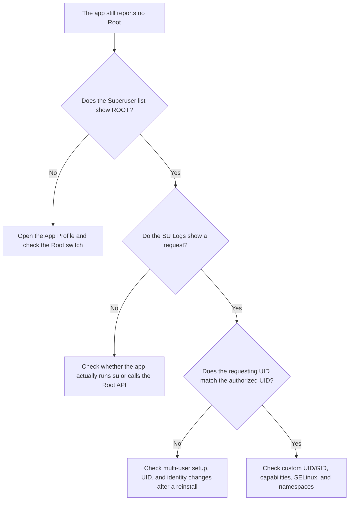

# Superuser

<Badge text="App authorization entry" type="tip" /> <Badge text="Applies per UID" type="warning" />

Superuser lists the apps the Manager can enumerate and shows the current Root and profile state of each one. It is not a history of apps that requested Root. Most system apps are hidden by default, but ordinary installed apps still appear in the list.

::: tip How to get there

Open the Manager → **Superuser** at the bottom. The document icon at the top left opens [SU Logs](/en/manager/su-log/).

:::

## What the List Contains

Each row may be one app or several apps that share one UID. The Manager itself never appears as an ordinary entry. Tapping an entry opens the [App Profile](/en/manager/app-profile/) for that UID. The Root switch is on the detail page, not on the right side of the row.

:::: table Status badges

| Badge | Meaning |
| --- | --- |
| `DYNAMIC KSU` | This UID has been granted Dynamic Manager identity and can manage the current driver. |
| `KSU` | A preset manager signature was recognized, but Dynamic Manager authorization has not been granted. |
| `ROOT` | The Root profile for this UID allows Root. |
| `UMOUNT` | The non-Root policy for this UID hides files injected by modules. |
| `CUSTOM` | The app does not use the default profile for that state, but a template or custom configuration. |
| `USER <id>` | The app belongs to a work profile, a clone, or another Android user. The same package can have different UIDs under different users. |

::::

::: important Badges describe current policy, not request history

An app that once showed a prompt and was later denied does not keep a permanent "denied" record in the list. What is shown here is the result of the current kernel profile. To find out whether a specific request happened, search the SU Logs for the package name and UID.

:::

## Search

The search box matches:

- the app display name;
- the package name or a special profile marker;
- the pinyin of the app name.

When the search box is completely empty, the results area also shows **Recently installed**, covering apps installed in the last 60 minutes. It is only a lookup aid and does not add anything to the Root allowlist.

::: tip Cannot find an app

Clear the search and turn on "Show system apps" first. If the app belongs to another Android user, also make sure "Show only primary user apps" is not enabled.

:::

## Filters

The overflow menu at the top right offers:

:::: field-group

::: field Show system apps
@type `Filter`
Off by default. Turning it on adds system apps. Special UIDs such as WebView Zygote, and entries that already have Root or a custom profile, still follow their own display rules.
:::

::: field Show only primary user apps
@type `Multi-user`
Appears only when the Manager detects more than one Android user. When enabled, only entries from the primary user are shown, so work profile or cloned apps do not mix into the list.
:::

::::

::: warning System apps are not ordinary apps

System and special UIDs have more complex permission boundaries. Grant Root only when you know exactly who the caller is and what it is for. FinaSU also rejects ordinary Root grants for certain system UIDs.

:::

## Sorting

The sort menu at the top right supports:

| Sort field | When to use it |
| --- | --- |
| App name | When you know the app name in the current system language |
| Package name | When the package name is more reliable than the display name |
| Install time | To find apps added to the device recently |
| Update time | To find apps upgraded recently that may behave differently |

"Reverse" flips the current sort direction. The Manager still places dynamic managers, preset managers, authorized apps, and apps with custom policy nearer the top, so the sort field mainly orders entries inside those status groups.

## Granting, Denying, and Revoking

When an app requests Root, the Manager may show an authorization prompt. If you miss the prompt, you do not have to wait for the app to request again:

:::: steps

1. **Find the app**

   Search for the app name or package name on the Superuser page. Turn on "Show system apps" if necessary.

2. **Open the App Profile**

   Tap the app entry or UID group.

3. **Toggle Root**

   Turn the "Superuser" switch on or off. Turning it off only changes authorization. It does not clear app data and does not uninstall the app.

4. **Restart the target app**

   Some apps cache the result of their Root check. If authorization is in effect but the app still reports no Root, use "Force stop" or "Restart" from the menu at the top right of the detail page.

::::

Authorization decisions and App Profiles are stored by the kernel and survive a normal reboot. Restoring a backup or reinstalling an app can change its UID. If the UID changes after a reinstall, the old policy is not automatically applied to the new UID.

## Multiple Apps Sharing One UID

Android apps can declare `sharedUserId`, so several packages share one UID. The kernel decides authorization by UID, so these apps cannot get a different Root result for just one of them.

- The list collapses them into one row and shows how many apps it contains.
- Long-press the collapsed row to expand the app list.
- "Affected apps" on the detail page lists every package under that UID.
- Changing Root, the non-Root "Unmount modules" option, or a custom profile affects the whole UID.

::: danger Confirm the UID scope first

Granting Root to a shared UID grants it to every package under that UID. Do not rely on the name of the app you have open. Check the affected list on the detail page before saving the policy.

:::

## When Root Still Does Not Work

Common causes:

- the Root switch is off;
- the target app and the authorized entry belong to different Android users;
- the UID changed after an upgrade or reinstall;
- a custom Root profile restricts capabilities or the SELinux domain;
- the app is still showing a cached state and has not been restarted;
- the request never went through the Root API or `su`, so the SU Logs have no matching event.

## Related Pages

- [App Profile](/en/manager/app-profile/): configure permissions and file visibility per UID.
- [SU Logs](/en/manager/su-log/): confirm requests, execution, and authorization events.
- [Dynamic Manager](/en/manager/dynamic-manager/): grant or revoke manager identity.
- [Backup & WebDAV](/en/manager/backup/): save and restore the authorization list.
