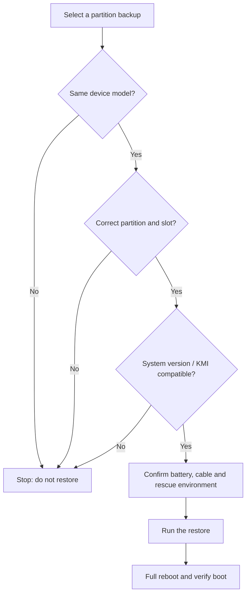

# Backup

<Badge text="Settings entry 8/8" type="info" /> <Badge text="Verify before restoring a partition" type="danger" />

Backup can save modules, the Superuser list and boot partitions locally or to WebDAV, and restore them from "Manage backups". Both an ordinary module backup and a boot partition restore can change the device state directly, so a single "restore succeeded" message is not enough.

::: tip How to get there

Open Manager → Settings → tap the fourth entry in the second row, **Backup**.

:::

## Choose Where to Back Up

### Local Directory

Local backups are written to the public downloads directory:

```file-tree title="Local backup location"
Download/
└── FinaSU/
    ├── modules/
    ├── allowlist/
    └── boot/
```

After opening "Local directory", you can use "Open backup directory" to jump to the system downloads page. The files live in a public directory, so uninstalling Manager does not delete the backups automatically.

### WebDAV

After enabling WebDAV, fill in:

:::: field-group

::: field Server address
@type `Required`
The WebDAV root address, for example the HTTPS URL provided by your host. The connection fails if the address or certificate is wrong.
:::

::: field Username
@type `As required by the host`
The account used for HTTP Basic authentication. Some private services accept an empty username or an access token.
:::

::: field Password
@type `Secret`
It is not echoed back after saving. Entering a new password replaces the saved value; do not clear or rewrite this field when you are not changing the password.
:::

::: field Remote path
@type `Optional`
A subdirectory for backups under the WebDAV root address. Leave it empty to use the root address.
:::

::: field Test connection
@type `Check`
Verifies the address, authentication and write capability. Run a backup after the connection succeeds.
:::

::: field Browse WebDAV
@type `File management`
Views remote directories, previews visible content and deletes remote files.
:::

::::

::: warning Do not bypass TLS verification

The WebDAV password has to be handed to network requests, so it is stored in Manager's secret storage in a reversible form. When the server certificate is untrusted, the right fix is to repair the address or certificate, not to turn off HTTPS verification.

:::

## Backup Contents

::: table Three kinds of content

| Content | What it includes | When to use it |
| --- | --- | --- |
| **Modules** | Module ZIPs archived from the selected package before flashing, plus related module snapshots | When you need to recover or reinstall modules around a flash |
| **Superuser list** | Root-authorized apps and related policy data | After migrating, restoring or accidentally changing authorization |
| **Partitions** | The `boot`, `init_boot` and `vendor_boot` that Manager detects | To keep a copy before a boot image update, or when you need to restore |

:::

### What the Module Switch Actually Does

The "Modules" switch is mainly for **pre-flash backup**: around an install or flash that overwrites modules, Manager can archive the selected package and related state.

::: important "Back up now" mainly saves authorization and partitions

"Back up now" does not currently treat the ordinary module list as a separate restore item; it runs the enabled Superuser list and the selected partition backup. Do not read the "Modules" switch as one-tap packaging of every installed module at any time.

:::

### Superuser List

Saves which apps have Root, the matching App Profile policies and other management data. After a restore you should still check each app's authorization, because package name, UID or system environment changes can make an old policy unsuitable.

### Boot Partitions

The page lists only the partitions Manager actually detects. Common meanings:

- **`boot`**: the Linux kernel; on some devices before Android 13 it also holds the generic ramdisk.
- **`init_boot`**: the separate generic ramdisk on some GKI devices from Android 13 onward.
- **`vendor_boot`**: vendor kernel modules, the device tree and the vendor ramdisk.

A partition the device does not have is not listed; do not guess or flash one by hand. Different root solutions modify different partitions, so backing up several partitions is safer than backing up only one.

## Pre-Flash Backup

With "Pre-flash backup" enabled, Manager tries to snapshot the related modules or partitions before a flash overwrites them.

- At least one writable target is required (local or WebDAV).
- The backup is best effort; a failure is written to the log and should not be taken as a guarantee that the flash succeeded.
- Before flashing you still have to confirm the stock image, device model, slot and system version separately.

::: tip Run it manually once

After configuring WebDAV or a new backup directory for the first time, tap "Back up now" to verify permissions, space and the remote path. Do not wait until a flash fails to discover that the backup was never written.

:::

## Back Up Now

"Back up now" runs one backup according to the current target and content selection. It requires at least:

- One target enabled, either local or WebDAV.
- The Superuser list or at least one partition selected.

Enabling only "Modules" is not enough to start an immediate backup. When it finishes, it shows the number of written, skipped and failed items.

:::: steps

1. Choose the local directory, WebDAV, or enable both.
2. Select the Superuser list and the partitions to save.
3. Confirm the target has enough space; partition images can be large.
4. Tap "Back up now" and wait for the statistics.
5. Tap "Manage backups" to confirm the entries really appear in the list.

::::

## Manage Backups

"Manage backups" reads the recognizable entries from local storage and WebDAV, grouped by modules, authorization list and partitions.

- Each entry shows its source and size.
- Tapping an entry performs a restore.
- Deleting removes the backup file and its metadata and usually cannot be undone.
- WebDAV entries are read remotely; a restore fails when the network drops.

::: danger Verify before restoring

Restoring a partition writes the backup image straight back to the device. Before you do it, confirm that:

- The backup comes from the same device model.
- The image matches the correct partition and the correct slot.
- The system version and KMI have not changed across a generation.
- The current Root deployment allows writing back to that partition.
- A rescue path through a computer or Recovery is available.

When restoring management data, also avoid two Manager instances writing the same directory at once.

:::

## Restoring Partitions



A partition restore usually needs a full reboot afterwards. If the device cannot boot, follow [Bootloop Rescue](/en/guide/rescue-bootloop/) and restore with a stock image that exactly matches the current system, do not keep trying images from different sources.

## WebDAV Browsing

The browsing page can:

- Enter remote directories.
- View the size and preview of visible files.
- Delete remote entries.

Deleting a remote file may not be recoverable from a recycle bin. Do not clean up server files you do not recognize here, especially a WebDAV directory shared with other apps.

## Safety and Maintenance

:::: collapse accordion

- **Why is the default backup location Download/FinaSU?**

  That directory is visible to the user, easy to copy out, and does not disappear when Manager is uninstalled. Partition images are large, so remember to clean them up regularly.

- **Can local and WebDAV be enabled at the same time?**

  Yes. Every backup writes to all enabled targets that are writable.

- **If the WebDAV test succeeds, is a restore guaranteed to work?**

  No. The test verifies only the current connection and basic read/write; file permissions, remote space, network stability and the server implementation can still affect later operations.

- **Why does an app still lack Root after restoring the authorization list?**

  Check the UID, package name, App Profile and kernel allowlist. Reinstalling the system or the app can change the UID.

- **Do local backups survive deleting Manager?**

  Local backups are in the public downloads directory and usually do not disappear when Manager is uninstalled. Do not treat them as your only backup; important images should also be copied to a computer or trusted storage.

::::

## Related Pages

- [Updating FinaSU](/en/guide/update/)
- [Install & Flash](/en/guide/install/)
- [Bootloop Rescue](/en/guide/rescue-bootloop/)
- [App Profile](/en/manager/app-profile/)
- [Backup and WebDAV (Manager guide)](/en/manager/backup/)
