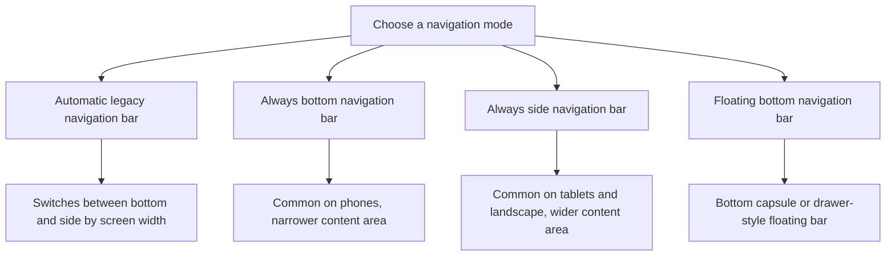

# Behavior Settings

<Badge text="Settings entry 3/8" type="info" /> <Badge text="Interface behavior and compatibility" type="warning" />

Behavior decides how the Manager navigates, how it responds to gestures, how it displays modules, and a number of userspace compatibility options. It does not grant Root, but a wrong SU compatibility or soft reboot choice can affect your Root workflow.

::: tip How to get there

Open the Manager → Settings → tap **Behavior**, the third entry in the first row.

:::

## Navigation and Gestures

### Navigation Bar Badges

When enabled, the bottom or side navigation shows:

- The number of authorized apps on the superuser entry.
- The number of enabled plugins on the plugins entry.
- The number of enabled modules on the modules entry; when module updates exist, the update count is shown instead.

A badge is only a status hint. Hiding the plugins, superuser or modules entry does not delete the matching data.

### Predictive Back Gesture

This option is only shown on Android 14 and above. When enabled, the Manager turns on the system predictive back animation, so the back gesture provides a preview before switching pages.

You can turn it off if system animations behave abnormally or gestures stutter. This setting does not change the actual back logic of a page.

### Custom Bottom Navigation Icons

When enabled, you can pick a local image for the home screen, plugins, superuser, modules and settings entries separately.

- The image only replaces the navigation icon of the current Manager.
- A single icon can be cleared to restore the default icon.
- "Restore the default theme" or a wallpaper-related reset may also clear custom navigation icons.

### Navigation Entry Visibility

The plugins, superuser and modules entries can be hidden separately. Once hidden:

- The entry no longer appears in the bottom bar, side bar or floating bar.
- Data, modules and app authorizations are still kept.
- It becomes accessible again after you restore the display.

::: tip Keep at least one usable entry

Hiding entries does not lock features. If a tablet layout or the floating bar does not suit you, switch back to bottom or side navigation.

:::

### Navigation Modes



What the four modes mean:

- **Automatic legacy navigation bar**: the Manager chooses between the bottom bar and the side bar based on the available width.
- **Always bottom navigation bar**: always shows the traditional bottom bar.
- **Always side navigation bar**: always shows the side bar, which suits tablets and landscape.
- **Floating bottom navigation bar**: collects the entries into a capsule that can float and be hidden.

### Floating Bar Style

The following options only appear after you select "Floating bottom navigation bar".

- **Standard**: a fixed-width floating capsule.
- **Drawer**: more compact, and expands to show the navigation entries.

### Frosted Glass

Frosted glass requires Android 13 and above. Once enabled, you can adjust:

:::: field-group

::: field Blur strength
@type `0–100%`
Controls how much the content behind the floating bar is blurred in real time. Higher values soften more but cost more graphics performance.
:::

::: field Background transparency
@type `0–100%`
Controls how much the floating bar itself covers the background. Too high a transparency reduces text readability.
:::

::: field Highlight strength
@type `0–100%`
Adjusts the overall highlight intensity of the glass surface.
:::

::: field Specular reflection
@type `Switch`
Adds a specular highlight at the top of the navigation bar.
:::

::: field Inner glow
@type `Switch`
Adds a faint inner glow at the bottom of the navigation bar.
:::

::: field Glass border
@type `Switch`
Draws a thin border around the floating bar to strengthen the edges.
:::

::::

::: warning Do not force it on older systems

Real-time blur is not available below Android 13. Keep frosted glass off when the system does not support it, and use "Compact corners" and an ordinary background instead.

:::

### Compact Corners and Auto-hide

- **Compact corners**: only appears when frosted glass is off, and reduces the floating bar size and corner spacing.
- **Auto-hide floating bottom bar**: hides after about 3 seconds without interaction.
- **Swipe to hide floating bottom bar**: swipe down to hide, swipe up to show.

Hiding only affects the interface; it does not stop the current page, module tasks or Root authorization.

For navigation details, see [Navigation](/en/setting/navigation/) and [Floating Navigation Bar](/en/setting/floating-bar/).

## Legacy SU Command Support

Legacy SU compatibility lets apps request Root through `/system/bin/su` instead of only using FinaSU's own authorization interface.

:::: code-tabs

@tab Enabled (default)

```text
/system/bin/su is available.
Regular Root apps and older scripts can keep gaining root the traditional way.
```

@tab Disabled until reboot

```text
Legacy su is off for this boot.
It is enabled again after the next full reboot.
```

@tab Permanently disabled

```text
Saved as disabled.
Later boots stay disabled until you change it back to "Enabled" manually.
```

::::

::: warning What breaks after turning it off may not be Root

Apps or module scripts that only call `su` by its absolute path may no longer obtain Root. If an older app reports "not rooted" after you turn it off, restore legacy SU compatibility first before judging.

:::

When the control shows `forced`, `managed` or `unsupported`, it cannot be changed. That is not a broken switch: the boot configuration, a module or the current kernel has already taken over that capability.

## Soft Reboot Instead of a Full Reboot

When enabled, the Manager can use a soft reboot instead of a full reboot to reload userspace services when installing, updating, enabling or disabling modules, which is usually faster than a full reboot.

:::: field-group

::: field Normal mode
@type `Optional`
@default `Can be turned off`
You can decide yourself whether to use a soft or a full reboot after module operations.
:::

::: field Jailbreak mode
@type `Forced`
@default `Cannot be turned off`
The switch stays on and is greyed out. A full reboot loses the current jailbreak session.
:::

::: field Limits
@type `Not a cure-all`
A soft reboot does not replace the Linux kernel, the boot image or drivers that are already loaded. Updating drivers and security settings may still require a full reboot.
:::

::::

## WebView Debugging

WebView debugging enables debugging capabilities for module WebUI, for developing or troubleshooting page problems.

Once enabled, a computer or a debugging tool may connect to the WebView debugging interface. Keep it off for daily use, and especially do not leave it on for a long time on untrusted module pages.

## Automatic Jailbreak

Automatic jailbreak can only be configured in Jailbreak mode (late load). When it detects Permissive SELinux at boot, it tries to gain root through Magica automatically and load FinaSU.

The conditions for use are:

- The current runtime mode is Jailbreak mode.
- SELinux is Permissive.
- Magica is available.
- The Manager has the autostart permission.

::: danger Automatic jailbreak is not a permanent install

It only tries to restore temporary Root for the current boot session. After a full reboot the jailbreak conditions still have to be met again. Changes in the Android version, vendor policy or SELinux state can all make the automatic flow fail.

:::

## Module Cards and Banners

### Module Cards

- **Show module details**: shows the version, author and description on the module card.
- **Collapse module cards**: tucks the action buttons away until the card is expanded, reducing list clutter.
- **Join cards**: connects module cards in the same group into a continuous visual group.
- **Action button style**: choose full buttons with text or icon-only buttons.

These options only change how the modules page is displayed and do not change whether a module is enabled.

### Module Banners

Module banners can show a cover image for module cards; the source may be a built-in source, the module marketplace or a custom API.

:::: field-group

::: field Enable banners
@type `Master switch`
When turned off, the banner-related options are hidden.
:::

::: field Custom banners
@type `Manual selection`
When enabled, you can long-press a module card and pick that module's banner image yourself.
:::

::: field API mode
@type `Optional`
Fetches module banners from an API or a local directory. The row is not shown when the source policy does not support it.
:::

::: field API source
@type `API / directory`
Enter the banner API link or a local directory. Only shown when API mode is available.
:::

::: field API marketplace
@type `Page`
Opens the banner source marketplace to select or browse the available API sources.
:::

::: field Clear cache
@type `Maintenance`
Deletes downloaded banner caches so they are requested again the next time they are shown.
:::

::: field Custom opacity
@type `Display`
When enabled, an opacity slider appears, ranging from `10%–100%`.
:::

::::

::: warning Remote banners involve the network

A custom API, marketplace or remote image may expose device request information and may include third-party tracking. Use trusted sources only; turn module banners off when you do not need them.

:::

For detailed configuration, see [Module Cards & Banners](/en/setting/module-cards/).

## Suggested Configurations

::: table Common scenarios

| Scenario | Suggestion |
| --- | --- |
| Ordinary phone user | Automatic legacy navigation; enable badges as needed, no need for frosted glass |
| Tablet or landscape | Side navigation; hide unused entries when you need more content width |
| Few Root apps | Keep legacy SU enabled for the best compatibility |
| Many modules | Collapse and join cards; shorten the description lines as needed |
| Jailbreak mode | Keep the soft reboot switch forced on; configure automatic jailbreak and the autostart permission as needed |
| Troubleshooting WebUI | Turn WebView debugging on temporarily and off when done |

:::

## FAQ

:::: collapse accordion

- **Why do I not see frosted glass?**

  It requires Android 13 or above, and the navigation mode must be the floating bottom navigation bar.

- **Why does "Compact corners" sometimes disappear?**

  It only appears when frosted glass is off. With frosted glass on, the glass parameters control the appearance instead.

- **I hid the "Superuser" entry, is the authorization still there?**

  Yes. Hiding only removes the navigation entry; it does not delete the allowlist or App Profiles.

- **After enabling soft reboot, why was the driver not updated?**

  A soft reboot mainly reloads userspace and cannot replace the kernel or the boot image. A driver update requires reinstalling it in the way that matches your deployment and then doing a full reboot.

- **After turning off legacy SU, is FinaSU authorization still valid?**

  Root authorization is still managed by the kernel, but older apps that rely on `/system/bin/su` may no longer be able to call it. The two are not the same switch.

::::

## Related Pages

- [Navigation](/en/setting/navigation/)
- [Floating Navigation Bar](/en/setting/floating-bar/)
- [Interaction & Compatibility](/en/setting/interaction/)
- [Module Cards & Banners](/en/setting/module-cards/)
- [Module Management](/en/manager/module/)
