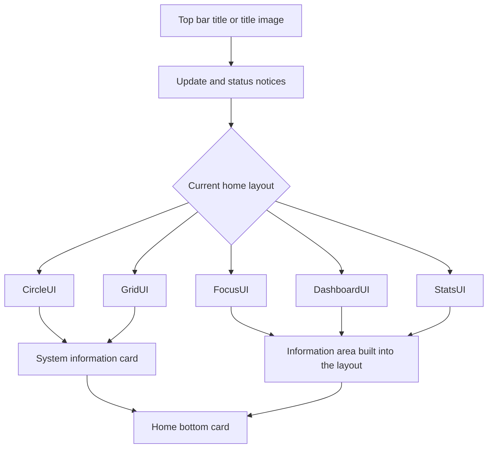

# Home & Layout

<Badge text="Home screen appearance" type="info" /> <Badge text="Does not change Root state" type="tip" />

The home screen consists of the top bar title, the status and update area, the current home layout, the system information card and the bottom card. This page explains how these areas are arranged, how they are hidden, and under which conditions custom content actually appears.

::: tip Entry

Open the Manager → Settings → Appearance, then adjust in the "Layout" and "Home screen information" groups. The page layout selects the "Home layout"; do not confuse it with the "Layout variant" again.

:::

## Home Screen Structure

The layout decides how the main content is arranged, and the bottom card is independent of the layout choice. Hiding system information or switching the bottom card changes neither Root authorization, module state nor kernel features.

## Five Home Layouts

::: table Layout choice

| Layout | Home screen focus | Suits |
| --- | --- | --- |
| **CircleUI** | A circular status area and a centralized home screen | Users who like a clean screen focused on Root state |
| **GridUI** | Two-column cards and more entries to scan | Users who want more information blocks on the home screen |
| **FocusUI** | Highlights the main status and adapts to screen orientation | Mixed phone and tablet use |
| **DashboardUI** | Dashboard-style sectioned cards | Users who like to read information by section |
| **StatsUI** | Superusers, modules, plugins and live metric statistics | Users who need counts and runtime metrics quickly |

:::

Switching the home layout changes the home screen content immediately and does not affect theme colors, wallpaper, font or bottom card settings. The system information card sits in a different place in each layout: CircleUI and GridUI show it after the layout body, while the other layouts place the information in their own panels.

## Layout Variants

The layout variant applies to the plugins, superuser and modules pages:

- **M3E**: large title, collapsible search bar and a more pronounced scroll hierarchy.
- **Traditional**: compact top bar that fits more content on one screen.

The home screen itself keeps a compact top bar; this option does not turn the home screen into another layout.

## Home Bottom Card

The bottom card sits after the home screen content and is a tappable shortcut information card. Go to "Appearance → Layout → Home bottom card" to choose the display mode.

::: table Four modes

| Mode | Actual content | What a tap does |
| --- | --- | --- |
| **Learn about FinaSU** (default) | The "Learn about FinaSU" title and the "Learn about FinaSU features and modules" description | Opens the FinaSU website in an external browser |
| **Support development and KernelSU** | First line "Support development", second line "Learn about KernelSU" | Opens the donation page and the KernelSU guide respectively |
| **Hidden** | No card is drawn at all | None |
| **Custom** | The title, subtitle and link you fill in yourself | Opens the HTTP(S) link you entered |

:::

### Learn about FinaSU

This is the default mode and has only one line:

- Title: Learn about FinaSU.
- Subtitle: Learn about FinaSU features and modules.
- Tap: opens `https://fina.mysqil.com/`.

Keep this mode when you are not sure what to choose.

### Support Development and KernelSU

This mode shows two lines:

:::: field-group

::: field Support development
@type `Donation entry`
@default `Opens Patreon`
Explains that KernelSU stays free and open source; tapping opens the project donation page.
:::

::: field Learn about KernelSU
@type `Documentation entry`
@default `Localized link`
Opens the KernelSU guide matching the current interface language, to learn about KernelSU installation and module development.
:::

::::

This opens external web pages. Without a browser, without network access, or when the system blocks the link, the page does not open inside the Manager.

### Hidden

After you select "Hidden", the home screen draws no bottom card and shows no blank placeholder either.

Hiding only affects the current display. If you switch back to "Learn about FinaSU" or "Custom" later, custom content saved earlier is still kept.

### Custom

After you select "Custom", three tappable text items appear on the settings page:

::: table Custom fields

| Field | Where it appears | What to write |
| --- | --- | --- |
| **Card title** | First line of the card, in bold | Briefly state "what this is" |
| **Card subtitle** | Below the title | State "what a tap will do" |
| **Link address** | The full URL is not shown | Enter the complete HTTP(S) address of the target page |

:::

Tapping any item opens an input box; confirming saves immediately, and cancelling keeps the original content.

::: warning A custom card requires all three fields

The title, subtitle and link must all be non-empty. If any one is missing, the home screen shows no card even though "Custom" is selected, which has the same effect as "Hidden". This is not a fault; it prevents a half-finished card.

:::

The link must use `http://` or `https://`:

- `https://example.com/guide`: can be saved.
- `http://example.com`: can be saved.
- `example.com`: missing the scheme, so you are asked to enter it again.
- `ftp://example.com`, `javascript:...`: not supported.

An invalid link does not overwrite the old value and the input box stays open; the value is saved only after you enter a valid address and confirm.

### A Complete Setup

:::: steps

1. Select "Custom" under "Home bottom card".
2. Open "Card title", enter the title and confirm.
3. Open "Card subtitle", enter the description and confirm.
4. Open "Link address", enter the complete `https://` address and confirm.
5. Return to the home screen and confirm the whole card is visible and that tapping it opens the target page.

::::

::: tip Want to hide the card temporarily

There is no need to clear the custom content. Switch the mode to "Hidden"; switching back to "Custom" later keeps using the original content.

:::

## Top Bar Title

The text title has three modes, and a title image can be enabled on top of them:

- **App name**: shows the current Manager app name.
- **KernelSU**: shows the KernelSU title.
- **Custom**: opens an input box for your own title.
- **Title image**: not a text mode; once enabled, an image replaces the current text title.

### Title Image

The advanced title image is a separate switch. Selecting an image enables the title image automatically; clearing the image turns it off.

Once the image is enabled, you can adjust:

- **Day opacity**: the image transparency in light mode.
- **Night opacity**: the image transparency in dark mode.
- **Darkening amount**: darkens the image so the title area does not get too bright.
- **Horizontal offset**: ranges from `-200 dp` to `200 dp` to move the image left or right.

Turning the image switch off returns to the selected text title. The title image is used only for the top title area and is not part of the wallpaper background.

## Home Screen Information Visibility

The home screen information area offers four hide switches:

- **Hide system fingerprint**: removes the system and kernel identification rows.
- **Hide Zygisk implementation**: only appears when a Zygisk implementation actually exists.
- **Hide SUSFS**: only appears when SUSFS is detected.
- **Hide module mount**: only appears when the Folk Mount state can be read.

::: info Hiding is not turning off

These switches only change what the home screen shows. Zygisk, SUSFS, the mount backend and Root authorization keep working as before. When troubleshooting compatibility problems, restore the display first and then judge the actual state.

:::

## Other Home Screen Settings

### Launcher Icon

You can switch between the default, geometric and KernelSU launcher icons. It only replaces the home screen icon and does not change the package name, signature or runtime mode.

### Interface Scale

The range is `80%–110%`. Larger values read better, smaller values fit more content; it does not change the Android system display size.

### Module Description Lines

A module description is collapsed automatically when it exceeds `1–5` lines. This setting affects module cards, not the home screen body text.

## FAQ

:::: collapse accordion

- **I selected "Custom" but the home screen shows no card**

  Check whether the title, subtitle and link are all filled in and saved, and in particular that the link starts with `http://` or `https://`.

- **I changed the title, but tapping the card still opens the old page**

  The link is a separate field and has to be changed on its own. Changing only the title or subtitle does not change the tap address.

- **Why was an invalid link not saved?**

  The Manager only accepts HTTP(S) web addresses, to avoid mistaking file paths, app intents or other protocols for a web link.

- **Does switching to "Hidden" delete the custom content?**

  No. The custom text and link stay in the settings, and switching back to "Custom" keeps using them.

- **Why is the wallpaper unchanged after downloading from the gallery?**

  Downloading only saves the image. You have to select the image again on the wallpaper page; a download never replaces the current background automatically.

::::

## Related Pages

- [Appearance](/en/setting/appearance/)
- [Theme & Color](/en/setting/theme/)
- [Wallpaper](/en/setting/wallpaper/)
- [Navigation](/en/setting/navigation/)
- [Module Cards](/en/setting/module-cards/)
