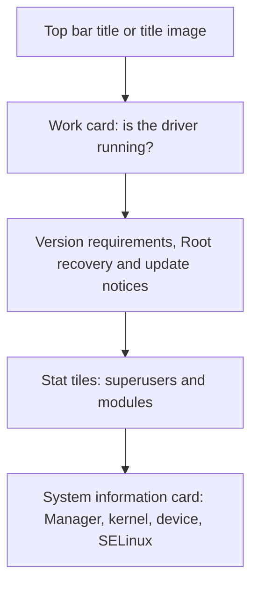

# Home & Layout

<Badge text="Home screen appearance" type="info" /> <Badge text="Does not change Root state" type="tip" />

The home screen consists of the top bar title, the work card, notices and version warnings, the two stat tiles and the system information card. This page explains how these areas are arranged, how they are hidden, and under which conditions custom content actually appears.

::: tip Entry

Open the Manager → Settings → Appearance, then adjust in the "Layout", "Home screen information" and "Other" groups.

:::

## Home Screen Structure

There is one arrangement: the work card always comes first, because it answers "is the driver loaded?" before anything else matters. The stat tiles sit between the work card and the information card and do not move with window size or orientation.

## Work Card

The work card is one tall card that states the status in display type:

- **Working**: a pale green card with a bright green stroked check mark (bottom corner, overflowing and clipped), the word "Working", and the version in a monospaced line under the title; along the top edge sit the run mode (LKM / Built-In), the custom LKM, safe mode and jailbreak tags. When the theme takes its colours from the wallpaper, the card and the mark use the dynamic palette instead.
- **Not installed**: the same height, a red "Tap to install" line at the top, "Not installed" in display type, and an "Install" button; a "Jailbreak" button joins it while SELinux is permissive.
- **Unsupported**: the reason in red at the top and "Unsupported" in display type, with no buttons.

Tapping the work card is the same as tapping install. The Manager keeps a wallpaper surface for this card alone: [Wallpaper → Work card](/en/setting/wallpaper/) sets its image, opacity, dim and day/night values, and can hide the mark, the text or the run-mode tag.

## Stat Tiles

Under the work card sit two tiles side by side - a large number over its name.

- **Superuser**: how many apps are granted, and a door into the superuser list.
- **Module**: how many modules are enabled, and a door into the module list.

When the counts cannot be read the tile says "Unavailable" and stops being tappable.

## Layout Variants

The layout variant applies to the plugins, superuser and modules pages:

- **M3E**: large title, collapsible search bar and a more pronounced scroll hierarchy.
- **Traditional**: compact top bar that fits more content on one screen.

The home screen itself keeps a compact top bar; this option does not turn the home screen into another layout.

## Top Bar Title

The text title has three modes, and a title image can be enabled on top of them:

- **App name**: shows the current Manager app name.
- **KernelSU**: shows the KernelSU title.
- **Custom**: opens an input box for your own title.
- **Title image**: not a text mode; once enabled, an image replaces the current text title.

### Title Image

The advanced title image is a separate switch. Selecting an image enables the title image automatically; clearing the image turns it off.

Once the image is enabled, you can adjust:

- **Day opacity**: the image transparency in light mode.
- **Night opacity**: the image transparency in dark mode.
- **Darkening amount**: darkens the image so the title area does not get too bright.
- **Horizontal offset**: ranges from `-200 dp` to `200 dp` to move the image left or right.

Turning the image switch off returns to the selected text title. The title image is used only for the top title area and is not part of the wallpaper background.

## Home Screen Information Visibility

The home screen information area offers four hide switches:

- **Hide system fingerprint**: removes the system and kernel identification rows.
- **Hide Zygisk implementation**: only appears when a Zygisk implementation actually exists.
- **Hide SUSFS**: only appears when SUSFS is detected.
- **Hide module mount**: only appears when the Folk Mount state can be read.

::: info Hiding is not turning off

These switches only change what the home screen shows. Zygisk, SUSFS, the mount backend and Root authorization keep working as before. When troubleshooting compatibility problems, restore the display first and then judge the actual state.

:::

## Other Home Screen Settings

### Interface Scale

The range is `80%–110%`. Larger values read better, smaller values fit more content; it does not change the Android system display size.

### Module Description Lines

A module description is collapsed automatically when it exceeds `1–5` lines. This setting affects module cards, not the home screen body text.

## FAQ

:::: collapse accordion

- **I set an image for the work card but the home screen did not change**

  The work card image lives in [Wallpaper → Work card](/en/setting/wallpaper/), and "Enable work card background" has to be on as well. Picking an image alone paints nothing.

- **Why is the wallpaper unchanged after downloading from the gallery?**

  Downloading only saves the image. You have to select the image again on the wallpaper page; a download never replaces the current background automatically.

::::

## Related Pages

- [Appearance](/en/setting/appearance/)
- [Theme & Color](/en/setting/theme/)
- [Wallpaper](/en/setting/wallpaper/)
- [Navigation](/en/setting/navigation/)
- [Module Cards](/en/setting/module-cards/)
