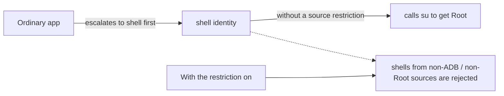

# Security Settings

<Badge text="Settings entry 5/8" type="info" /> <Badge text="Changes the system security boundary" type="danger" />

Security manages the kernel security state and debug entry points; it is not the Manager app lock. The app launch password and sensitive operation verification live under [Verification](/en/setting/authentication/).

::: tip How to get there

Open Manager → Settings → tap the second entry in the second row, **Security**.

:::

## The Four Security Features

::: table Feature quick reference

| Feature | What it does | Risk |
| --- | --- | --- |
| **Hide SELinux modifications** | Reduces the chance that apps detect FinaSU's changes to SELinux policy | May need a reboot; not universal hiding |
| **SELinux mode** | Shows the current mode and switches between Enforcing and Permissive | Permissive lowers whole-device protection |
| **ADB Root** | Runs `adbd` as Root so an ADB Shell gets high privileges directly | Exposes the debug entry |
| **Restrict Shell Root to ADB only** | Stops an ordinary app from becoming shell and then gaining Root | May affect Shell workflows that do not use ADB |

:::

## Hide SELinux Modifications

SELinux is Android's mandatory access control mechanism. To implement Root and module features, FinaSU may load extra policy or change runtime state; enabling this option does that as much as possible while preventing apps from detecting those changes.

How to use it:

:::: steps

1. Find "Hide SELinux modifications" on the Security page.
2. Toggle it while the switch is available; Manager writes the state to the boot configuration.
3. If it says "takes effect after reboot", do a full reboot and check again.
4. After the reboot, verify that app detection, module mounting and authorization still work.

::::

::: warning It is not complete invisibility

This feature targets SELinux modification detection only. Apps may still detect problems through mount records, kernel version, Zygisk, Root traces or other environment differences. Do not treat it as one-tap invisibility against every check.

:::

When the control shows `forced`, `managed` or `unsupported`, follow the page instructions. Forcing an external configuration may conflict with boot scripts or other modules.

## SELinux Mode

Tapping "SELinux mode" opens a confirmation dialog, and the page shows the current mode first.

::: table Switchable modes

| Mode | Meaning | Behavior in Settings |
| --- | --- | --- |
| **Enforcing** | Operations denied by policy are blocked and logged | Can be switched back from Permissive |
| **Permissive** | Policy denials are logged but usually not blocked | Can be switched to from Enforcing |

:::

The dialog offers only these two options. What the system actually executes is `setenforce 1` or `setenforce 0`:

- `setenforce 1` → Enforcing.
- `setenforce 0` → Permissive.
- There is no option or command to "switch SELinux to Disabled".

::: info Why the page may show "disabled"

Manager reads the result of `getenforce` and can display `Disabled`. If SELinux was already fully turned off in the kernel or system layer at boot, the current state shows "disabled"; this is a **read-only state**, you cannot switch to Disabled from here, and it is not a third selectable target.

:::

::: danger Permissive is a debugging state

Switching to Permissive weakens mandatory access control for the whole device. Do not keep it long term except for the jailbreak flow or explicit troubleshooting. Jailbreak mode may also depend on Permissive; before switching back to Enforcing, confirm that the current Root flow still works.

:::

You are asked to confirm again before switching. If the write fails, the page keeps the current mode it actually read back and does not pretend to succeed.

## ADB Root

ADB Root runs `adbd` with Root privileges, so a Shell connected over ADB has high privileges directly.

When to use it:

- Debugging system services.
- Reading logs or paths that an ordinary ADB Shell cannot access.
- Running commands that need Root during rescue and troubleshooting.

::: warning Enable it only while in use

Once on, anyone who can connect over ADB gets stronger capabilities. Do not leave it on with a public computer, an untrusted USB debugging environment, or a device left unattended for long periods. Turn it off when you are done.

:::

If the computer still shows an ordinary Shell, replug the USB cable, restart the ADB service, or disconnect and reconnect. Vendors differ in their restrictions on `adbd` and debug authorization.

## FinaSU Hide

FinaSU Hide changes selected bootloader-state properties to locked values during `post-fs-data`, so checks that read system properties directly see a locked state. Turning it on applies the change immediately and keeps it across later boots.

Only properties that already exist are covered: `ro.boot.vbmeta.device_state`, `ro.boot.verifiedbootstate`, `ro.boot.flash.locked`, `ro.boot.veritymode`, `vendor.boot.vbmeta.device_state`, `vendor.boot.verifiedbootstate`, `ro.boot.warranty_bit`, `ro.warranty_bit`, `ro.vendor.boot.warranty_bit`, `ro.vendor.warranty_bit`, `ro.secureboot.lockstate`, `ro.boot.realmebootstate`, `ro.boot.realme.lockstate`, `ro.debuggable`, `ro.adb.secure` and `ro.secure`. `service.adb.root` is deleted only when present; missing properties are never created.

Turning the switch off only stops future overrides; properties changed during the current boot remain changed. Reboot before checking the real values.

::: warning Capability boundaries

FinaSU Hide does not solve Play Integrity, keybox or hardware integrity attestation. It does not modify `/proc/bootconfig` or `/proc/cmdline`; use SUSFS cmdline/bootconfig spoofing when those detection surfaces also need to be consistent. It also does not hide USB debugging, wireless debugging or the root identity of `adbd` while ADB Root is active.

:::

## Restrict Shell Root to ADB Only

This feature adds a source check for an already authorized Shell: only a Shell started by `adbd` or by a KernelSU-family Root process can escalate to Root.

It mainly blocks this attack chain:

This is not "forbidding Shell from using Root"; it restricts where the Shell process comes from. A debug Shell opened over ADB, and a Shell started by a trusted Root process, can still use Root.

::: tip When a terminal app suddenly cannot use Root

First check whether that terminal app's own Root process comes from an allowed source. Turning this item off restores the old permissive behavior, but it also re-exposes the "app → shell → Root" chain.

:::

## Security Baseline

::: timeline Recommended day-to-day security order

- Keep SELinux in Enforcing and switch to Permissive only temporarily for jailbreak or troubleshooting
  time=System type=success

- Turn off ADB Root when you do not need to debug from a computer, and turn off Android wireless debugging
  time=Debug

- Keep "Restrict Shell Root to ADB only" on unless a specific workflow requires it off
  time=Root

- Grant Root only to trusted apps and narrow privileges with App Profile
  time=Apps

- Enable [Verification](/en/setting/authentication/) for Manager launch and high-risk operations
  time=Manager type=tip

:::

## Common Questions

:::: collapse accordion

- **Why is a reboot still needed after hiding SELinux modifications?**

  Some policies or detection surfaces are established only early in boot. When the current session cannot replace them completely, Manager asks for a reboot.

- **Does Permissive make every Root app work correctly?**

  Not necessarily. It only relaxes SELinux denial behavior; it does not fix file permissions, mounts, signatures or an app's own compatibility problems.

- **Are ADB Root and "allow any app to become dynamic manager" the same thing?**

  No. ADB Root changes the identity of the debug Shell; the dynamic manager option changes which apps can become the manager.

- **Why does restricting the Shell source also affect ADB modules?**

  Check the actual parent process of the Shell that the module starts. Only chains recognized as `adbd` or a KernelSU-family Root source qualify.

- **Can these options replace an app lock?**

  No. They are kernel and debugging boundaries; the app lock belongs to the Verification category.

::::

## Related Pages

- [Hiding & Kernel Security](/en/setting/hiding/)
- [Access Control](/en/setting/access/)
- [Verification](/en/setting/authentication/)
- [App Profile](/en/manager/app-profile/)
