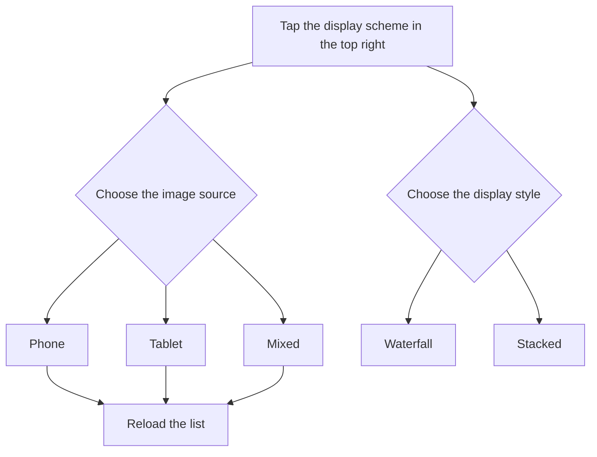

# Wallpaper Gallery

<Badge text="Settings home entry" type="info" /> <Badge text="Downloading is not applying" type="warning" />

The wallpaper gallery is a separate image browsing page whose entry sits in the shortcuts list on the Settings home screen; it is not one of the eight settings categories.

It is for viewing, previewing and downloading wallpapers. ==Downloading does not replace the current Manager wallpaper automatically==; after the download you still have to go to "Appearance → Wallpaper" and choose it manually.

::: tip Where to find it

Open Manager → Settings → tap **Wallpaper gallery** below the eight categories.

:::

## What the Page Does

::: table Feature overview

| Action | Location | Result |
| --- | --- | --- |
| **Switch display scheme** | The tune icon on the right of the top bar | Choose the device scope and a waterfall or stacked layout |
| **Load more** | Scroll down the list | Keeps loading images |
| **Refresh the gallery** | Pull down from the top | Clears the current gallery cache and fetches again |
| **Preview** | Tap any image | Opens the full-size preview |
| **Download** | "Download" in the preview dialog | Saves the image to the device pictures directory |
| **Cancel** | "Cancel" in the preview dialog | Closes the preview without saving a file |

:::

## Adjusting the Display Scheme

Tapping the "display scheme" icon in the top right opens a settings panel from the bottom.

### Image Source Device

- **Phone**: mainly shows images suited to a phone screen.
- **Tablet**: mainly shows images suited to a tablet screen.
- **Mixed**: blends phone and tablet sources.

After you change the device scope, the list reloads for the new scope.

### Display Style

- **Waterfall**: images of different aspect ratios flow continuously, which suits quickly browsing many images.
- **Stacked**: uses layered cards, so the images are more concentrated.

The display style only changes the browsing layout, not the downloaded image files.



## Browsing and Previewing

Images are shown as cards. Tapping an image opens the preview dialog, which has two actions:

:::: field-group

::: field Cancel
@type `Close`
@default `Do not save`
Closes the preview without downloading the image or changing the current wallpaper.
:::

::: field Download
@type `Save image`
@default `Do not apply automatically`
Shows "saved" on success; on failure it shows the reason.
:::

::::

As you scroll down near the end of the list, the page keeps loading images. When the network is unavailable, the gallery is temporarily empty or loading fails, the page shows a message and a "Retry" button.

::: tip Pull to refresh clears the gallery cache

A refresh does not merely rearrange the current list; it clears the gallery cache and fetches again. Images already downloaded to `Pictures/FinaSU` are not affected.

:::

## Where Downloads Go

The save location depends on the Android version:

::: table Save location

| System version | Save location | Easy to find in a file manager |
| --- | --- | --- |
| **Android 10 and later** | The public pictures directory `Pictures/FinaSU` | Yes, visible from the "Photos" or "Files" app |
| **Android 9 and earlier** | `FinaSU` under Manager's own external pictures directory | Depends on the device file manager, may be less obvious than a public directory |

:::

On Android 10 and later you can usually find it in a file manager at this path:

```file-tree title="Android 10+ download location"
Pictures/
└── FinaSU/
    └── Downloaded wallpaper images
```

The download page does not clean up old wallpapers automatically. To free space, delete unneeded images with the system file manager.

## Setting a Downloaded Image as Wallpaper

:::: steps

1. Open an image in the wallpaper gallery and choose "Download".
2. After you see "saved", go back to Settings.
3. Enter "Appearance → Wallpaper".
4. Turn on "Enable wallpaper".
5. Tap "Choose image" and find the image you just downloaded in the system file picker.
6. Adjust surface opacity, blur, scrim and day/night display as needed.

::::

::: warning The gallery does not set the wallpaper directly

The gallery page only browses and saves images; it has no "set as wallpaper now" button. If you do not go to the wallpaper page and choose the file after downloading, the current Manager background does not change.

:::

## Not Using Gallery Images

You can choose to:

- Go back to [Wallpaper](/en/setting/wallpaper/) and pick another image from the device.
- Use a video background.
- Choose "Restore the default theme" to clear the current wallpaper and related theme resources.

Files downloaded from the gallery are kept, and restoring the default wallpaper does not delete images already downloaded to `Pictures/FinaSU`.

## Common Questions

:::: collapse accordion

- **The wallpaper gallery never finishes loading**

  Check the network first, then pull down from the top of the page to refresh; if it still fails, tap "Retry". If the gallery cache is corrupted, a refresh rebuilds it.

- **Why does the wallpaper not change after downloading?**

  Downloading only saves the image. You have to go back to "Appearance → Wallpaper" and choose that file.

- **Why did the download fail?**

  Common causes are a dropped network, an expired image URL, insufficient device storage or the system being unable to write to the pictures directory. The error message gives the current reason.

- **Can the gallery page delete downloaded images?**

  No. The gallery page only offers preview and download; use the system "Photos" or "Files" app to delete files.

- **Does switching between waterfall and stacked download the images again?**

  No. The display style only affects layout; only a change in the image source scope triggers a list reload.

- **Does a download overwrite a file with the same name?**

  Do not rely on same-name overwriting to update an image. Check the file name and save directory before downloading to avoid mixing wallpapers from different sources.

::::

## Related Pages

- [Appearance](/en/setting/appearance/)
- [Wallpaper](/en/setting/wallpaper/)
- [Home & Layout](/en/setting/home/)
