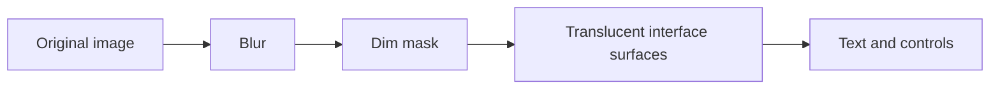

# Background Blur

<Badge text="Image backgrounds only" type="tip" /> <Badge text="UI 0–50" type="info" /> <Badge text="Runtime limit 64" type="warning" />

The Blur option on the wallpaper page changes the blur radius of a static image or GIF background. It does not blur button text and does not blur a video background; the opacity and dim on cards are two other layers.

## Three Ranges That Must Be Read Separately

:::: table The three boundaries of a blur value

| Layer | Range | Behavior |
| --- | --- | --- |
| Wallpaper settings UI | `0..50` | The range the user can pick directly by dragging the slider |
| Theme import validation | `0..100` | Theme fields in this range pass numeric validation |
| Runtime storage | `0..64` | `WallpaperConfig.updateBlur` finally clamps the value to 64 |

::::

So when you import a theme with `backgroundBlur: 80`, the field passes import validation but the effective runtime value is 64. Do not read that difference as "a theme that writes 100 is necessarily rendered at 100".

## What It Applies To

- JPG, PNG, WebP and JPEG static backgrounds;
- animated images such as GIF that the system can decode;
- single-image wallpapers;
- per-page images in multi-background mode.

The following do not use this blur value:

- a `video_background.*` video background;
- system interfaces such as the navigation bar and status bar;
- the image resources inside cards themselves;
- theme store preview images.

While a video background keeps playing, the image layer is paused or hidden, so changing the image blur no longer produces a visible change.

## Relationship with Transparency and Dim



Conceptually the three layers solve different problems:

- **Blur** reduces background texture so edges and text are calmer;
- **dim** darkens the background and raises the contrast of light text;
- **surface opacity** decides how much background a card covers.

Actual rendering is decided jointly by the wallpaper, the surface tokens and the page material; the three values are not a simple CSS filter order.

## Recommendations

::::: steps

1. Turn off extreme dim values first and pick a wallpaper with detail.
2. Start increasing blur from 10–20 and watch the small text and card edges on the home screen.
3. Then adjust the dim so both dark and light backgrounds are readable.
4. Finally adjust the surface opacity so not everything is covered by one frosted panel.
5. Scroll a long list on a low-end device and confirm there is no obvious frame drop.

:::::

:::: warning High resolution does not become sharper on its own

The background uses crop-to-fill, so oversized images first bring decoding and GPU memory cost. A high blur value also does not guarantee that low-contrast text is readable; text still depends on dim, surfaces and the theme palette.

::::

## Theme Fields

```json
{
  "isBackgroundEnabled": true,
  "backgroundBlur": 20
}
```

`backgroundBlur` only has real meaning when the background is enabled. After import you can keep adjusting it in Settings → Appearance → Wallpaper; exporting again writes the value stored at runtime.

## Related Pages

- [Wallpaper](/en/setting/wallpaper/): picking an image, sliders and dim.
- [Global Background](/en/theme/global/transparency/): interface surfaces and card backgrounds.
- [Video Background](/en/theme/global/video/): why video does not use image blur.
