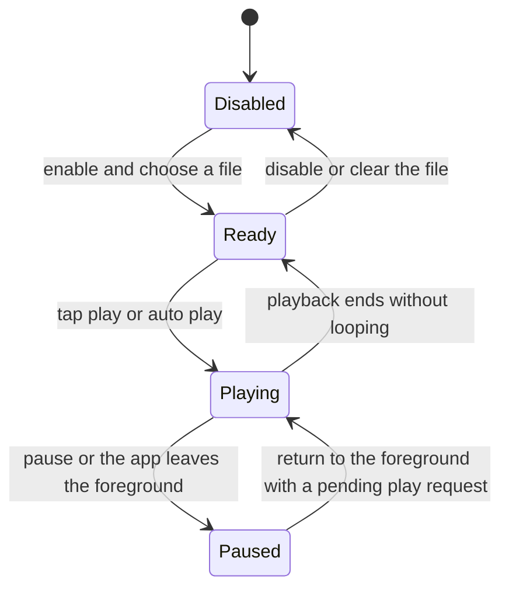

# Background Music

<Badge text="Plays in the Manager foreground only" type="tip" /> <Badge text="Uses the actual file name" type="warning" /> <Badge text="Not part of system media controls" type="info" />

Background music is played by the `MediaPlayer` of the FinaSU Manager and only continues while the app is in the foreground. Playback stops after leaving the app and resumes according to the manual play or auto play state when you return.

## Settings

:::: table Music settings

| Setting | Field | Behavior |
| --- | --- | --- |
| Background music | `isMusicEnabled` | Master switch; no resource is loaded when off |
| Choose file | `musicFilename` | Import audio with the system file picker |
| Auto play | `isAutoPlayEnabled` | Starts automatically when entering the foreground |
| Loop playback | `isLoopingEnabled` | Replays after reaching the end |
| Volume | `musicVolume` | 0–1, adjusted live during playback |
| Manual play/pause | Player state | Appears only when enabled and a file is present |

::::

Picking a file enables music automatically. The player decodes within the range the system `MediaPlayer` supports; the theme format adds no further restriction on audio encoding, but a playback failure is still shown when the device does not support the file.

## Lifecycle



The player is initialized once and prepared asynchronously. It pauses when the app goes to the background; the sound does not become a system-level background playback service and is not registered in Android media notifications.

## Theme Package

A theme references music by its actual file name:

```json
{
  "isMusicEnabled": true,
  "musicFilename": "background_music.mp3",
  "musicVolume": 0.7,
  "isAutoPlayEnabled": true,
  "isLoopingEnabled": true
}
```

The ZIP must contain an entry with the same name, for example:

```file-tree title="Music resource example"
fpt root
├── theme.json
└── background_music.mp3
```

The importer only looks up and copies that entry when music is enabled. `musicFilename` is the key for finding a resource inside the package, not an arbitrary file system path.

:::: warning The enable field and the resource must both be correct

Writing only `isMusicEnabled=true` without a file of the same name shows a missing-resource warning; including audio without writing the file name does not play it either.

::::

## Files and Size

- prefer a short looping clip;
- long audio noticeably increases the size of the `.fpt`;
- high-bitrate lossless formats may consume more decoding resources on a phone;
- confirm the audio copyright and distribution license before sharing a theme;
- clearing the music disables music and deletes the Manager private copy at the same time.

## Common Questions

::::: collapse accordion

:::: collapse The settings show a file but there is no sound
Tap play first, then check whether the volume is 0, whether the file fails to decode, or whether the app is in the background. A player error shows Cannot play in the settings.
::::

:::: collapse Music plays automatically every time I return to the app
With auto play enabled, entering the foreground resumes playback. Turn off Auto play if you want manual control.
::::

:::: collapse Music and video sound play at the same time
A video background and background music are two independent players. Lower one of the volumes, or disable the media you do not need.
::::

:::: collapse Music is still held by the old file after a theme import
An import stops the current playback, replaces the file and reloads. If it is still abnormal, clear the music and import again.
::::

:::::

## Related Pages

- [Multimedia Settings](/en/setting/multimedia/): the complete settings entry for music, sound effects and vibration.
- [Sound Effects](/en/theme/global/sound/): touch and boot sound effects.
- [Video Background](/en/theme/global/video/): an independent video audio track.
- [Theme Package Structure](/en/developer/theme-package/): music file mapping and validation.
