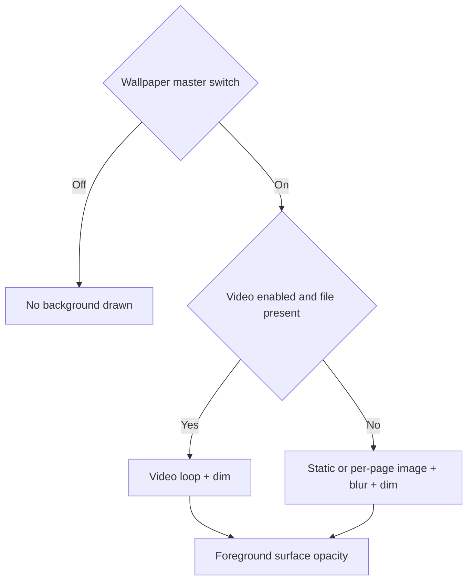

# Video Background

<Badge text="Loops" type="tip" /> <Badge text="The system decoder decides compatibility" type="warning" /> <Badge text="Size grows noticeably" type="danger" />

A video background loops in the Manager foreground and replaces the static image background layer. It is still controlled by the wallpaper master switch and the dim, but image blur does not apply to video.

## Supported Resource Names

The theme resource policy accepts:

```text
video_background.mp4
video_background.webm
video_background.mkv
```

The priority is `mp4`, then `webm`, then `mkv`. Whether playback actually works depends on the Android `VideoView` / `MediaPlayer`, the device decoder and the video encoding parameters; a supported extension does not mean any encoding will play.

## Playback Behavior

- uses `SCALE_TO_FIT_WITH_CROPPING` to crop and fill the window;
- loops automatically;
- continues playing on foreground `ON_START`;
- pauses when the app goes to the background;
- sound is controlled by `videoVolume`, in the range 0–1;
- the wallpaper dim is overlaid on the background layer.

The video does not become an Android live wallpaper and does not affect the home screen, lock screen or other apps. It is not a persistent background playback service.

## Relationship with Images, Blur and Transparency



The video itself has no image blur. In video mode the wallpaper page hides the global opacity and blur sliders; an already saved opacity still takes part in the surface tokens, so how much the video shows through depends on the card surface material, not on alpha embedded in the video resource.

## Theme Fields

```json
{
  "isBackgroundEnabled": true,
  "isVideoBackgroundEnabled": true,
  "videoVolume": 0.0,
  "backgroundDim": 0.2
}
```

`isBackgroundEnabled` is the master switch. When only `isVideoBackgroundEnabled` is true but the master switch is off, the video is not drawn. A missing resource produces a warning and a fallback is used.

A video entry noticeably increases the size of the `.fpt`. Check the container limits and the free space on the device before exporting, and do not label it as a wallpaper package of only a few MB when sharing.

## Performance and Format Recommendations

::::: steps

1. Choose a short looping clip to reduce sustained decoding pressure.
2. Prefer a combination common on the target device, such as H.264/AVC MP4.
3. Keep the resolution no higher than the screen you mainly use.
4. Disable unnecessary audio, or set `videoVolume` to 0.
5. On a low-end device, scroll a long list and press Home to return, and check pause and resume.

:::::

:::: danger A decoding failure may show only an empty background

Player errors are consumed so the app does not crash, but the user may only see a dark background. Verify the file in the system player first, then check the codec, profile and audio track.

::::

## Common Questions

::::: collapse accordion

:::: collapse The video has sound but no picture
The video encoding or resolution may be unsupported. Transcode to a format common on the device instead of only changing the extension.
::::

:::: collapse Playback does not continue after switching to the background
This is by design. A video background only plays in the foreground to avoid continuous decoding and battery drain in the background.
::::

:::: collapse The video background and background music interfere with each other
They are independent players. Disable the video audio track, lower the video volume, or turn off the background music.
::::

:::: collapse I want to blur the video
The current video layer has no blur parameter. When you need a static softened effect, apply it to an image or during video editing.
::::

:::::

## Related Pages

- [Wallpaper](/en/setting/wallpaper/): selecting, clearing video and volume.
- [Background Blur](/en/theme/global/blur/): blur for static images and GIFs only.
- [Background Music](/en/theme/global/music/): the independent music player.
- [Theme Package Structure](/en/developer/theme-package/): video entries and validation.
