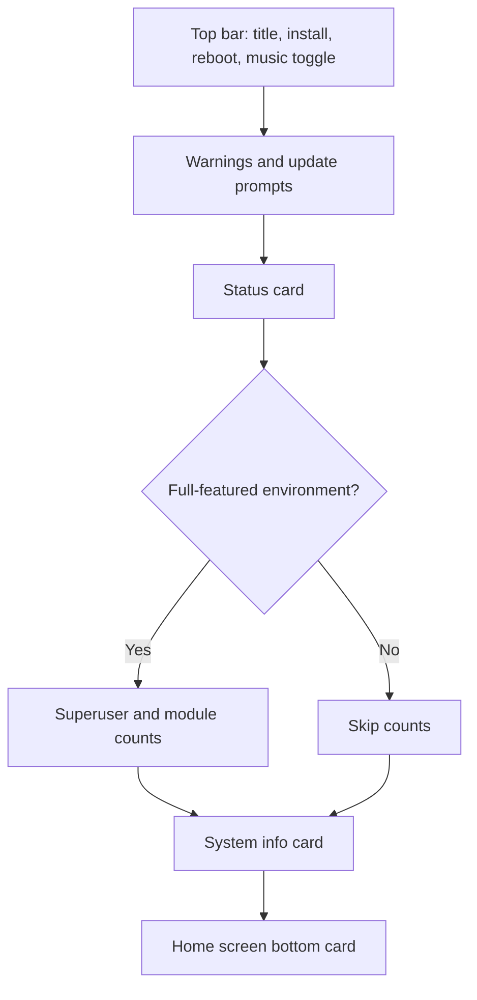

# Circle Theme Overview

<Badge text="Default layout" type="tip" /> <Badge text="Single-column card flow" type="info" /> <Badge text="No dedicated card surface" type="warning" />

CircleUI is the default home layout of FinaSU, with the token `circle`. It arranges status, counts, system facts and the bottom card in a single column, focusing on a clear information hierarchy rather than the largest number of information blocks.

## Home Screen Structure

:::: table Page Composition

| Area | Content |
| --- | --- |
| Top bar | Title/title image, music, install, reboot |
| Status card | Running, not installed or unsupported; version and run mode |
| Counts | Superuser count, enabled module count |
| System info | Manager, kernel, device, SELinux, Seccomp and optional capabilities |
| Bottom | Learn about FinaSU, classic support, custom or hidden |

::::

## When Counts Appear

Counts are drawn only when `useFullFeaturedLayout()` is true. It means the current interface has a full-featured environment, not that "two numbers always show as long as the Manager is installed".

In a full-featured environment, the two count cards sit side by side horizontally:

- Tapping the superuser card opens the Superuser page;
- Tapping the module card opens the Modules page;
- The numbers come from the current Manager state.

## Layout Compatibility

::::: field-group

:::: field FinaSU
@type `circle`
Select CircleUI in "Settings → Appearance → Layout → Home Layout".
::::

:::: field FolkPatch
@type `default` / `sign`
Mapped to CircleUI on import; if the local layout has not been changed by other settings, exporting again can keep the original historic token.
::::

:::: field Unknown token
@type `Keep current layout`
Unsupported layout values are removed and produce a warning; a new layout is not forced onto them.
::::

:::::

## What Circle Does Not Have

CircleUI currently has no standalone "working card image" surface. The following settings belong to other layouts:

- Grid working card background `grid_working_card_background.*`;
- The four Focus card backgrounds;
- Dashboard Hero `dashboard_card_bg.*`.

Circle can still use the page wallpaper, global surface transparency, dim, blur, colors, fonts and the bottom card. When you need a standalone card image, switch to the matching layout instead of looking for an entry that does not exist on the Circle page.

## Pages

- [Basic Styling](/en/theme/theme-circle/basic/)
- [Background](/en/theme/theme-circle/background/)
- [Working Card](/en/theme/theme-circle/working-card/)
- [Component Hiding](/en/theme/theme-circle/component-hiding/)
- [Interaction](/en/theme/theme-circle/interaction/)
