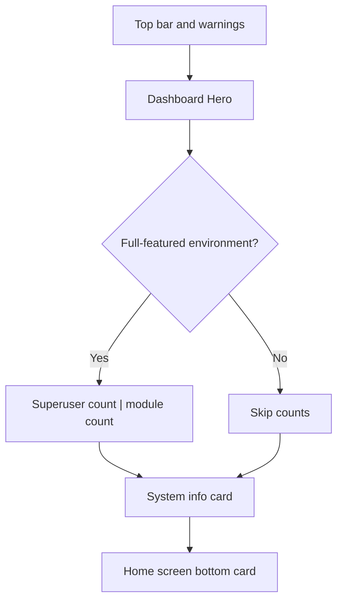

# Dashboard Theme Overview

<Badge text="Wide Hero" type="tip" /> <Badge text="Always single column" type="warning" /> <Badge text="Hero image is independent" type="info" />

The token for DashboardUI is `dashboard_ui`. It summarizes the core state in one wide Hero, with two count cards and the system info card below.

## Structure



Dashboard currently does not become two columns based on width. Even when a tablet is 600dp wide, the Hero, the counts and the system info are still arranged vertically; where this differs from the implementation of some FolkPatch reference layouts, the current FinaSU source is authoritative.

## Hero

The Hero contains:

- The status icon and title;
- A version summary;
- Run/safe/jailbreak/custom LKM state;
- Three facts: module version, kernel, SELinux;
- A jailbreak button when not installed and SELinux is Permissive.

The Hero can use an image independently:

```text
dashboard_card_bg.*
surface.layout.dashboard.hero
```

## Counts and System Info

A full-featured environment shows the superuser and enabled module counts, each taking half of the width horizontally. The system info card then shows the Manager, kernel, device, SELinux, Seccomp and optional capabilities.

## Difference from Stats

Dashboard:

- Does not continuously collect device metrics;
- Does not draw CPU/RAM waveforms;
- Does not draw ring statistics;
- The Hero and the system info are the main visual layers.

StatsUI:

- Samples continuously;
- Includes the monitoring card and module/user/plugin ring charts;
- Can split into two columns on wide screens.

## Pages

- [Basic Styling](/en/theme/theme-dashboard/basic/)
- [Status Info](/en/theme/theme-dashboard/hardware/)
- [Statistics Entry](/en/theme/theme-dashboard/statistics/)
- [Interaction](/en/theme/theme-dashboard/interaction/)
