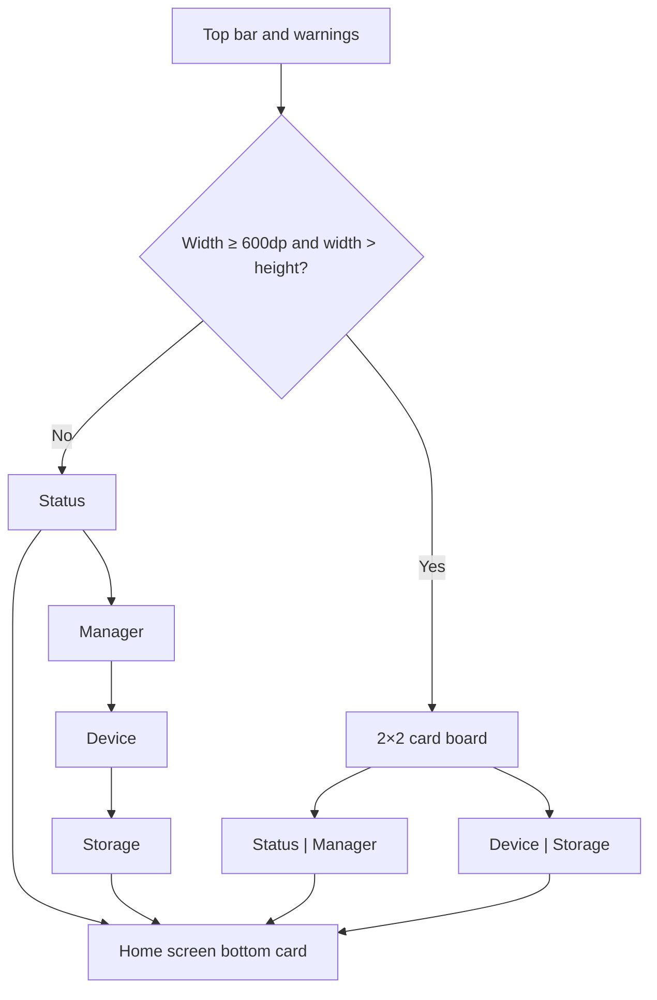

# Focus Theme Overview

<Badge text="Four-card information board" type="tip" /> <Badge text="2×2 in landscape" type="info" /> <Badge text="Continuously sampled metrics" type="warning" />

The token for FocusUI is `focus`. It splits the home screen into four semantic cards — status, Manager, device and storage — so the same fact is not repeated across multiple cards.

## Structure



The 2×2 reflow also requires the current full-featured layout. A screen width of 600dp alone is not enough; the window must also be wider than it is tall.

## The Four Cards

:::: table Card Responsibilities

| Card | Main content | Actions |
| --- | --- | --- |
| Status | Run state, version-UAPI, run/safe/jailbreak/custom LKM state | Install, update Manager, jailbreak |
| Manager | Manager, kernel, device, SELinux, Seccomp, optional capabilities | The SUSFS row can be managed |
| Device | Battery temperature, CPU temperature, battery level | No separate buttons |
| Storage | Data, RAM, zram, swap | No separate buttons |

::::

Device and storage are sampled continuously only while the Manager home screen is the current page and the current layout is Focus/Stats.

## Surface Configuration

The four Focus cards share one parent surface:

```text
layout.focus
```

The shared parts are:

- The master switch;
- Opacity and day/night opacity;
- Dim and day/night dim.

The four child cards each store only their own image:

```text
layout.focus.card.kernel
layout.focus.card.app
layout.focus.card.device
layout.focus.card.storage
```

When the parent is turned off, none of the four cards draws an image background.

## Pages

- [Basic Styling](/en/theme/theme-focus/basic/)
- [Hardware Info](/en/theme/theme-focus/hardware/)
- [Tablet Layout](/en/theme/theme-focus/tablet/)
- [Interaction](/en/theme/theme-focus/interaction/)
