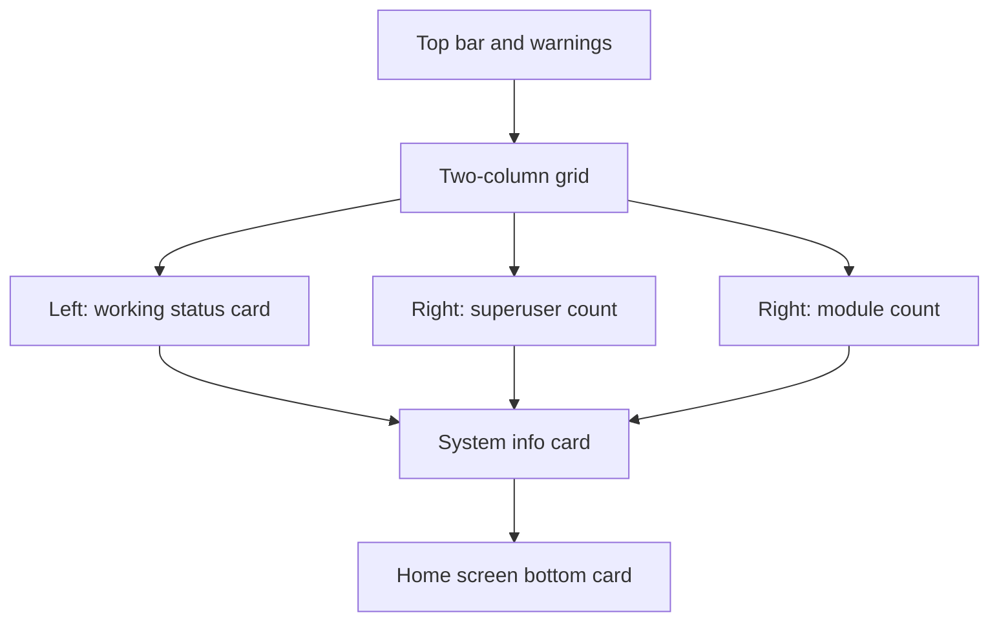

# Grid Theme Overview

<Badge text="Two-column cards" type="tip" /> <Badge text="Working card image is independent" type="info" /> <Badge text="Always two columns" type="warning" />

The token for GridUI is `kernelsu`. The top of the home screen is always two columns: the working status card on the left, and the superuser and module counts stacked vertically on the right. The system info card and the bottom card sit below.

## Page Structure



The two columns use equal weight, and the working card height is determined by the content in its row. It does not collapse into a single column on narrow screens; this is the main difference between Grid and the Focus responsive reflow.

## Count Availability

The count cards always occupy their position, but numbers are shown only in a full-featured environment where root is available. When unavailable, the placeholder is kept so the page layout does not jump.

Available count cards:

- Superuser count;
- Enabled module count.

## Working Card Surface

Grid is the first layout with a complete working card surface:

```text
surface.layout.grid.workCard.*
Image base name: grid_working_card_background
```

It can independently enable an image, adjust opacity, set day and night opacity and dim, and hide the icon, the title and the run mode tags.

When the StatsUI top layout is set to `grid`, the same working card surface is reused; when the Stats top layout is `list`, the standard status card is used instead and the surface is not applied.

## Layout Selection

Select GridUI in "Settings → Appearance → Layout → Home Layout". The theme JSON uses `kernelsu`.

:::: warning The Label and the Token Differ

The interface shows GridUI, but the historic protocol token is `kernelsu`. When writing a theme, use `homeLayoutStyle: "kernelsu"` and do not invent `grid`.

::::

## Pages

- [Basic Styling](/en/theme/theme-grid/basic/)
- [Background](/en/theme/theme-grid/background/)
- [Working Card](/en/theme/theme-grid/working-card/)
- [Component Hiding](/en/theme/theme-grid/component-hiding/)
- [Interaction](/en/theme/theme-grid/interaction/)
