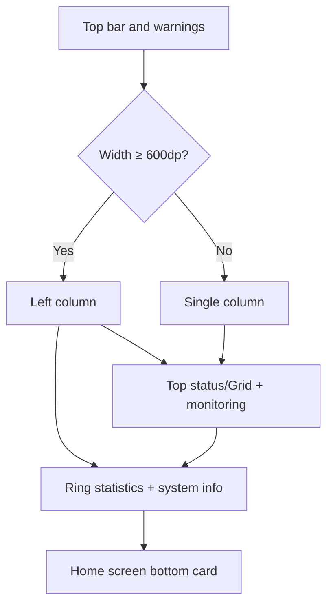

# StatsUI Theme Overview

<Badge text="Live monitoring" type="tip" /> <Badge text="Top can switch list/grid" type="info" /> <Badge text="Two columns on wide screens" type="warning" />

The token for StatsUI is `stats`. It combines the top status, device monitoring, a three-category ring chart and system info into one information-dense home screen.

## Structure

The Stats wide-screen check only requires a width of at least 600dp and does not require the window to be wider than it is tall. This differs from the Focus orientation condition.

## Top Layout

`statsTopLayout` has two official settings:

::::: field-group

:::: field List style
@type `list`
The top uses the standard status card. The Circle "Hide status tags" setting is also visible here, used to hide the `LKM` / `Built-In` tags.
::::

:::: field Grid style
@type `grid`
The top reuses the Grid working card and the two count cards, sharing the `surface.layout.grid.workCard` configuration.
::::

:::::

Settings entry: "Settings → Appearance → Layout → Top layout", shown only when the current home screen is StatsUI.

## Four Main Areas

:::: table Stats Cards

| Area | Content |
| --- | --- |
| Top | The standard status card, or the Grid working card plus counts |
| Monitoring | CPU temperature waveform, RAM waveform, CPU clusters, battery, zram, swap |
| Ring statistics | Module, superuser and plugin counts |
| System info | Manager, kernel, device, SELinux, Seccomp and optional capabilities |

::::

Stats has no monitoring card image surface; its themeable images mainly come from the page background, plus the Grid working card when Grid is selected for the top.

## Sampling

Metrics are collected continuously only while the home screen is the current page and the layout is Stats/Focus. Once every 5 seconds, keeping 30 samples. Collection stops after leaving the page.

## Pages

- [Basic Styling](/en/theme/theme-statsui/basic/)
- [Hardware Monitoring](/en/theme/theme-statsui/hardware/)
- [Statistics](/en/theme/theme-statsui/statistics/)
- [Interaction](/en/theme/theme-statsui/interaction/)
