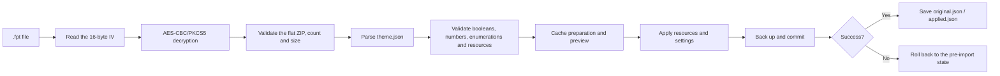

# Theme Preview & Usage

<Badge text="Changes Manager appearance only" type="tip" /> <Badge text=".fpt is not a signature" type="danger" /> <Badge text="Compatible with FolkPatch theme fields" type="warning" />

A FinaSU theme only changes the display and interaction resources of the Manager. It does not change root authorization, App Profile, the module list, kernel configuration or mount results. A single theme package can contain colors, background, font, home layout, navigation icons, music and sound effects, but each feature must still meet its own conditions for taking effect.

==Downloading a theme does not mean it is applied.== After a theme store download completes, the confirmation and `.fpt` import flow still follow; saving the file to the download directory alone does not change the Manager.

## Where to Start From

:::: table Theme-related entry points

| Task | Entry point | Notes |
| --- | --- | --- |
| Choose the layout, bottom cards and title | Settings → Appearance → Layout | Layout and home screen information are Manager settings |
| Change light or dark mode and colors | Settings → Appearance → Theme settings | Choose between system, light, dark and AMOLED |
| Set wallpaper, video and theme packages | Settings → Appearance → Wallpaper | Import, export and restore default theme also live here |
| Change the font | Settings → Appearance → Font | App default, system default or custom file |
| Browse online themes | Settings → Appearance → Theme store | Built-in download or browser compatibility mode |
| Change music, sound effects and vibration | Settings → Multimedia | Vibration is not part of the `.fpt` theme resources |

::::

## Five Home Layouts

:::: table Actual layout tokens and structure

| Interface name | Theme JSON token | Home screen structure | Live metrics |
| --- | --- | --- | --- |
| CircleUI | `circle` | Single status card; two count cards are added in a full environment | No continuous sampling |
| GridUI | `kernelsu` | Working card on the left, two vertical count cards on the right | No continuous sampling |
| FocusUI | `focus` | Four cards: status, Manager, device and storage | Continuous sampling |
| DashboardUI | `dashboard_ui` | Wide hero, two count cards, system information | No continuous sampling |
| StatsUI | `stats` | Top status or grid, monitoring, ring statistics, system information | Continuous sampling |

::::

The `default` and `sign` values in a FolkPatch theme map to FinaSU `circle`; `kernelsu`, `focus`, `dashboard_ui` and `stats` correspond directly. An unknown layout token does not forcibly override the current layout and produces a warning during import.

## Theme Store

The theme store reads an online theme index that is compatible with FolkPatch. The two modes only change how a theme reaches the device, not index browsing, search or filtering.

The first time you open the store it asks you to choose a download method; afterwards you can change it in Settings → Appearance → Theme store mode.

::::: field-group

:::: field Built-in mode
@type `In-app download`
The download progress is shown in the app and can be paused, resumed or canceled. `.fpt` and the preview image download separately, so a failed preview does not damage the theme file. Once the download finishes you go straight to the same theme import confirmation dialog.
::::

:::: field Compatibility mode
@type `Browser fallback`
Tapping download hands the theme link to the browser. After saving the `.fpt`, open it with FinaSU from the file manager, or return to the wallpaper page and import it manually. This suits devices where the built-in download or file import flow is unstable.
::::

:::::

Built-in mode saves themes in the Manager private directory `filesDir/themes/<author>/<name>/` and writes `theme_meta.json`. The author and name from the URL first have characters that are illegal on the file system replaced, so a directory traversal cannot form directly.

In compatibility mode the browser takes over the download, so the store does not show the My Themes entry; save it as an ordinary `.fpt` file and import it through the system file picker.

The store supports:

- search by name, author and description;
- filtering by author and by official or third-party source;
- selecting the phone or tablet type at the same time;
- pull to refresh;
- at most three theme download tasks at the same time;
- at most three retries, with pause resuming through HTTP `Range`;
- searching, re-applying or deleting local themes in My Themes.

:::: warning A Completed status does not guarantee the theme is compatible

The downloader only checks the file size, the minimum length and the AES-CBC container length. The real ZIP structure, `theme.json`, resources and field validation happen during import. When a download succeeds but the import fails, read the import error instead of tapping Apply repeatedly.

::::

## Import a Theme

:::: steps

1. **Obtain the `.fpt` file**

   Download it from a trusted source and confirm the file was not renamed to `.zip`, `.bin` or another extension by a chat app, cloud drive or downloader.

2. **Open it in the app**

   You can tap Apply in the theme store, open it with FinaSU from the file manager, or pick the file from Settings → Appearance → Wallpaper → Import theme package.

3. **Check the preview and metadata**

   Confirm the theme name, author, version, phone or tablet type and resource count. The preview image only identifies the theme; it does not mean every resource will decode.

4. **Confirm and apply**

   If an app lock is enabled, the import first requires passing theme import authentication. After confirmation the Manager prepares the theme in the cache directory and then applies it transactionally.

5. **Check the actual result**

   Go through the home layout, colors, wallpaper, font, navigation icons, music and sound effects. Missing resources usually fall back or produce a warning; a file that does not exist is never reported as success.

::::

The import flow can be summarized as:

Applying a theme first saves a backup of the current resources and settings. Application starts only after authentication passes; any failing step attempts a rollback. The language switch runs last, because on Android 13 and above the system may recreate the Activity.

## What a Theme Can Change

::::: collapse accordion

:::: collapse Background and layout
Main wallpaper, five per-page backgrounds, video background, advanced title image, Grid working card, four Focus cards, Dashboard hero, layout token and Stats top layout.
::::

:::: collapse Colors and text
Light or dark mode, accent color, exact ARGB seed, color standard, color style, contrast field, title text mode and custom title.
::::

:::: collapse Resources
Images, GIFs, fonts, video, navigation icons, background music and touch sound effects. Extension priority is decided by the theme resource policy.
::::

:::: collapse Language
`appLanguage` uses a BCP-47 tag. A missing field keeps the current language; an explicit empty string means following the system again. When a translation is missing, Android resources are still used as a fallback.
::::

:::: collapse Not modified by themes
Root authorization, App Profile, module enable state, SUSFS rules, kernel configuration, backup password, app lock credentials and vibration settings.
::::

:::::

## Relationship with FolkPatch Themes

FinaSU reuses the `.fpt` container, many historical JSON keys, layout tokens and surface compatibility keys from the FolkPatch ecosystem, so themes from either side can often be imported into the other. That compatibility has clear limits:

- `default` and `sign` are historical FolkPatch layout values, and FinaSU interprets them as CircleUI;
- FinaSU reads its own `surface.<id>.<field>` keys first and falls back to the historical compatibility keys;
- unrecognized fields and unused resources are kept in `theme_passthrough/` so they can be exported again;
- FinaSU extensions such as arbitrary ARGB seeds and title fields may not be fully understood by other implementations;
- passing a theme through another platform may drop extension keys or change disabled states and resource descriptions, so it is not a lossless sync;
- the two sides may differ in how they interpret missing fields, default values and some switches, so always run a real export and re-import test before publishing.

=="A `.fpt` opens" only proves the container and basic fields are readable. It does not prove every visual meaning is identical.==

For the fuller container, field and compatibility matrix see [Theme Package Structure](/en/developer/theme-package/).

## Restore the Default Theme

Settings → Appearance → Wallpaper → Restore default theme performs a complete reset:

- clears the main wallpaper, per-page backgrounds, video, title image and surface images;
- clears the custom font and navigation icons;
- clears music, sound effects and theme surface configuration;
- resets the layout, Stats top layout, status tag hiding and color-related settings;
- clears the app language set by the theme and returns to following the system.

The color-related defaults after restoring include: follow system, `keyColor = 0`, system dynamic color available, TonalSpot, the 2025 color standard, `custom` generation mode and standard contrast. Root authorization, modules, App Profile and vibration are not affected.

:::: danger Export the current state first

Restoring the default theme clears several preferences. If the current theme has been tuned over a long time, export a `.fpt` first and record app lock, root authorization and other non-theme items separately.

::::

## Security Boundaries

`.fpt` uses AES-CBC with a fixed symmetric key and only provides container wrapping. It provides no author signature, source authentication or integrity authentication. Anyone who can read the app code can construct or modify a theme package.

- Do not skip the metadata check just because a theme comes from the theme store;
- do not look for executable scripts or root capability inside a theme;
- do not load oversized video, fonts or abnormal images from untrusted sources;
- keep the original file when an import fails so the error can be checked;
- when the Manager, kernel or a module misbehaves, restore a known-good theme first and then follow the troubleshooting flow.

:::: chat title="Theme usage quick Q&A"
{User}
The theme store download finished, so why has the home screen not changed?

{.}
The download only puts the `.fpt` into the local theme library. You still need to tap Apply in the completion prompt, or pick the theme in My Themes and confirm the import.

{User}
Can a theme package prove the author's identity?

{.}
No. `.fpt` has no signature verification. The author, version and store source are just metadata and cannot replace a trusted download channel.

{User}
Why did a switch not change after import?

{.}
The field may be missing, the enumeration unsupported, the resource missing, or the current layout may not use that feature at all. Check the import warnings and the page for the current layout first.

{User}
Does restoring the default delete root authorization?

{.}
No. It clears theme resources and theme-related preferences; it does not modify the allowlist, App Profile, module list or kernel settings.
::::

## Continue Reading

- [Become a Theme Developer](/en/theme/theme-dev/): create, verify and distribute themes.
- [Export Theme](/en/theme/export/info/): export scope, save location and limits.
- [Share Theme](/en/theme/export/share/): cross-device distribution and import notes.
- [Dark Mode and Colors](/en/theme/global/theme-style/): how color fields map to the actual UI.
- [Home & Layout](/en/setting/home/): layout, bottom cards, title and information visibility.
