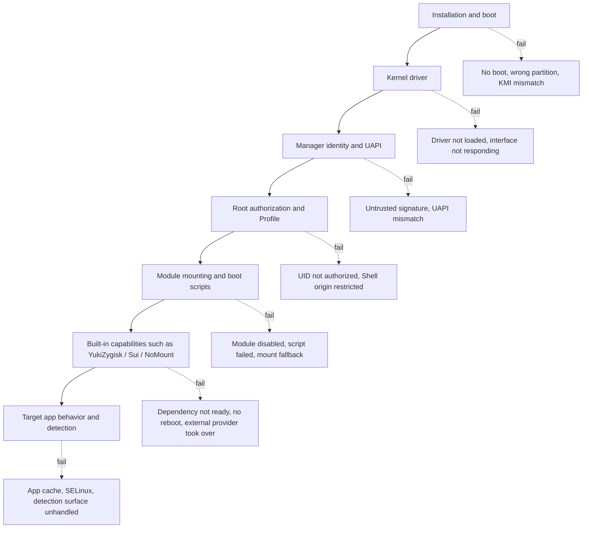
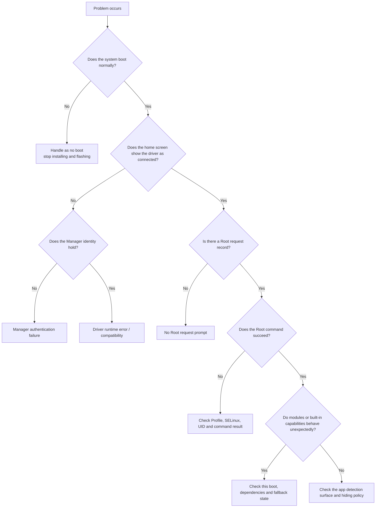

# Troubleshooting Overview

<Badge text="Locate the layer first" type="tip" /> <Badge text="Do not flash just yet" type="warning" /> <Badge text="Keep the evidence" type="danger" />

Troubleshooting is not about trying every switch you can think of. ==First decide which layer the fault is in==, then make one reversible, observable change, and finally verify the result with the same operation. The FinaSU driver, `ksud`, the Manager, modules and app policy are different layers; one working layer does not prove the others are working.

::: danger Check the safety boundary first

If the device already shows a boot loop, repeated restarts, a black screen, or cannot reach the system, do not keep installing modules, switching built-in capabilities, or flashing unknown images. Read [Device Won't Boot](/en/troubleshoot/bootloop/) and [Bootloop Rescue](/en/guide/rescue-bootloop/) first.

:::

## Fault Layers



The order between layers cannot be reversed freely. For example, if Sui does not work, first confirm that the FinaSU driver is available and that a Zygisk backend actually exists; and an app detecting Root does not mean that "hiding mount records" alone will fix it.

## Find Your Symptom First

:::: table Symptoms and entry points

| Symptom you see | What to judge first | Where to go |
| --- | --- | --- |
| No boot after flashing, boot animation loop, Recovery available or not | Whether the fault is in the boot chain or in the module stage | [Device Won't Boot](/en/troubleshoot/bootloop/) |
| The Manager shows "not installed", "not supported", or no driver version | Whether device conditions, KMI, ABI, partitions and build match | [Device Compatibility](/en/troubleshoot/compatibility/) |
| The Manager opens, but reading or writing authorization, modules or version fails | Manager signature, dynamic Manager identity, or UAPI | [Manager Authentication Failure](/en/troubleshoot/manager-auth/) |
| An app requests Root but gets no grant, or still reports no Root | Whether the request arrived, whether the UID matches, whether the Shell origin is restricted | [No Root Request Prompt](/en/troubleshoot/root-request/) |
| The driver is "connected" but `ksud`, modules or built-in capabilities misbehave | User-space service, run mode, or dependency chain | [Driver Runtime Errors](/en/troubleshoot/runtime/) |
| Modules or Zygisk are visible to other apps but not to the target app | App Profile, mount filtering, NoMount exceptions, or SELinux | [Detection & Hiding](/en/troubleshoot/detection/) |
| Daily apps work, but a detection tool still shows red items | Whether more work is actually needed, to avoid stacking useless hiding | [Passing Detection](/en/troubleshoot/pass-detection/) |
| You need to export logs, compare timelines or check log content before feedback | Whether the log is complete and contains sensitive data | [Logs & Feedback](/en/troubleshoot/logs/) |
| You can reproduce the problem and are about to report it | How to give a minimal but actionable report | [Reporting Issues](/en/troubleshoot/report/) |

::::

## Four Kinds of Not Working

"The button does nothing", "saved successfully but the behavior did not change", "the current kernel does not support it" and "it was never expected to happen" are four different problems. Mixing them up often leads to deleting configuration or flashing repeatedly.

::::: field-group

:::: field Not running
@type `Run state`
The configuration expects this feature to work, but this boot has no corresponding daemon, module or provider. Check this boot's state, dependencies and failure records first.
::::

:::: field Not supported
@type `Capability boundary`
The current kernel, architecture, KMI or build does not provide this capability. Installing a newer APK does not necessarily add kernel functionality.
::::

:::: field Saved but not applied
@type `When it takes effect`
The setting is already written to persistent configuration, but the feature reads it only after a reboot, after reopening the target app, or in a new process. A successful save does not mean the current process has changed.
::::

:::: field Never meant to take effect
@type `Policy or scope`
For example, once an app is allowed Root, the non-Root Profile's "unmount modules" no longer controls that UID; existing connections are also not retroactively cut by later network isolation rules.
::::

:::::

## Safety Levels

:::: table Choose actions by risk

| Level | Example | Principle |
| --- | --- | --- |
| **Observable on the spot** | Check status, refresh lists, open the SU log, restart the target app | Do it first; it does not change persistent configuration |
| **Requires a reboot** | Enable a module, switch the Folk Mount mode, enable YukiZygisk or Sui | Change one item at a time and record the pre-change state |
| **Requires restoring an image** | Wrong boot partition, wrong KMI, kernel will not boot, safe mode unreachable | Stop guessing and flash the stock image for the partition you actually modified |

::::

## Consistent Evidence Order

:::: steps

1. **Write down the minimal symptom**

   Use one sentence to separate "will not open", "no grant", "command fails after the grant", "module files are not visible" and "the app still detects Root". Do not just write "it does not work".

2. **Record the last change**

   Include times for installing or updating the APK, flashing a boot image, switching installation methods, enabling or disabling modules, changing App Profiles, changing hiding options and system OTA.

3. **Confirm the current boot method**

   The home screen should state whether the current mode is LKM, Built-In, Jailbreak mode, or safe mode. The Manager APK opening does not mean the driver is loaded or the Manager is trusted.

4. **Confirm the Manager identity and version**

   Only when the Manager identity holds will the home screen show the driver version, kernel UAPI and management capabilities. For an abnormal identity, see [Manager Authentication Failure](/en/troubleshoot/manager-auth/) first instead of restoring all modules.

5. **Confirm the Root request and UID**

   Check the package name, Android user and UID on the Superuser page; check the request, grant and execution result in the SU log. Multiple users, app clones, shared UIDs and reinstalled apps can all change the identity.

6. **Record this boot's state**

   Modules, Folk Mount, YukiZygisk, Sui and NoMount may all distinguish "configuration for the next boot" from "result of this boot". Check the current boot first, then the persistent settings.

7. **Change one item and reproduce**

   Disable only the most recently added capability, restore one Profile, or enable one module at a time. After each change, reproduce through the same path to avoid mixing several variables.

8. **Export the full log last**

   Confirm the time point and failure text on the device first, then export the log bundle. A full log contains a lot of environment and privacy data, so save it right after reproducing instead of waiting for it to roll over.

::::

## What to Check First

The Manager UI comes first, because it shows identity, run mode, module state and capability gating at the same time:

:::: code-tabs

@tab:active Identity and driver

```text
Manager → Home
Check: run method, driver version, UAPI, Root Shell status, safe mode
```

@tab Root authorization

```text
Manager → Superuser → target app / UID
Check: Root switch, shared UID, Android user, App Profile
```

@tab Modules and capabilities

```text
Manager → Modules
Manager → Settings → Features
Check: enable state, this boot's provider, failure/paused/fallback hints
```

@tab Events and logs

```text
Manager → Superuser → SU log in the top left corner
Manager → Settings → Diagnostics & Feedback → Send logs
```

::::

With a Root Shell, read-only commands can add facts:

```sh
/data/adb/ksud boot-info current-kmi
/data/adb/ksud boot-info supported-kmis
/data/adb/ksud nomount status --json
```

These commands record facts. Do not call internal ioctls directly, load `.ko` files of unknown origin by hand, or edit state files under `/data/adb/ksu` just to "fix" something.

## Do Not Troubleshoot This Way

:::: collapse accordion

### Clearing `/data/adb` first

This deletes modules, authorization, Profiles, dynamic Manager registrations and logs. The symptom may disappear, but the cause is deleted with it. Unless a maintainer explicitly asks and you have a backup, do not do this.

### Disabling all hiding at once

Turning off every hiding item widens the system's exposure surface and does not prove which item caused the fault. First decide whether the problem is "the app cannot see its own files" or "a detector still finds Root", and roll back only the most recent change.

### Flashing the same failing image again

If the fault is in the boot chain, flashing again only re-enters the same failing path. Confirm the partition, KMI, slot and image source first, then restore the stock image.

### Treating a missing prompt as the only evidence

Whether an authorization dialog appears depends on the Manager process, the app's request path, the UID and the existing Profile. The SU log, the Root request result and what the target app actually does are more reliable.

### Mixing Manager, `ksud` and driver versions

The UAPI and boot image of all three must match. Copying another package's `ksud` or `.ko` by hand may let the Manager open, but later requests will fail and the device may not boot at all.

::::

## A Minimal Decision Tree



## Related Pages

- [Device Won't Boot](/en/troubleshoot/bootloop/): separate boot chain faults from module faults.
- [Device Compatibility](/en/troubleshoot/compatibility/): KMI, ABI, boot partitions and the build matrix.
- [Manager Authentication Failure](/en/troubleshoot/manager-auth/): signature, dynamic Manager and UAPI.
- [No Root Request Prompt](/en/troubleshoot/root-request/): requests, UIDs, Shell and Profiles.
- [Driver Runtime Errors](/en/troubleshoot/runtime/): `ksud`, modules, built-in capabilities and run modes.
- [Passing Detection](/en/troubleshoot/pass-detection/): keep the target app working instead of chasing all-green detectors.
- [Detection & Hiding](/en/troubleshoot/detection/): what each hiding method can and cannot handle.
- [Logs & Feedback](/en/troubleshoot/logs/): diagnostic logs, commands and privacy.
- [Reporting Issues](/en/troubleshoot/report/): a report template you can copy.
