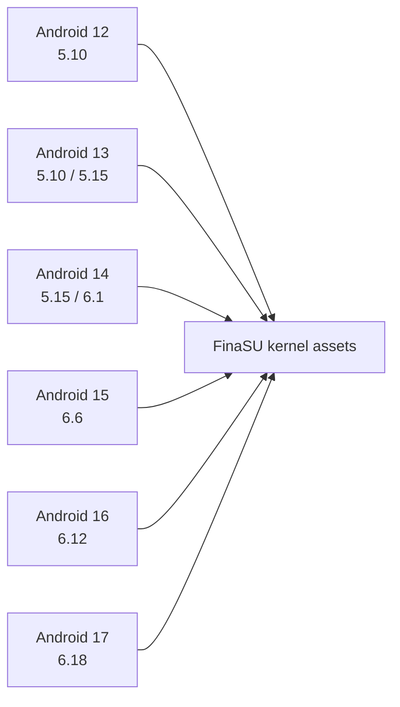

# Device Compatibility

<Badge text="A version is not a KMI" type="warning" /> <Badge text="Judge by the full build" type="tip" /> <Badge text="Do not cross-flash" type="danger" />

Compatibility is not just "the Android version is new enough". It involves at least the device architecture, KMI, boot image layout, kernel configuration, installation method, Manager signature and current kernel UAPI at the same time. A mismatch in any one of them can show up as "the Manager will not open", "the driver does not load", "no boot after flashing" or "only one built-in capability is unavailable".

::: important Record six facts first

Device model, Android build, full kernel version, KMI, ABI, current slot. Recording only "Android 15" or "kernel 6.6" is not enough to judge whether an LKM matches.

:::

## KMI Matrix in the Current Source

The repository's CI and bundled assets build `kernelsu.ko` and `nomount.ko` for the following KMIs:



:::: table Current build matrix

| KMI identifier | Android/Kernel mapping |
| --- | --- |
| `android12-5.10` | Android 12, Linux 5.10 |
| `android13-5.10` | Android 13, Linux 5.10 |
| `android13-5.15` | Android 13, Linux 5.15 |
| `android14-5.15` | Android 14, Linux 5.15 |
| `android14-6.1` | Android 14, Linux 6.1 |
| `android15-6.6` | Android 15, Linux 6.6 |
| `android16-6.12` | Android 16, Linux 6.12 |
| `android17-6.18` | Android 17, Linux 6.18 |

::::

This table describes **the current repository's build assets**, not a permanent promise for every Android device. A device may still use a vendor kernel, different symbol exports, a different kernel configuration, or a modified version string.

::: warning A local build ships only one KMI by default

The local default `KMIS` of `build.sh` is `android15-6.6`. Running a local `lkm` build once produces an APK or driver that fits only that KMI. A complete multi-KMI package requires the release build matrix, or an explicit expansion of `KMIS`.

:::

## ABI and Built-in Payloads

:::: table Scope of current CI assets

| ABI | Driver/NoMount | `ksud` | FolkZygisk | Sui |
| --- | --- | --- | --- | --- |
| `arm64-v8a` | Current KMI matrix | Provided | 64-bit and 32-bit injection assets provided | Provided |
| `x86_64` | Current KMI matrix | Provided | 64-bit and 32-bit injection assets provided | Provided |
| `riscv64` | Not provided by the current release matrix | Provided | Not provided | Not provided |

::::

Do not confuse whether `ksud` runs with full capability support. On `riscv64`, `ksud` and `ksuinit` can currently be built, but the repository's release build has no KernelSU/NoMount module for the corresponding KMI, and no Sui or FolkZygisk payloads; the Manager should report the missing payloads instead of pretending they are available.

Architecture errors are usually more direct:

- a 64-bit device cannot load a 32-bit kernel module;
- an x86_64 device cannot use an arm64 `ksud` or `.ko`;
- multi-ABI apps may contain both 32-bit and 64-bit processes, so Zygisk injection results can differ.

## Boot Partitions and Installation Methods

::::: field-group

:::: field LKM
@type `Modifies ramdisk`
The target is usually `init_boot`; when there is no separate `init_boot`, or the KMI is `android12-*`, it is usually `boot`. Only consider other partitions when the installation page explicitly supports manual selection.
::::

:::: field Built-In
@type `Replaces the kernel`
Requires a full kernel already compiled with the FinaSU driver, usually flashed through `boot`. The kernel, vendor modules and system build must belong to the same compatible set.
::::

:::: field Jailbreak mode
@type `Loaded after boot`
Does not modify the boot partition, but still requires the running kernel to be compatible with the target `.ko` in KMI, architecture and symbols.
::::

:::::

::: danger An unlocked Bootloader does not mean you can flash anything

Some devices also have AVB, vendor integrity checks, anti-rollback or partition protection. Even with an unlocked Bootloader, a verification chain or a wrong image can prevent boot. Whether the device needs extra handling depends on the vendor firmware and the actual boot result.

:::

## Why the Same 6.6 Can Still Be Incompatible

The KMI identifier is part of the ABI compatibility layer, not a complete build fingerprint. Even if two devices both report `android15-6.6`, the following differences may still exist:

- the vendor kernel does not export the symbols FinaSU needs;
- the kernel configuration disables a feature or build option;
- the kernel changed a struct, hook point or syscall implementation;
- the module vermagic, architecture or signature does not match the current kernel;
- the Built-In source does not match the target kernel version, patches or configuration.

Therefore:

- when LKM fails, check the exact KMI asset, architecture and boot partition first;
- when Built-In fails, do not compare only the KMI; check the full kernel source and configuration;
- an unavailable feature does not mean the whole driver is unavailable; network isolation, UTS View, mount view filtering and SUSFS integration, for example, each have their own capability gating.

## Decision Path on the Device

:::: steps

1. **Look at the run method on the home screen**

   Once the driver is connected, the home screen shows LKM, Built-In or Jailbreak mode. If there is no driver version, see [Manager Authentication Failure](/en/troubleshoot/manager-auth/) first; the Manager opening does not mean the identity holds.

2. **Check the full kernel version**

   Read `uname -r` from the Manager info card or a terminal. Keep the full Android/KMI markers instead of writing only the major version.

3. **Check the KMI**

   With a Root Shell, run:

   ```sh
   /data/adb/ksud boot-info current-kmi
   /data/adb/ksud boot-info supported-kmis
   ```

   The first line shows the current detection result, and the second shows the driver KMIs the current package actually carries.

4. **Check the ABI**

   Confirm that the device is not 32-bit only and that the package contains assets for the same architecture as the system kernel. For Zygisk and Sui, also check the ABI the target app uses.

5. **Check the installation target**

   Go back to the installation page, backup record or flash log and confirm whether `boot`, `init_boot`, `vendor_boot` or the inactive slot was actually modified.

6. **Check capability gating**

   If only one feature shows "not supported", first confirm whether it needs kernel source, kernel configuration, a specific KMI asset, or an additional external provider.

::::

## What the Status Words Mean

:::: table Do not confuse these states

| Display | Meaning | Next step |
| --- | --- | --- |
| **Not installed** | The Manager did not detect a usable FinaSU driver, or there is no installed identity | Check the installation method, partitions and Manager identity |
| **Not supported** | The current path or device conditions are not met | Look at the specific capability/device conditions first; it does not mean every installation method is impossible |
| **Driver available** | The Manager has connected to the kernel interface | Continue checking Root authorization, `ksud` and capability state |
| **UAPI mismatch** | The kernel and `ksud` or the Manager expect different interface versions | Install matching versions; a reboot cannot remove this |
| **Payload missing** | The APK has no assets for the current ABI/KMI | Use a complete release package; a local build may carry only one KMI |
| **Capability unavailable** | The driver may be fine, but the feature lacks kernel support or dependencies | Check the corresponding built-in capability page; do not force configuration |

::::

## System Updates and OTA

A system OTA can replace the kernel, the boot partition or the whole slot. After updating, decide again:

- whether the new system still belongs to the same KMI;
- whether the current FinaSU kernel assets still match;
- whether Built-In must be rebuilt for the new kernel source;
- whether the active slot of an A/B device has changed;
- whether the old modules still support the new Android and kernel.

For LKM, updating the APK does not automatically update an already flashed boot image. For Built-In, installing a new Manager does not replace the driver inside the kernel. See [Updating FinaSU](/en/guide/update/) for the full flow.

## What Not to Do When Incompatible

:::: collapse accordion

### Gambling on a Module from a Neighboring KMI

Force-loading an `android14-6.1` `.ko` into a different KMI can break the kernel directly. A vermagic mismatch is only the earliest check, not the only risk.

### Faking the Version String to Fool the Loader

The same version string does not mean the same symbols, structs or ABI. Forcing your way around the check increases the risk of a kernel crash.

### Mixing Manager and Driver from Different Sources

The Manager's signature trust, the kernel UAPI and the `ksud` version must match. Being able to install the APK does not mean it can manage the current driver.

### Treating an Unavailable Feature as Fixable by Reinstalling the APK

When the kernel lacks a feature, replacing the user-space APK does not add kernel code. The built-in capability pages state which features depend on the kernel and which depend on external modules.

::::

## Related Pages

- [Installation Options](/en/guide/install/): choosing between LKM, Built-In and Jailbreak mode.
- [Updating FinaSU](/en/guide/update/): update boundaries for the APK, boot image and OTA.
- [Manager Authentication Failure](/en/troubleshoot/manager-auth/): judging signatures and UAPI.
- [Driver Runtime Errors](/en/troubleshoot/runtime/): runtime problems after the driver connects.
- [Built-In Capabilities Overview](/en/builtin/): kernel and external dependencies of each feature.
