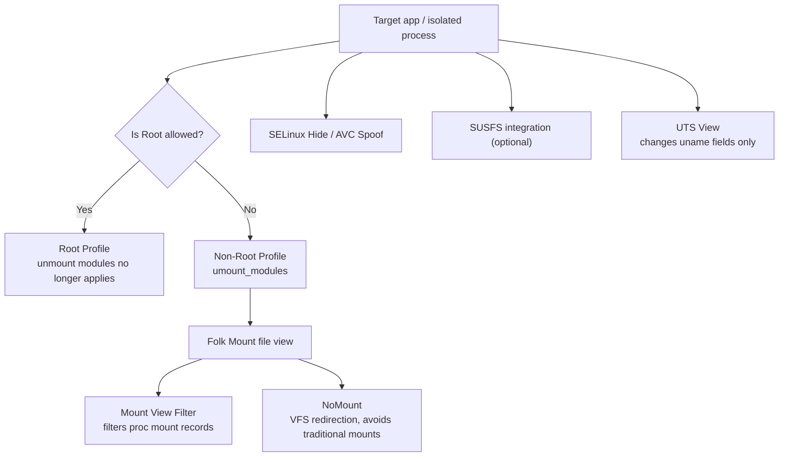

# Detection & Hiding

<Badge text="Layered capabilities" type="warning" /> <Badge text="No universal invisibility" type="danger" /> <Badge text="Confirm the detection surface" type="tip" />

FinaSU has no single switch that guarantees passing every app's detection. Different switches handle different observable surfaces: the module file view, `/proc` mount records, SELinux changes, AVC auditing, kernel version fields, or external SUSFS capabilities. Confirm what the target app actually sees, then choose the matching layer.

## How Hiding Capabilities Are Layered

These capabilities can affect each other, but they are not the same "invisibility level". NoMount reduces traditional mount records, Mount View Filter filters the mount table that is read, SELinux Hide handles security policy queries, and UTS View only changes the `uname` fields of the selected process.

## Unmount Modules in App Profile

The non-Root Profile's `umount_modules` is enabled by default. It makes UIDs that have not been granted Root see the file view from before module injection.

::: important Once Root is allowed, this switch no longer controls that UID

When the kernel decides that a UID is allowed Root, ==module unmounting is skipped==. The Root Profile applies instead; `umount_modules` is a field of the **non-Root Profile**. If an app has been granted Root and can still see module files, that is usually not "unmount modules is broken".

:::

Scope of application:

- the target UID is not allowed Root;
- the traditional module file view of the built-in Folk Mount is in use;
- when a UID is shared, the policy affects the whole UID.

It is not responsible for hiding mounts of other processes in `/proc`, process lists, system properties, SELinux auditing, or detection results the app stored itself.

## Mount View Filter

"Hide mount records" filters the `/proc` mount view that apps and isolated processes read when the current kernel supports it, including records such as `mounts`, `mountinfo` and `mountstats`. The filter decides using the module unmount policy together with known Root/module mount paths.

:::: table What it can and cannot handle

| Can do | Cannot guarantee |
| --- | --- |
| Not show matching module or Root mount records to the target process | Hide actual file contents, open file descriptors or app-side caches |
| Cover regular app UIDs and isolated process paths | Handle every kernel version and every way of reading proc uniformly |
| Work together with the unmount modules policy | Replace NoMount's VFS redirection |
| Take effect immediately when the kernel hook installs successfully | Fix SELinux, property, process or integrity detection |

::::

If the page reports this capability as unavailable, the current kernel did not successfully provide the hook or symbols; do not force it on by editing configuration.

## NoMount

NoMount serves module files through kernel VFS path redirection without creating traditional mounts. It suits scenarios that need fewer mount traces, but it is not equal to "completely traceless".

::::: field-group

:::: field Advantages
@type `Avoids traditional mounts`
The mount table a process reads can stay unchanged, while file contents are still provided from the module path by VFS rules.
::::

:::: field Default visibility
@type `Opposite of Magic Mount`
By default NoMount lets apps see injected files, and only exception UIDs see the stock view. Configure exceptions before switching; you cannot carry over the intuition that "everything is hidden from all apps by default".
::::

:::: field Still leaves traces
@type `Not full invisibility`
File contents, open file descriptors, SELinux, audit logs, system properties and behavioral differences can still be detected.
::::

:::::

NoMount and Mount View Filter solve different problems. The former reduces traditional mounts themselves, the latter filters what proc shows; do not swap both at once while investigating a single file visibility problem.

## SELinux Hide and AVC Spoof

The two features are related but not equivalent:

:::: table Two SELinux-related capabilities

| Feature | What it handles | Do not expect |
| --- | --- | --- |
| **Hide SELinux changes** | Reduces what apps can observe about policy changes, context queries or permission computation differences introduced by FinaSU | Hiding mounts, files, processes or Root authorization |
| **AVC log spoofing** | Adjusts records in the SELinux audit that relate to FinaSU target contexts | Preventing policy denials, or hiding all audit events |

::::

A wrong SELinux setting can also break app features directly. If an app cannot access its own files after enabling it, module reads fail, or a service fails to start, roll back the most recent item instead of stacking more hiding switches.

## SUSFS, UTS View and Other Surfaces

**SUSFS** is not provided by the FinaSU kernel itself. Only after kernel source integration or loading a matching SUSFS-LKM can FinaSU configure it. The source integration and the LKM may differ in feature scope; judge hiding items by the current implementation and page state. See [SUSFS](/en/builtin/susfs/).

**UTS View** only affects the `uname` fields that selected processes see. It cannot change hardware attestation, system properties, app caches or a full device fingerprint. See [UTS View](/en/builtin/uts-view/).

**System properties**: after FinaSU Hide is enabled, only bootloader-state properties are overridden; other property surfaces remain outside its scope.

**FolkZygisk and Sui** are feature providers, not hiding switches. They may themselves create new observable surfaces; do not assume the system is stealthier because Zygisk or Sui is enabled.

## Ask Four Questions First

:::: steps

1. **Who sees what?**

   Record the target package name, UID, Android user and the exact symptom: module files, mount records, SELinux differences, `uname`, a Root request, or an integrity check?

2. **Is this UID Root or non-Root?**

   A UID that is allowed Root does not use "unmount modules". Confirm the actual state in App Profile before discussing hiding.

3. **Which module file provider is in use?**

   The default visibility of the built-in Magic Mount, NoMount, Metamodules and disabled mounting differs. Look at "this boot's provider", not only at the mode configuration.

4. **Has the target app been restarted?**

   Many settings only affect new processes or the next boot. Existing processes, already opened file descriptors and caches are not modified retroactively.

::::

## Troubleshoot by Symptom

:::: collapse accordion

### Only the Target App Sees Module Files

Confirm whether that UID is allowed Root. If it is, the non-Root "unmount modules" does not apply. If it is not, check the Profile's "unmount modules", NoMount exceptions and shared UIDs.

### All Apps See Module Files

Check whether NoMount is in use. NoMount is visible by default, and only exception UIDs see the stock view. Also confirm that no "clear all" exception was configured and that the device has been rebooted since the switch.

### Files Are Hidden but Detection Still Finds Root

Hiding the file view only handles one surface. Continue checking mount records, SELinux, properties, processes, command paths, app caches and hardware integrity checks. Do not immediately turn on more global switches.

### The App Breaks After Enabling Hiding

Turn off the item you enabled most recently first. Check SELinux Hide, AVC Spoof, NoMount exceptions and Mount View Filter in particular. Hiding module files can also hide the app's own configuration or module WebUI resources.

### Detection Results Differ Between Apps

This is normal. Different UIDs, isolated processes, Root states, App Profiles and detection methods produce different views. Do not infer the whole device state from one app's result.

### An External Zygisk Provider Took Over

FinaSU cannot verify its injection result. Check the external provider's own management page instead of judging the full injection chain from FinaSU's Sui or status page.

::::

## Configuration Patterns to Avoid

- disabling "unmount modules" for all apps uniformly and then expecting one hiding switch to cover every check;
- stacking NoMount, Mount View Filter, SUSFS and every SELinux hiding item at the same time;
- keeping SELinux in Permissive mode long term to pass detection;
- treating UTS View as full device fingerprint spoofing;
- using hiding modules of unknown origin that modify the same kernel interface as FinaSU;
- force-enabling capabilities the kernel does not support by editing state files under `/data/adb/ksu`.

## Minimal Verification Flow

:::: steps

1. Record the target app's UID, Root state and the current mount provider.
2. Disable the most recently added hiding capability, then fully reboot or restart the target process.
3. Reproduce with the same detection operation and compare the file view, mount records and app logs.
4. Enable only the one capability that matches the detection surface and verify again.
5. If a feature breaks, keep the time point, UID, PID and error text, then roll back.

::::

## Related Pages

- [App Profile](/en/manager/app-profile/): non-Root module visibility.
- [Hiding & Kernel Security](/en/setting/hiding/): SELinux Hide, mount filtering and AVC Spoof.
- [Folk Mount](/en/builtin/folk-mount/): mount providers and the visibility model.
- [NoMount](/en/builtin/nomount/): VFS redirection, exception UIDs and detection boundaries.
- [SUSFS](/en/builtin/susfs/): optional kernel integration and the LKM.
- [UTS View](/en/builtin/uts-view/): changes `uname` fields only.
- [Passing Detection](/en/troubleshoot/pass-detection/): when a detector is not all green, decide whether more work is worth it.
