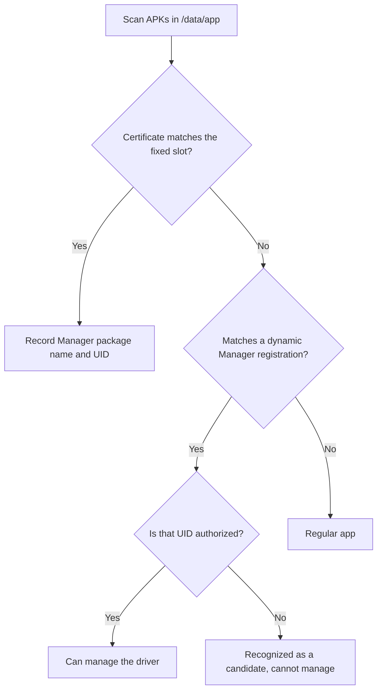

# Manager Authentication Failure

<Badge text="The signature is the identity" type="warning" /> <Badge text="A package name proves nothing" type="danger" /> <Badge text="Check the UAPI first" type="tip" />

The FinaSU Manager is not an ordinary viewer. The kernel only lets a trusted Manager call management interfaces, read the driver version and maintain authorization. An APK that installs, opens, and even carries exactly the official package name does not automatically become the Manager accepted by the current kernel.

## Distinguish the Fault Types

:::: table Symptoms, boundaries and entry points

| Symptom | More likely cause | Check first |
| --- | --- | --- |
| The home screen shows no driver version at all and reports not installed / not supported | The driver is not loaded, the KMI/partition does not match, or the Manager identity does not hold | Installation method, boot partition, Manager certificate |
| The device is rooted and another Manager works, but the current APK cannot manage it | The current APK's signature or UID has no management identity | Fixed signature, dynamic Manager authorization |
| The home screen shows a driver version but asks to update the Manager/kernel | The Manager or `ksud` and the kernel UAPI disagree | Versions and UAPI numbers on both sides |
| The home screen loads, but changing authorization, modules or capabilities fails | Management interface permission, `ksud`, or the specific capability | Driver runtime and SU log |
| It breaks right after swapping the APK, and recovers after reinstalling the old APK | Management identity is bound to the signature | APK source and certificate |

::::

::: important "The Manager opens" is not proof of identity

The Manager app itself can start and show its UI normally. Only after the kernel recognizes the current UID as the Manager can the home screen read the driver version, the kernel UAPI and protected management state.

:::

## How Manager Identity Is Established

The kernel embeds fixed trusted Manager signature information, including the certificate size and SHA-256. After boot, or after an installation change, the kernel scans APKs in `/data/app` and maps package names to UIDs through `/data/system/packages.list`.



There are three different concepts here:

::::: field-group

:::: field Signature recognized
@type `Candidate`
The kernel recognizes that the APK's signature may come from a known Manager, but does not grant management permission automatically. The Superuser list may show a `KSU` candidate badge.
::::

:::: field Dynamic Manager registered
@type `Trusted signature`
The user actively adds an APK's certificate to the dynamic Manager table. The signature layer is already trusted; whether a UID must also be authorized depends on whether the current kernel supports a separate authorization table.
::::

:::: field Current UID authorized
@type `Actual identity`
Newer kernels with a separate authorization table check the app ID as well. Older kernels treat a trusted signature directly as management identity and cannot revoke a single UID under the same signature.
::::

:::::

Both the fixed Manager identity and the dynamic Manager resolve the app ID per Android user. An app in a work profile, an app clone or another Android user has to be judged by its actual UID and policy even when the package name is the same.

## Why a Package Name Is Not Evidence

All of the following give a "looks the same" APK a different identity:

- same package name, but signed with a debug key, a personal key or a third party;
- different package name, but the certificate matches the kernel record;
- the app was uninstalled and reinstalled, so the UID changed;
- the same APK is installed in another Android user;
- the dynamic Manager revoked only the UID authorization, while the signature registration remains.

Therefore, do not "fix" authentication by renaming the package, faking the app label or modifying the kernel signature check. These weaken the whole Root management boundary and still do not prove the APK source is trustworthy.

## UAPI Mismatch Is a Different Problem

Once the Manager identity holds, the kernel and user-space interface versions must also be checked. When the kernel and `ksud` disagree, user space reports explicitly:

```text
UAPI version mismatch: kernel=<kernel value>, ksud=<user-space value>. Please update KernelSU!
```

The Manager home screen may report separately:

- **Manager UAPI higher than kernel UAPI**: the kernel-side driver must be updated;
- **Manager UAPI lower than kernel UAPI**: the Manager APK must be updated;
- both sides equal: the basic interface compatibility condition is met.

::: warning Updating only the APK may not be enough

The driver loaded by LKM comes from the boot image, and the Built-In driver comes from the current kernel; updating the APK alone does not replace either. Conversely, switching back to an older Manager does not make a newer kernel interface older.

:::

If the root cause is the Manager identity rather than the UAPI, it usually will not be solved just by seeing one version warning disappear. Confirm whether the home screen actually shows a driver version and UAPI, then decide which layer is at fault.

## Common Scenarios

:::: collapse accordion

### No Manager Identity Even After Installing the Official APK

Check whether the APK really is the build that pairs with the current kernel. A custom-signed kernel must recompute `KSU_EXPECTED_SIZE` / `KSU_EXPECTED_HASH` from the target APK's certificate; changing only the package name or version number is not enough.

### A Self-Compiled APK Was Installed

Self-compiled builds usually use a different certificate. If the kernel supports the dynamic Manager, you can set that UID as a dynamic Manager after confirming the APK source; if it does not, you can only use an APK that matches the kernel's fixed slot.

### It Stops Working After Uninstall and Reinstall

Reinstalling may assign a new UID. Both the fixed Manager scan and dynamic Manager authorization may need to recognize it again; for the dynamic Manager, also confirm that the new UID is in the authorization table. A reboot usually triggers a new scan, but do not treat it as a replacement for checking.

### Another Manager Works but This One Does Not

Two APKs may connect to the same driver while only one of them has a trusted signature or UID. Do not let two Managers modify authorization or module state at the same time; decide which one is the real management end first, then revoke the other identity you no longer need.

### `KSU` Still Shows After Disabling the Dynamic Manager

`KSU` may only be a "preinstalled Manager candidate" badge, which does not mean management permission still exists. Newer kernels keep the signature registration but revoke the UID; on older kernels without separate revocation, disabling the switch may delete the whole signature registration.

::::

## Safe Recovery Order

:::: steps

1. **Stop changing authorization and modules**

   Until the identity is confirmed, do not change App Profiles, install modules or switch hiding settings. Save the current home screen state and the time point first.

2. **Confirm the installation method**

   Go back to the LKM, Built-In or Jailbreak installation records and confirm the current driver source and version. See [Device Compatibility](/en/troubleshoot/compatibility/).

3. **Install a matching Manager**

   Prefer the Manager from the same release build as the current driver. If several Managers are installed, record each APK's package name, version, installation source and UID.

4. **Check whether the dynamic Manager is needed**

   Grant the dynamic Manager in App Profile only when the current kernel supports the capability, the current app meets the display conditions, and you have confirmed the APK source. See [Dynamic Manager](/en/manager/dynamic-manager/) for details.

5. **Check the UAPI and versions**

   Reopen the home screen and confirm the driver version, kernel UAPI and Manager UAPI. Update whichever side the prompt names.

6. **Verify with a minimal operation**

   Read the home screen and run one read-only Root operation first, then try changing the authorization of one test app that can be rolled back. Do not verify identity with a bulk Profile import.

::::

::: danger Do not modify the kernel to bypass authentication

Disabling signature checks, faking certificates, persistently modifying the allowlist or copying someone else's management state all give a wrong build full Root management capability. Authentication failures should be solved with a matching build or an explicit dynamic Manager.

:::

## What to Include in a Report

If authentication still fails after a matching installation, the report should include at least:

- the current boot method: LKM, Built-In, Jailbreak mode;
- the Manager package name, version, signature source and installing UID;
- the driver version and UAPI shown on the home screen;
- whether another Manager works;
- whether the app was recently uninstalled, reinstalled, re-signed, or had the dynamic Manager changed;
- the archive exported by "Send logs" and the time the problem occurred.

See [Reporting Issues](/en/troubleshoot/report/) for the full field list.

## Related Pages

- [Dynamic Manager](/en/manager/dynamic-manager/): registration, authorization, revocation and persistence.
- [Device Compatibility](/en/troubleshoot/compatibility/): driver, KMI, ABI and UAPI boundaries.
- [Driver Runtime Errors](/en/troubleshoot/runtime/): `ksud` and module problems after the identity holds.
- [Logs & Feedback](/en/troubleshoot/logs/): identity and version information in the log bundle.
