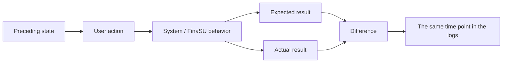

# Reporting Issues

<Badge text="One issue per report" type="tip" /> <Badge text="Reproduce minimally first" type="warning" /> <Badge text="Never publish keys" type="danger" />

Maintainers need reproducible facts, not a very large attachment. A report should let someone who never touched the device judge the fault layer from the text and logs alone, repeat the same steps, and know which results differ from expectations.

## Three Things to Do Before Reporting

:::: steps

1. **Rule out a rescue state**

   If the device still cannot boot, recover it as described in [Device Won't Boot](/en/troubleshoot/bootloop/) and [Bootloop Rescue](/en/guide/rescue-bootloop/) first. Do not mix boot chain problems into an ordinary feature report.

2. **Do one minimal reproduction**

   Keep only the necessary modules and settings, and record the expected and actual result of the same operations. If the problem only appears with several hiding switches on, state the minimal combination.

3. **Save the raw logs**

   Export "Send logs" right after reproducing, and keep the key error text, time points and the necessary `logcat` / `dmesg`. Do not clean the logs or reinstall all modules first.

::::

## Required Environment

:::: table Environment fields in a report

| Field | Example | Where to get it |
| --- | --- | --- |
| Device model and product name | brand, model, `ro.product.device` | Manager info card or `getprop` |
| Android version and build | Android 15, full fingerprint | System settings or `basic.txt` |
| Full kernel version | the whole `uname -r` | Manager or terminal |
| KMI | for example `android15-6.6` | Home screen / `ksud boot-info current-kmi` |
| ABI | `arm64-v8a` or `x86_64` | System and APK info |
| Installation method | LKM, Built-In, Jailbreak mode | Home screen run method and installation records |
| Modified boot partition | `boot`, `init_boot`, `vendor_boot`, none | Installation page, backup or flash log |
| Manager version | version name, version code, UAPI | Home screen / About |
| Driver version and UAPI | home screen status card | Home screen / diagnostic bundle |
| Current slot | `a` or `b` on A/B devices | `fastboot getvar current-slot` or the Manager |
| Recent changes | modules, Profiles, themes, OTA, hiding settings | Your own records |

::::

::: warning Do not just write "latest version"

"Latest version" is not a verifiable version. State the actual versions of the Manager, `ksud`, driver, kernel and modules; if unsure, attach the home screen and the diagnostic information.

:::

## Reproduction Information

An actionable reproduction includes at least:

- **Preconditions**: system, run mode, modules, Profiles, safe mode and external providers;
- **Steps**: which page you open, which button you tap, which command you run;
- **Expected result**: what should be seen under normal conditions;
- **Actual result**: the error text, return code, black screen, crash or behavioral difference you see;
- **Frequency**: every time, only on first boot, only after a reboot, only on a specific app, or intermittent;
- **Last time it worked**: after which change it started;
- **Whether it is reversible**: which item you turned off and the problem disappeared.



If the problem cannot be reproduced reliably, state the number of attempts, the success/failure count and the trigger conditions. Do not replace frequency with "sometimes it does not work".

## Copyable Report Template

The following content can be pasted directly into the issue page and filled in according to the actual situation:

````markdown
## Issue summary

Describe in one sentence which feature fails under which conditions.

## Environment

- Device model / product name:
- Android version / build:
- Full kernel version:
- KMI:
- ABI:
- Current slot:
- FinaSU Manager version / version code / UAPI:
- Driver version / kernel UAPI:
- Run method: LKM / Built-In / Jailbreak mode / safe mode
- Installation method and the partition actually modified:
- Modules, themes, Zygisk provider, Sui or NoMount state in use:
- Recent changes and their times:

## Steps to reproduce

1.
2.
3.

Expected result:

Actual result:

Frequency:

Last time it worked normally:

## Items already verified

- [ ] The home screen shows the driver as connected
- [ ] The Manager Root Shell works
- [ ] Target app UID / Android user checked
- [ ] The default App Profile has been tried
- [ ] Recently added modules or hiding settings have been disabled
- [ ] The SU log has been checked
- [ ] This boot's mount / Zygisk / Sui state has been checked
- [ ] Confirmed that no other Root implementation is running at the same time

## Logs and attachments

- Send logs archive:
- Key time points:
- Key error text:
- Additional dmesg / logcat:
- Screenshots or screen recordings (if any):

## Recovery actions already taken

State whether you rebooted, flashed an image back, switched slots, cleared caches or reinstalled. Do not omit this, because these actions affect how the logs are interpreted.

## Other notes

Device-specific behavior, whether it only appears after an OTA, whether it can be rolled back reliably, and so on.
````

## How to Provide Log Attachments

Prefer `KernelSU_bugreport_*.tar.gz`. It covers the Manager version, run mode, module state, processes, mounts, kernel log and system properties in one go.

If the full bundle is too large or contains sensitive data:

- provide the `dmesg`, `logcat` and SU log excerpts matching the problem time;
- provide the relevant parts of `basic.txt`, `modules.json` and `mount.log`;
- clearly state which files or fields were removed, and do not silently modify content;
- keep the original time, UID, PID, exit code and the context of the error text.

See [Logs & Feedback](/en/troubleshoot/logs/) for the full list and collection commands.

## What Not to Publish

:::: collapse accordion

### Passwords, Keys and Credentials

The Manager password, WebDAV password, app lock PIN, tokens, private keys, backup keys and signing keys must never be published or committed to the repository.

### Device Serial Numbers and Account Information

Serial numbers, advertising IDs, account names, phone numbers, intranet addresses and unnecessary installation sources should be removed or replaced. Keep replacements consistent so logs can still be correlated.

### Unnecessary Full Allowlist

`allowlist.bin` contains authorization and App Profile data. If it is unrelated to the problem, provide only the target UID's state; if the full bundle is needed, confirm the transfer channel with a maintainer first.

### Security Vulnerability Details

If the problem involves signature bypass, arbitrary privilege escalation, cross-user permissions, log leaks or a reproducible defense bypass, do not publish the exploitation steps, PoC or full exploitation parameters directly. Contact the project maintainers through the private channel they designate first.

::::

## Good Reports and Bad Reports

::::: field-group

:::: field A good report
@type `Actionable`
"LKM, android14-6.1, target UID 10123 already shows Root, but after restarting the app it still cannot access a path; in the SU log the Root execve for that UID returns Permission denied; the default Profile is fine, and the problem reproduces after enabling an SELinux domain in a custom Profile."
::::

:::: field A bad report
@type `Cannot be located`
"Root is broken, the latest version does not help either, please help."
::::

:::: field Good logs
@type `Clear timeline`
They include the actions before and after the problem, events for the same UID, return codes and the relevant state.
::::

:::: field Bad logs
@type `Missing context`
Only a screenshot cropped to remove the time and package name, or only the last line `Permission denied`.
::::

:::::

## Pre-Submission Checklist

:::: steps

1. The title describes the symptom and the layer, not just "help" or "bug".
2. One issue per report; do not mix boot, module and detection problems.
3. Environment fields use actual versions; do not write "latest".
4. Steps to reproduce can be followed by someone else.
5. Expected result and actual result are written separately.
6. Log times correspond to the reproduction times.
7. Sensitive information has been removed or replaced.
8. Recovery actions already tried are listed explicitly.

::::

:::: chat title="Quick questions about issue reports"
{User}
Can I just send the "Send logs" archive?

{.}
You can attach it as the main attachment, but you still need to write the issue summary, steps to reproduce, expected result and actual result. Without textual context, maintainers have a hard time knowing which time point to look at.

{User}
What if the log bundle is too large?

{.}
Explain first why the full bundle cannot be provided directly, then provide the matching text by problem layer. Do not delete every UID, time and error line just to reduce the size.

{User}
I already solved it by clearing data. Should I still report?

{.}
If you can still describe the symptom and the version before the change, you can report it. State clearly that the on-device data has been cleared, so that "cannot reproduce" is not mistaken for the problem not existing.
::::

## Related Pages

- [Logs & Feedback](/en/troubleshoot/logs/): diagnostic bundle contents, collection and privacy.
- [Troubleshooting Overview](/en/troubleshoot/): judge the fault layer first.
- [Device Compatibility](/en/troubleshoot/compatibility/): preparing the environment fields.
- [Driver Runtime Errors](/en/troubleshoot/runtime/): runtime-layer problems and read-only checks.
