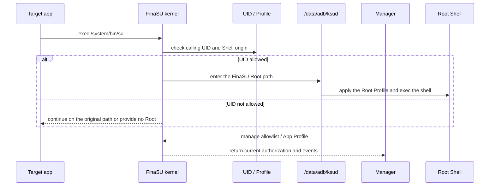
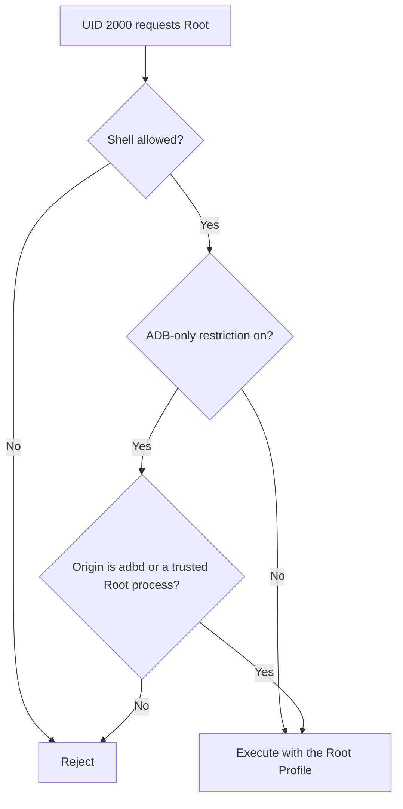

# No Root Request Prompt

<Badge text="Applies per UID" type="warning" /> <Badge text="Check the request record first" type="tip" /> <Badge text="Shell has extra origin checks" type="danger" />

"No dialog appeared" does not necessarily mean the Root driver is broken. The app may never have sent a Root request, the request may go through Sui instead of traditional `su`, the current UID may already be authorized, the Manager may be unable to respond, or the Shell may be rejected by origin policy. When troubleshooting, separate "the app requests", "the kernel decides", "the Manager grants" and "the Root command executes".

## What a Traditional Root Request Goes Through

The Manager is responsible for managing authorization and policy, but whether traditional `su` enters the FinaSU path is first decided by the kernel from the current UID, the allowlist, the Shell origin and the Profile. Do not treat "the kernel notifies the Manager to show a dialog" as the only working model.

::: important No dialog can also be a normal result

If that UID is already allowed Root, the app can enter the Root context directly; if the app never calls `su` or a Root API, there will be no request record either. Confirm what the app actually does before deciding whether the authorization UI is abnormal.

:::

## Layer 1 - Whether the Manager Can Still Manage Root

The Manager's own Root Shell is the management channel for maintaining authorization, reading modules and changing Profiles. It usually prefers `/data/adb/ksud debug su` and only tries `su` from PATH after that fails. A plain `sh` fallback is not considered a usable Root Shell by the Manager.

:::: table Judging this layer

| State | Meaning | Next step |
| --- | --- | --- |
| The home screen has a driver version and the Root Shell works | The management channel basically holds | Continue with the target app, UID and logs |
| The home screen has a driver version but the Root Shell is unavailable | Possibly `ksud` is missing, the UAPI mismatches, or the boot stage is incomplete | See [Driver Runtime Errors](/en/troubleshoot/runtime/) |
| The home screen has no driver version | The driver or the Manager identity does not hold yet | See [Manager Authentication Failure](/en/troubleshoot/manager-auth/) |
| Every engine capability page is unavailable | Do not look at app detection yet | Return to the driver and `ksud` foundation |

::::

Do not restore the management channel by copying a `ksud` of another version by hand. The kernel, `ksud` and the Manager must agree on the UAPI.

## Layer 2 - Whether the Target UID Is Authorized

Root authorization is stored per UID. The app name shown in the Manager is only a hint; what actually takes effect is the UID of the current process.

:::: steps

1. **Find the app on the Superuser page**

   Search for the package name and, if needed, turn on "show system apps". Confirm first that the entry matches the app version on the device.

2. **Open the App Profile**

   The Root switch is on the app detail page, not on the right side of the list. After toggling it, the page should read back the new state.

3. **Check the Android user**

   Apps in a work profile, an app clone or another user may have different UIDs. Do not grant in the primary user and then verify from an app of the same name in another user.

4. **Check shared UIDs**

   When several packages share a UID, the authorization affects the whole UID. The "affects the following apps" section on the detail page should list every affected package.

5. **Restart the target app**

   Some apps check for Root only once at startup. After granting, fully stop and reopen the app so it does not keep using an old cache.

::::

## Layer 3 - Whether the Request Reached the SU Log

Open **Superuser → SU log in the top left corner** and read by time:

- **Traditional SU**: the app requested Root through the `/system/bin/su` compatibility entry;
- **Root execve**: a process executed a command in the Root context;
- **Grant Root**: the management channel issued a Root grant;
- **Daemon restart**: the log daemon started or recovered;
- **Dropped**: the kernel event queue lost records.

:::: table How to read the log results

| Log situation | More likely cause |
| --- | --- |
| No record of the target app at all | The app did not request, the request happened before logging was on, the UID does not match, or another path such as Sui was used |
| A traditional SU record exists but failed | Authorization, Shell origin, Profile, or `ksud` execution failed |
| A Root execve record exists but the command exits non-zero | Root was entered; the failure comes from the command, file permissions, SELinux or app logic |
| Only DROPPED entries or an interrupted log | You cannot conclude "no request"; reduce noise and reproduce again |
| The grant is allowed, but the log time is after the problem | The app may cache an earlier failure; restart the app and try again |

::::

See [SU Logs](/en/manager/su-log/) for event fields and filtering.

## Layer 4 - Special UIDs and Shell Origins

The kernel does not let every UID obtain Root unconditionally:

- most UIDs below `2000` are rejected, with `system` (1000) as the exception;
- the Manager UID is always allowed;
- `shell` (2000) can be admitted by "allow Shell";
- after enabling "restrict Shell to obtain Root only over ADB", `shell` must also come from an allowed origin.

This mainly affects terminal apps, scripts, ADB and child processes started by modules.

If only terminal apps fail while regular apps are authorized normally, check [Security Settings → Restrict Shell to obtain Root only over ADB](/en/setting/security/) and the target process's parent origin first.

## Layer 5 - Authorized but the App Still Reports No Root

"Allow Root" only means that UID may enter the Root Profile. Failures can still happen afterwards:

- custom UID/GID or groups differ from what the app expects;
- capabilities are trimmed, so the app cannot perform operations such as `mount` or `chown`;
- the SELinux domain or additional rules restrict the target path;
- the mount namespace differs from what the app expects;
- the app only checks `su` at a fixed path, a specific version number or a fixed distribution marker;
- the app itself cached the result from before the grant;
- the app uses Sui, but Sui permissions or the Zygisk backend are not ready yet.

Switch back to the default Root Profile temporarily to verify. If the default Profile works, restore the custom fields one by one; do not restore a whole imported template at once.

## Sui Versus Traditional Root Requests

Sui is a Shizuku API compatible backend, not another name for the traditional `su` authorization dialog. An app may:

- request Root or Shell permission through Sui;
- connect to Sui through the Zygisk service;
- hold separate permission records in Sui.

If the app explicitly uses Sui:

1. check whether the FinaSU driver is available;
2. check whether a Zygisk provider is actually available on this boot;
3. check the Sui service state and the target app's permissions;
4. then check the traditional SU log.

See [Sui](/en/builtin/sui/) for detailed states. An external compatible Zygisk provider can run Sui, but FinaSU cannot verify that provider's injection result.

## Recommended Order

:::: steps

1. **Confirm the driver connection**

   When the home screen has no driver version, do not look further into app settings.

2. **Confirm the Manager Root Shell**

   When the Manager cannot maintain the allowlist, fix `ksud` or the UAPI first.

3. **Confirm the app and UID**

   Check the package name, Android user, shared UID and UID changes after reinstalling.

4. **Trigger one identifiable request**

   Use the feature through which the target app actually calls `su` or a Root API, and note the exact time.

5. **Check the SU log**

   Separate "no request", "request rejected", "command failed after Root" and "log lost".

6. **Check the Shell origin**

   The ADB origin restriction matters mainly for `shell` or terminal scenarios.

7. **Verify with the default Profile**

   When custom UID, capabilities, SELinux or namespaces are at fault, the default Profile is a necessary comparison.

8. **Check the app's own behavior last**

   If the Root Shell, SU log and default Profile are all fine, then consider app caches, fixed Root implementation recognition or detection logic.

::::

## Related Pages

- [Superuser](/en/manager/superuser/): finding apps, UIDs and the Root switch.
- [App Profile](/en/manager/app-profile/): permissions, SELinux, namespaces and non-Root visibility.
- [SU Logs](/en/manager/su-log/): requests, grants and execution results.
- [Security Settings](/en/setting/security/): Shell origin restriction and ADB Root.
- [Manager Authentication Failure](/en/troubleshoot/manager-auth/): no driver identity on the home screen.
- [Driver Runtime Errors](/en/troubleshoot/runtime/): abnormal `ksud` and run modes.
