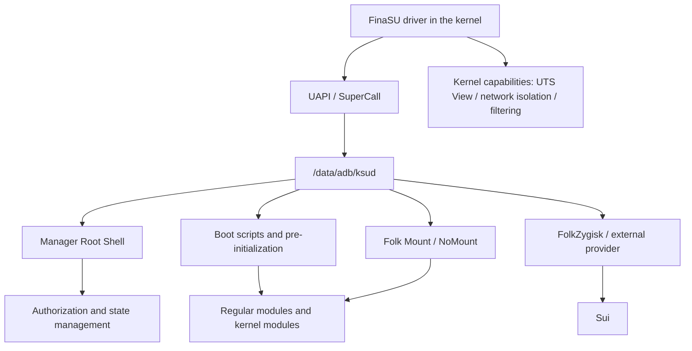
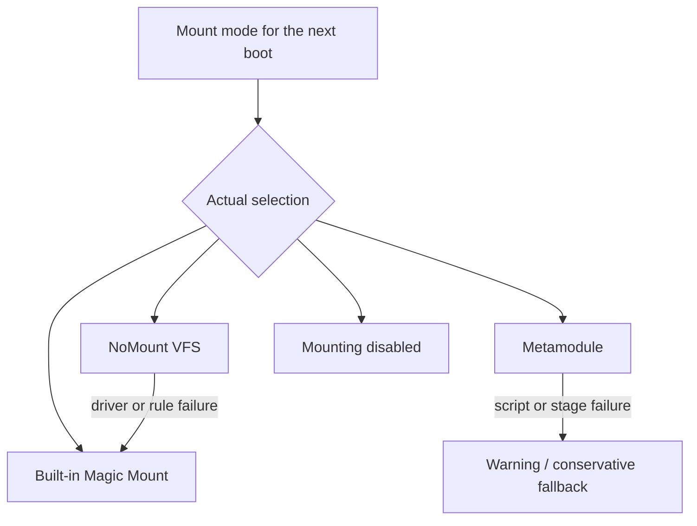

# Driver Runtime Errors

<Badge text="Driver before features" type="tip" /> <Badge text="Configuration is not this boot" type="warning" /> <Badge text="Do not splice payloads" type="danger" />

This page covers "the Manager can already see the driver, but runtime behavior still does not match expectations". If the home screen shows no driver version at all, see [Manager Authentication Failure](/en/troubleshoot/manager-auth/) first; if the device cannot boot, see [Device Won't Boot](/en/troubleshoot/bootloop/) first.

## Map the Runtime Chain First



A failure in any layer can make the Manager pages look like "it opens but does not work well". Confirm which arrow failed before deciding whether to reboot, change configuration or reinstall.

## Locating Common Symptoms

:::: table Going from a symptom to the matching layer

| Symptom | Check first | Page |
| --- | --- | --- |
| No driver version on the home screen, not installed, or not supported | Boot partition, KMI, Manager identity | [Device Compatibility](/en/troubleshoot/compatibility/), [Manager Authentication Failure](/en/troubleshoot/manager-auth/) |
| A version shows, but the Root Shell stays unavailable | `ksud`, UAPI, Root Shell fallback | This page |
| Apps have no Root | UID, Profile, Shell origin, request records | [No Root Request Prompt](/en/troubleshoot/root-request/) |
| The module switch is saved but files or scripts do not take effect | This boot, mount provider, scripts, safe mode | This page |
| Abnormal Zygisk state | External provider, ABI, injection receipt, boot protection | [FolkZygisk](/en/builtin/folkzygisk/) |
| Sui unavailable | Zygisk backend, Sui state, app permissions | [Sui](/en/builtin/sui/) |
| NoMount falls back or has no rules | Driver, KMI assets, exception UIDs, module contributions | [NoMount](/en/builtin/nomount/) |
| A built-in capability reports not supported | Kernel features, configuration, external provider | [Built-In Capabilities Overview](/en/builtin/) |
| Importing a `.ko` fails or it does not load | Architecture, vermagic, dependencies, state records | [Kernel Modules](/en/manager/kernel-module/) |

::::

## A Version Shows but the Root Shell Is Unavailable

The Manager's own Root Shell mainly verifies three things:

1. the kernel interface can complete management operations;
2. `/data/adb/ksud` can be executed;
3. the execution result really obtains UID 0 instead of falling back to a plain `sh`.

The Manager does not mark a plain Shell as Ready. It first tries `/data/adb/ksud debug su`, only tries `su` from PATH after that fails, and retries with backoff. If it stays unavailable, do not rely on the sentence "the app is already rooted".

:::: collapse accordion

### `ksud` Missing or Not Executable

Check whether `/data/adb/ksud` exists and whether it comes from the current release payload. The proper fix is to install the complete release package that matches the kernel; do not copy a `ksud` of unknown version by hand from another APK.

### UAPI Mismatch

When the interface versions of the kernel and `ksud` disagree, user space reports:

```text
UAPI version mismatch: kernel=<kernel value>, ksud=<user-space value>. Please update KernelSU!
```

A reboot does not change the interface version here. Align both sides by updating the matching Manager, boot image or kernel.

### Safe Mode Is Active

Safe mode skips a large part of the module and built-in capability boot flow. The Root management channel may still open, but the states of modules, mounting, Zygisk and Sui cannot be judged as a normal boot.

### Boot Has Not Finished

Right after booting, `ksud`, mounting and engine states may still be initializing. Wait for the system to settle and refresh the page; only treat it as a failure if the state stays at Starting for a long time.

::::

## Modules Do Not Take Effect

Module problems fall into at least three layers:

::::: field-group

:::: field Module state
@type `Whether it joins the boot`
The module may be disabled, marked for deletion, updating, or disabled in bulk by safe mode.
::::

:::: field File mounting
@type `Whether module files are visible`
Even when scripts run, the module's `system/` files do not necessarily appear in the target app's view. Folk Mount, NoMount, Metamodules and App Profile all affect the result.
::::

:::: field Scripts and kernel objects
@type `Whether boot logic runs`
`post-fs-data.sh`, `service.sh`, pre-initialization and managed `.ko` files are different execution stages. Successful file mounting does not mean the script succeeded, and a successful script does not mean the kernel module is loaded.
::::

:::::

Look at this boot's records, not only the "enabled" switch:

- **Configured mode**: what the next boot intends to use;
- **This boot's provider**: who actually performed the mounting this time;
- **Fallback reason**: whether it fell back to the built-in engine after NoMount, a Metamodule or the driver failed;
- **Pre-initialization state**: whether configuration is synchronized and whether boots kept failing;
- **Safe mode**: whether scripts and mounting were skipped.

::: tip When only one app cannot see them

Check that app's App Profile first. The default non-Root Profile has "unmount modules" enabled; NoMount uses a different exception-UID model. Do not change the global mount mode first.

:::

## Abnormal Mount Provider

Folk Mount has several modes, and this boot's provider may differ from the configuration:



When the page reports a fallback, read the warning and the [Folk Mount](/en/builtin/folk-mount/) description first. The configuration may still say NoMount while the built-in engine did the mounting this time; that does not mean the setting was not saved, but that this boot degraded.

A successful NoMount driver load also requires API probing to pass. A load call returning, or a name appearing in `/proc/modules`, does not mean the driver can accept rules. Use this for the detailed state:

```sh
/data/adb/ksud nomount status --json
```

## FolkZygisk and Sui

### FolkZygisk

Distinguish between:

- "enabled for the next boot": configuration only;
- "injected / partially injected / failed / unverified on this boot": the actual result of the current boot;
- "external provider took over": the built-in engine steps aside by design;
- "boot protection paused": automatic attempts stop after consecutive failures.

Only when the current boot shows injected, and the ABIs the target app needs are covered, can you consider FolkZygisk's own injection check complete. When an external provider takes over, Sui may still run, but FinaSU cannot verify that provider's injection result; check the external module's own entry point.

### Sui

Sui ==depends on a working Zygisk backend==. A working FinaSU driver and an enabled FolkZygisk switch do not automatically mean Sui is available. Also check:

- whether a Zygisk provider really works on this boot;
- whether the Sui service is in a usable state;
- whether the target app has been granted Sui's Root or Shell permission;
- whether the Manager identity and notification conditions are met.

See [Sui](/en/builtin/sui/) for the full diagnosis.

## Kernel Capabilities Unavailable

The Manager being able to display a feature does not mean the current kernel implements it. Different features have different gating:

- **Mount view filtering** requires the proc display hook to install successfully on the current kernel;
- **UTS View** requires the matching kernel feature, and the available state may change when SUSFS takes over;
- **Network isolation** requires the kernel-side rule interface;
- **SUSFS** only configures an existing source integration or a matching SUSFS-LKM;
- **NoMount** requires the assets for the current KMI or a driver built into the kernel.

If a feature shows `unsupported`, `unavailable`, or a forced/managed state, check the corresponding page first. Do not force a button on by hand-editing JSON or internal state files.

## No Effect After Importing a `.ko`

Importing is not the same as auto-loading:

- importing only saves the file and configuration;
- enabling it or setting it to auto-load decides whether later boots try;
- actual loading must still match the architecture, KMI, vermagic, symbol dependencies and kernel configuration;
- safe mode forbids loading managed kernel modules;
- the last entry's failure reason is more reliable than whether `/sys/module` exists.

Do not run `insmod` repeatedly to guess the state, and do not load modules of unknown origin. Check "last result" in [Kernel Modules](/en/manager/kernel-module/) and the system logs first.

## Recommended Read-Only Checks

```sh
/data/adb/ksud boot-info current-kmi
/data/adb/ksud module list
/data/adb/ksud nomount status --json
ls -l /data/adb/ksud /data/adb/ksu/log
```

If the command itself reports a UAPI mismatch, stop trying modules or built-in capabilities. Fix the version relationship between the driver and user space first.

```file-tree title="Runtime state and log locations"
/data/adb
├── ksud                         # user-space management payload
├── modules/                     # regular modules
├── modules_update/              # updates waiting to be merged
└── ksu/
    ├── log/
    │   ├── mount.log            # mount and fallback records
    │   ├── mount_capture.log    # boot anomaly capture (after enabling)
    │   └── sulog-*.log          # Root events
    ├── mount_mode               # mount mode for the next boot
    ├── mount_runtime            # this boot's provider
    ├── nomount_runtime          # this boot's NoMount result
    ├── preinit_status           # pre-initialization state
    ├── .allowlist               # authorization and Profiles
    └── .dynamic_manager         # dynamic Manager registrations
```

These files are for diagnostics. Editing them directly can bypass transactions, locks and consistency checks, and also make the Manager display disagree with the real kernel state.

## When to Repair or Reinstall

Installing the matching complete release package suits these cases:

- the embedded `ksud`, FolkZygisk, Sui or NoMount payloads are missing;
- the Manager reports missing engine files or corrupt assets;
- the `ksud` on the device was replaced by hand, has abnormal permissions or is of unknown version;
- the kernel and Manager have a confirmed UAPI mismatch with a clear update direction.

Reinstalling the APK will not solve these cases:

- the boot image or Built-In kernel does not match;
- safe mode is still active;
- a module script or the third-party module itself is corrupt;
- an external Zygisk provider took over;
- a kernel feature was never compiled into the current kernel.

## Related Pages

- [Device Compatibility](/en/troubleshoot/compatibility/): KMI, ABI and capability gating.
- [Manager Authentication Failure](/en/troubleshoot/manager-auth/): the signature and UAPI identity layer.
- [No Root Request Prompt](/en/troubleshoot/root-request/): app authorization and Shell origins.
- [Folk Mount](/en/builtin/folk-mount/): provider selection and fallback.
- [NoMount](/en/builtin/nomount/): driver, rules and exception UIDs.
- [FolkZygisk](/en/builtin/folkzygisk/): injection state and boot protection.
- [Sui](/en/builtin/sui/): Zygisk dependency, permissions and service state.
