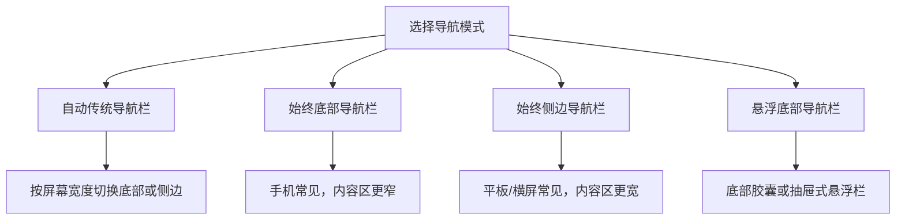

# 行为

<Badge text="设置入口 3/8" type="info" /> <Badge text="界面行为与兼容" type="warning" />

“行为”决定管理器如何导航、如何响应手势、如何显示模块，以及若干用户态兼容选项。它不会授予 Root，但错误的 SU 兼容或软重启选择会影响 Root 工作流。

::: tip 进入方式

打开管理器 → 设置 → 点第一行第三个 **行为**。

:::

## 导航与手势

### 导航栏角标

开启后，底部或侧边导航会显示：

- 超级用户入口的已授权应用数量。
- 插件入口的已启用插件数量。
- 模块入口的已启用模块数量；存在模块更新时优先显示更新数量。

角标只是状态提示。隐藏插件、超级用户或模块入口不会删除对应数据。

### 预测性返回手势

该选项只在 Android 14 及以上显示。开启后，管理器会启用系统预测性返回动画，让返回手势在页面切换前提供预览。

如果系统动画异常或手势卡顿，可以关闭。该设置不改变页面实际返回逻辑。

### 导航布局显隐

插件、超级用户和模块三个入口可以分别隐藏。隐藏后：

- 入口不再出现在底部栏、侧栏或悬浮栏。
- 数据、模块和应用授权仍然保留。
- 恢复显示后即可继续访问。

::: tip 至少保留可操作入口

隐藏入口不是锁定功能。如果平板或悬浮栏使用不习惯，可以改回底部导航或侧边导航。

:::

### 导航模式



四种模式的含义：

- **自动传统导航栏**：管理器根据可用宽度，在底部栏与侧边栏之间自动选择。
- **始终底部导航栏**：固定显示传统底部栏。
- **始终侧边导航栏**：固定显示侧边栏，适合平板和横屏。
- **悬浮底部导航栏**：把入口收进可悬浮、可隐藏的胶囊。

### 悬浮栏样式

只有选择“悬浮底部导航栏”后，以下选项才出现。

- **标准**：固定宽度的悬浮胶囊。
- **抽屉**：更紧凑，可展开后显示导航入口。

### 紧凑圆角与自动隐藏

- **紧凑圆角**：减小悬浮栏尺寸与圆角间距。
- **自动隐藏悬浮底栏**：约 3 秒无操作后隐藏。
- **滑动隐藏悬浮底栏**：向下滑隐藏，向上滑显示。

隐藏只影响界面，不会停止当前页面、模块任务或 Root 授权。

导航细节见 [导航](/setting/navigation/) 和 [悬浮导航栏](/setting/floating-bar/)。

## 传统 SU 命令支持

传统 SU 兼容让应用通过 `/system/bin/su` 调用 Root，而不是只使用 FinaSU 自己的授权接口。

:::: code-tabs

@tab 启用（默认）

```text
/system/bin/su 可用。
普通 Root 应用和旧脚本可以继续按传统方式提权。
```

@tab 禁用到重启

```text
本次启动内关闭传统 su。
下次完整重启后恢复为启用。
```

@tab 永久禁用

```text
保存为关闭状态。
后续启动继续保持关闭，直到手动改回“启用”。
```

::::

::: warning 关闭后可能坏掉的不是 Root

只通过绝对路径调用 `su` 的应用或模块脚本可能无法再取得 Root。若关闭后某个旧应用报“未 Root”，先恢复传统 SU 兼容再判断。

:::

控件显示 `forced`、`managed` 或 `unsupported` 时不能修改。此时不是开关故障，而是启动配置、模块或当前内核已经接管了该能力。

## 软重启代替完整重启

开启后，在安装、更新或启停模块时，管理器可以使用软重启代替完整重启以重新加载用户态服务，速度通常比完整重启更快。

:::: field-group

::: field 普通模式
@type `可选`
@default `可关闭`
可以自行决定模块操作后使用软重启还是完整重启。
:::

::: field 越狱模式
@type `强制`
@default `不可关闭`
开关会保持开启并置灰。完整重启会丢失当前越狱会话。
:::

::: field 限制
@type `并非万能`
软重启不会替换 Linux 内核、启动镜像或已经加载的驱动。更新驱动和安全设置时仍可能需要完整重启。
:::

::::

## WebView 调试

WebView 调试为模块 WebUI 启用调试能力，供开发或排查页面问题时使用。

开启后，电脑或调试工具可能连接到 WebView 的调试接口。日常使用建议关闭，尤其不要在不受信任的模块页面中长期开启。

## 自动越狱

自动越狱只在越狱模式（延迟加载）下可配置。它会在开机检测到 Permissive SELinux 时，尝试通过 Magica 自动提权并加载 FinaSU。

使用条件包括：

- 当前运行方式为越狱模式。
- SELinux 处于 Permissive。
- Magica 可用。
- 管理器具备自启动权限。

::: danger 自动越狱不是永久安装

它只是尝试恢复当前启动会话的临时 Root。完整重启后仍然需要重新满足越狱条件。Android 版本、厂商策略或 SELinux 状态变化都可能让自动流程失效。

:::

## 模块卡片

- **显示模块详情**：在模块卡片上显示版本、作者与描述。
- **折叠模块卡片**：在卡片展开前收起操作按钮，减少列表干扰。
- **拼接卡片**：把同一分组内的模块卡片连成连续视觉分组。
- **操作按钮样式**：选择带文字的完整按钮或纯图标按钮。

这些选项只改变模块页面的展示，不改变模块启用状态。

## 建议配置

::: table 常见场景

| 场景 | 建议 |
| --- | --- |
| 普通手机用户 | 自动传统导航；按需开启角标，不必使用悬浮栏 |
| 平板或横屏 | 侧边导航；需要更多内容宽度时隐藏不用的入口 |
| 少量 Root 应用 | 保留传统 SU 启用，兼容性最好 |
| 模块很多 | 折叠卡片、拼接卡片；按需缩短描述行数 |
| 越狱模式 | 保持软重启强制启用；按需配置自动越狱与自启动权限 |
| 排查 WebUI | 临时开启 WebView 调试，完成后关闭 |

:::

## 常见问题

:::: collapse accordion

- **隐藏了“超级用户”入口，授权还在吗？**

  在。隐藏只移除导航入口，不删除白名单或 App Profile。

- **开启软重启后，为什么驱动没有更新？**

  软重启主要重新加载用户态，不能替换内核或启动镜像。驱动更新需要按部署方式重新安装并完整重启。

- **关闭传统 SU 后，FinaSU 授权还有效吗？**

  Root 授权仍由内核管理，但依赖 `/system/bin/su` 的旧应用可能无法调用。两者不是同一个开关。

::::

## 相关页面

- [导航](/setting/navigation/)
- [悬浮导航栏](/setting/floating-bar/)
- [交互与兼容](/setting/interaction/)
- [模块卡片](/setting/module-cards/)
- [模块管理](/manager/module/)
