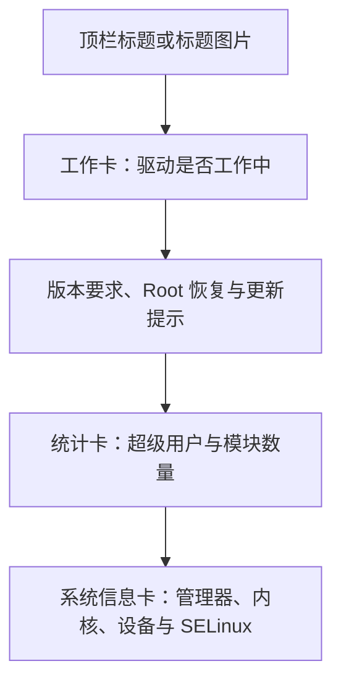

# 首页与布局

<Badge text="首页外观" type="info" /> <Badge text="不改变 Root 状态" type="tip" />

首页由顶栏标题、工作卡、提示与版本警告、统计卡和系统信息卡组成。本页解释这些区域怎样排列、怎样隐藏，以及自定义内容到底在什么条件下才会显示。

::: tip 入口

打开管理器 → 设置 → 外观，在“布局”“首页信息”和“其他”分组中调整。

:::

## 首页结构

首页只有一种排列：工作卡永远排在最前，先回答“驱动是否已加载”；只有它显示“工作中”，下面的统计与信息才有意义。统计卡固定在工作卡与信息卡之间，不随窗口大小或方向改变。

## 工作卡

工作卡是一整块高卡片，状态用大字写出来：

- **工作中**：大字“工作中”，右下角是一个超出卡片、被裁成一半的描边对勾，版本号以等宽字体排在标题下方；上沿依次排列运行方式（LKM / Built-In）、自定义 LKM、安全模式、越狱模式标记。
- **未安装**：同样的高度，顶部一行红字“点击安装”，中间是大字“未安装”，下面是“安装”按钮；SELinux 为宽容模式时还会出现“越狱”按钮。
- **不支持**：顶部红字说明原因，大字“不支持”，没有按钮。

点击工作卡等同于点击安装。管理器为工作卡单独保留了一块壁纸表面，可以在[壁纸 → 工作卡片](/setting/wallpaper/)里给它设置图片、不透明度、暗度与日夜参数，也可以隐藏图标、文字或运行方式标记。

## 统计卡

工作卡下面是两张并排的统计卡：上面是大号数字，下面是对应的名称。

- **超级用户**：已授权的应用数量，点击进入超级用户列表。
- **模块**：已启用模块的数量，点击进入模块列表。

数字读取不到时显示“不可用”，此时卡片不再可点击。

## 布局变体

布局变体作用于插件、超级用户和模块页面：

- **M3E**：大标题、可折叠搜索栏，滚动层次更明显。
- **传统**：紧凑顶栏，一屏能显示更多内容。

首页本身保持紧凑顶栏；该选项不会把首页改成另一种布局。

## 顶栏标题

文字标题有三种模式，另外可以启用标题图片：

- **应用名**：显示当前管理器应用名称。
- **KernelSU**：显示 KernelSU 标题。
- **自定义**：打开输入框，填写自己的标题。
- **标题图片**：不是文字模式；启用后由图片替代当前文字标题。

### 标题图片

高级标题图片是独立开关。选择图片时会自动启用标题图片；清除图片会关闭它。

启用图片后可以调整：

- **日间不透明度**：浅色模式下图片的透明度。
- **夜间不透明度**：深色模式下图片的透明度。
- **暗化程度**：压暗图片，避免标题区域过亮。
- **水平偏移**：范围 `-200 dp` 到 `200 dp`，用于左右移动图片。

关闭图片开关后会回到所选文字标题。标题图片只用于顶部标题区域，不属于壁纸背景。

## 首页信息显隐

首页信息区提供四项隐藏开关：

- **隐藏系统指纹**：移除系统与内核标识行。
- **隐藏 Zygisk 实现**：仅在当前确实存在 Zygisk 实现时出现。
- **隐藏 SUSFS**：仅在检测到 SUSFS 时出现。
- **隐藏模块挂载**：仅在 Folk Mount 状态可读取时出现。

::: info 隐藏不等于关闭

这些开关只改变首页展示。Zygisk、SUSFS、挂载后端和 Root 授权仍然按原状态工作。排查兼容问题时，先恢复显示再判断实际状态。

:::

## 其他首页相关设置

### 界面缩放

范围为 `80%–110%`。调大可读性更好，调小可显示更多内容；不会修改 Android 系统显示大小。

### 模块描述行数

模块介绍超过 `1–5` 行时自动折叠。该设置影响模块卡片，不是首页正文。

## 常见问题

:::: collapse accordion

- **给工作卡设了图片，首页却没有变化**

  工作卡的图片在[壁纸 → 工作卡片](/setting/wallpaper/)里设置，并且要同时打开“启用工作卡背景”。只选图片不启用不会绘制。

- **图鉴下载后为什么壁纸没变化？**

  下载只保存图片。需要到壁纸页重新选择图片，下载不会自动替换当前背景。

::::

## 相关页面

- [外观](/setting/appearance/)
- [主题与颜色](/setting/theme/)
- [壁纸](/setting/wallpaper/)
- [导航](/setting/navigation/)
- [模块卡片](/setting/module-cards/)
